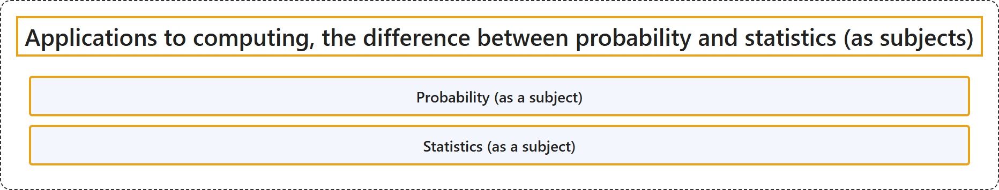

# 2.6 Applications to computing, the difference between probability and statistics (as subjects)

## Classification

## Glossary

| Term | Definition | 中文翻译 | Source |
|---|---|---|---|
| **Probability (as a subject)** 概率（作为学科） | "Probability is the branch of mathematics that studies the **possible outcomes of given events** together with the outcomes' **relative likelihoods and distributions**." | 概率是数学的一个分支，研究**给定事件的可能结果**，以及这些结果的**相对可能性和分布**。 | [Weisstein, n.d.-a, "Probability" entry, para. 1](https://mathworld.wolfram.com/Probability.html#:~:text=Probability%20is%20the%20branch%20of%20mathematics%20that%20studies%20the%20possible%20outcomes) |
| **Statistics (as a subject)** 统计（作为学科） | "The mathematical study of the **likelihood and probability of events** occurring based on known information and inferred by **taking a limited number of samples**." | 对事件发生的**可能性和概率**所作的数学研究，依据已知信息，并通过**抽取有限数量的样本**来推断。 | [Weisstein, n.d.-b, "Statistics" entry, para. 1](https://mathworld.wolfram.com/Statistics.html#:~:text=The%20mathematical%20study%20of%20the%20likelihood%20and%20probability%20of%20events) |

## References

- Joint Task Force on Computing Curricula. (2024). *Computer science curricula 2023*. Association for Computing Machinery. <https://doi.org/10.1145/3664191>
- Weisstein, E. W. (n.d.-a). *Probability*. MathWorld: A Wolfram Resource. Retrieved October 27, 2026, from <https://mathworld.wolfram.com/Probability.html>
- Weisstein, E. W. (n.d.-b). *Statistics*. MathWorld: A Wolfram Resource. Retrieved October 27, 2026, from <https://mathworld.wolfram.com/Statistics.html>
