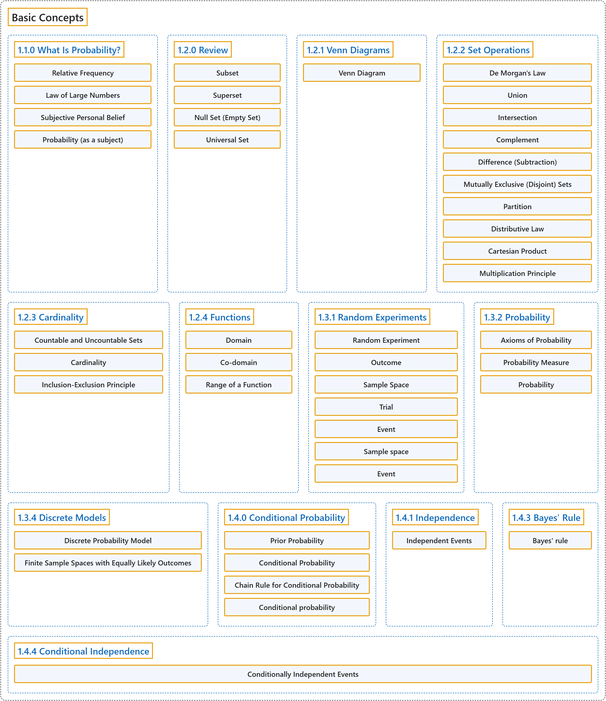

# 1 Basic Concepts

## Classification

## Glossary

| Term | Definition | 中文翻译 | Source |
|---|---|---|---|
| **1 Basic Concepts** 基本概念 | (No definition) | （无定义） | [Pishro-Nik, 2014, chapter 1](https://www.probabilitycourse.com/) |
| **1.1.0 What Is Probability?** 什么是概率？ | (No definition) | （无定义） | [Pishro-Nik, 2014, section 1.1.0](https://www.probabilitycourse.com/chapter1/1_1_0_what_is_probability.php) |
| **Relative Frequency** 相对频率 | "One is in terms of **relative frequency**. In other words, if we flip the coin a very large number of times, it will come up heads about $\frac{1}{2}$ of the time." | 一种是按**相对频率**来理解。换言之，如果将硬币抛掷很多次，约有 $\frac{1}{2}$ 的次数出现正面。 | [Pishro-Nik, 2014, section 1.1.0](https://www.probabilitycourse.com/chapter1/1_1_0_what_is_probability.php#:~:text=One%20is%20in%20terms%20of%20relative) |
| **Law of Large Numbers** 大数定律 | "In fact, this intuitive understanding of probability is a special case of the **law of large numbers**, which we will state and prove formally in later chapters of the book." | 事实上，这种对概率的直观理解是**大数定律**的一个特例，本书后面的章节将对其作出正式陈述并证明。 | [Pishro-Nik, 2014, section 1.1.0](https://www.probabilitycourse.com/chapter1/1_1_0_what_is_probability.php#:~:text=In%20fact%2C%20this%20intuitive%20understanding%20of) |
| **Subjective Personal Belief** 主观概率 | "A second interpretation of probability is that it is a quantification of our degree of **subjective personal belief** that something will happen." | 概率的第二种解释是，它是对我们认为某事将会发生的**主观个人信念**程度的量化。 | [Pishro-Nik, 2014, section 1.1.0](https://www.probabilitycourse.com/chapter1/1_1_0_what_is_probability.php#:~:text=A%20second%20interpretation%20of%20probability%20is) |
| **Probability (as a subject)** 概率（作为学科） | "Probability is the branch of mathematics that studies the **possible outcomes of given events** together with the outcomes' **relative likelihoods and distributions**." | 概率是数学的一个分支，研究**给定事件的可能结果**，以及这些结果的**相对可能性和分布**。 | [Weisstein, n.d.-d, "Probability" entry, para. 1](https://mathworld.wolfram.com/Probability.html#:~:text=Probability%20is%20the%20branch%20of%20mathematics%20that%20studies%20the%20possible%20outcomes) |
| **1.2.0 Review** 回顾 | (No definition) | （无定义） | [Pishro-Nik, 2014, section 1.2.0](https://www.probabilitycourse.com/chapter1/1_2_0_review_set_theory.php) |
| **Subset** 子集 | "Set $A$ is a **subset** of set $B$ if every element of $A$ is also an element of $B$." | 若 $A$ 的每个元素也都是 $B$ 的元素，则称集合 $A$ 是集合 $B$ 的**子集**。 | [Pishro-Nik, 2014, section 1.2.0](https://www.probabilitycourse.com/chapter1/1_2_0_review_set_theory.php#:~:text=Set%20is%20a%20subset%20of%20set) |
| **Superset** 超集 | "Equivalently, we say $B$ is a **superset** of $A$, or $B \supset A$." | 等价地，我们称 $B$ 是 $A$ 的**超集**，或写作 $B \supset A$。 | [Pishro-Nik, 2014, section 1.2.0](https://www.probabilitycourse.com/chapter1/1_2_0_review_set_theory.php#:~:text=Equivalently%2C%20we%20say%20is%20a%20superset) |
| **Null Set (Empty Set)** 空集 | "The set with no elements, i.e., $\emptyset=\{ \}$ is the **null set** or the **empty set**." | 没有任何元素的集合，即 $\emptyset=\{ \}$，称为**零集**或**空集**。 | [Pishro-Nik, 2014, section 1.2.0](https://www.probabilitycourse.com/chapter1/1_2_0_review_set_theory.php#:~:text=The%20set%20with%20no%20elements%2C%20i.e.%2C) |
| **Universal Set** 全集 | "The **universal set** is the set of all things that we could possibly consider in the context we are studying." | **全集**是在我们所研究的情境中可能考虑的所有事物构成的集合。 | [Pishro-Nik, 2014, section 1.2.0](https://www.probabilitycourse.com/chapter1/1_2_0_review_set_theory.php#:~:text=The%20universal%20set%20is%20the%20set) |
| **1.2.1 Venn Diagrams** 维恩图 | (No definition) | （无定义） | [Pishro-Nik, 2014, section 1.2.1](https://www.probabilitycourse.com/chapter1/1_2_1_venn.php) |
| **Venn Diagram** 韦恩图（Venn 图） | "**Venn diagrams** are very useful in visualizing relation between sets. In a Venn diagram any set is depicted by a closed region." | **韦恩图**非常适合直观表示集合之间的关系。在韦恩图中，任何集合都用一个封闭区域表示。 | [Pishro-Nik, 2014, section 1.2.1](https://www.probabilitycourse.com/chapter1/1_2_1_venn.php#:~:text=Venn%20diagrams%20are%20very%20useful%20in) |
| **1.2.2 Set Operations** 集合运算 | (No definition) | （无定义） | [Pishro-Nik, 2014, section 1.2.2](https://www.probabilitycourse.com/chapter1/1_2_2_set_operations.php) |
| **De Morgan's Law** 德摩根律 | "**De Morgan's law** For any sets $A_1$, $A_2$, $\cdots$, $A_n$, we have $(A_1 \cup A_2 \cup A_3 \cup \cdots A_n)^c=A_1^c \cap A_2^c \cap A_3^c\cdots \cap A_n^c$; $(A_1 \cap A_2 \cap A_3 \cap \cdots A_n)^c=A_1^c \cup A_2^c \cup A_3^c\cdots \cup A_n^c$." | **德摩根律**　对任意集合 $A_1$、$A_2$、$\cdots$、$A_n$，有 $(A_1 \cup A_2 \cup A_3 \cup \cdots A_n)^c=A_1^c \cap A_2^c \cap A_3^c\cdots \cap A_n^c$；$(A_1 \cap A_2 \cap A_3 \cap \cdots A_n)^c=A_1^c \cup A_2^c \cup A_3^c\cdots \cup A_n^c$。 | [Pishro-Nik, 2014, section 1.2.2](https://www.probabilitycourse.com/chapter1/1_2_2_set_operations.php#:~:text=De%20Morgan%27s%20law%20For%20any%20sets) |
| **Union** 并集 | "The **union** of two sets is a set containing all elements that are in $A$ or in $B$ (possibly both)." | 两个集合的**并集**是包含所有属于 $A$ 或属于 $B$（可以两者都属于）的元素的集合。 | [Pishro-Nik, 2014, section 1.2.2](https://www.probabilitycourse.com/chapter1/1_2_2_set_operations.php#:~:text=The%20union%20of%20two%20sets%20is) |
| **Intersection** 交集 | "The **intersection** of two sets $A$ and $B$, denoted by $A \cap B$, consists of all elements that are both in $A$ $\underline{\textrm{and}}$ $B$." | 集合 $A$ 与 $B$ 的**交集**记作 $A \cap B$，由既属于 $A$ 又属于 $B$ 的所有元素组成。 | [Pishro-Nik, 2014, section 1.2.2](https://www.probabilitycourse.com/chapter1/1_2_2_set_operations.php#:~:text=The%20intersection%20of%20two%20sets%20and) |
| **Complement** 补集 | "The **complement** of a set $A$, denoted by $A^c$ or $\bar{A}$, is the set of all elements that are in the universal set $S$ but are not in $A$." | 集合 $A$ 的**补集**记作 $A^c$ 或 $\bar{A}$，是全集 $S$ 中不属于 $A$ 的所有元素构成的集合。 | [Pishro-Nik, 2014, section 1.2.2](https://www.probabilitycourse.com/chapter1/1_2_2_set_operations.php#:~:text=The%20complement%20of%20a%20set%20%2C) |
| **Difference (Subtraction)** 差集 | "The **difference (subtraction)** is defined as follows. The set $A-B$ consists of elements that are in $A$ but not in $B$." | **差集**（减法）定义如下。集合 $A-B$ 由属于 $A$ 但不属于 $B$ 的元素组成。 | [Pishro-Nik, 2014, section 1.2.2](https://www.probabilitycourse.com/chapter1/1_2_2_set_operations.php#:~:text=The%20difference%20%28subtraction%29%20is%20defined%20as) |
| **Mutually Exclusive (Disjoint) Sets** 互斥集合（不相交集合） | "Two sets $A$ and $B$ are **mutually exclusive** or **disjoint** if they do not have any shared elements; i.e., their intersection is the empty set, $A \cap B=\emptyset$." | 若两个集合 $A$ 和 $B$ 没有任何公共元素，即它们的交集为空集 $A \cap B=\emptyset$，则称它们**互斥**或**不相交**。 | [Pishro-Nik, 2014, section 1.2.2](https://www.probabilitycourse.com/chapter1/1_2_2_set_operations.php#:~:text=Two%20sets%20and%20are%20mutually%20exclusive) |
| **Partition** 划分 | "In general, a collection of nonempty sets $A_1, A_2,\cdots$ is a **partition** of a set $A$ if they are disjoint and their union is $A$." | 一般地，若一族非空集合 $A_1, A_2,\cdots$ 互不相交且它们的并集为 $A$，则称其为集合 $A$ 的一个**划分**。 | [Pishro-Nik, 2014, section 1.2.2](https://www.probabilitycourse.com/chapter1/1_2_2_set_operations.php#:~:text=In%20general%2C%20a%20collection%20of%20nonempty) |
| **Distributive Law** 分配律 | "**Distributive law** For any sets $A$, $B$, and $C$ we have $A \cap (B \cup C)=(A \cap B) \cup (A\cap C)$; $A \cup (B \cap C)=(A \cup B) \cap (A\cup C)$." | **分配律**　对任意集合 $A$、$B$ 和 $C$，有 $A \cap (B \cup C)=(A \cap B) \cup (A\cap C)$；$A \cup (B \cap C)=(A \cup B) \cap (A\cup C)$。 | [Pishro-Nik, 2014, section 1.2.2](https://www.probabilitycourse.com/chapter1/1_2_2_set_operations.php#:~:text=Distributive%20law%20For%20any%20sets%20%2C) |
| **Cartesian Product** 笛卡尔积 | "A **Cartesian product** of two sets $A$ and $B$, written as $A\times B$, is the set containing **ordered pairs** from $A$ and $B$." | 集合 $A$ 与 $B$ 的**笛卡尔积**记作 $A\times B$，是由来自 $A$ 和 $B$ 的**有序对**构成的集合。 | [Pishro-Nik, 2014, section 1.2.2](https://www.probabilitycourse.com/chapter1/1_2_2_set_operations.php#:~:text=A%20Cartesian%20product%20of%20two%20sets) |
| **Multiplication Principle** 乘法原理 | "If you have two finite sets $A$ and $B$, where $A$ has $M$ elements and $B$ has $N$ elements, then $A \times B$ has $M \times N$ elements. This rule is called the **multiplication principle** and is very useful in counting the numbers of elements in sets." | 若有两个有限集合 $A$ 和 $B$，其中 $A$ 有 $M$ 个元素，$B$ 有 $N$ 个元素，则 $A \times B$ 有 $M \times N$ 个元素。这一规则称为**乘法原理**，在计算集合的元素个数时非常有用。 | [Pishro-Nik, 2014, section 1.2.2](https://www.probabilitycourse.com/chapter1/1_2_2_set_operations.php#:~:text=If%20you%20have%20two%20finite%20sets) |
| **1.2.3 Cardinality** 基数 | (No definition) | （无定义） | [Pishro-Nik, 2014, section 1.2.3](https://www.probabilitycourse.com/chapter1/1_2_3_cardinality.php) |
| **Countable and Uncountable Sets** 可数集与不可数集 | "Set $A$ is called **countable** if one of the following is true if it is a finite set, $\mid A \mid < \infty$; or it can be put in one-to-one correspondence with natural numbers $\mathbb{N}$, in which case the set is said to be countably infinite. A set is called **uncountable** if it is not countable." | 若满足下列条件之一，则称集合 $A$ **可数**：它是有限集，$\mid A \mid < \infty$；或者它可与自然数集 $\mathbb{N}$ 建立一一对应，此时称该集合为可数无限集。若集合不可数，则称其为**不可数**集。 | [Pishro-Nik, 2014, section 1.2.3](https://www.probabilitycourse.com/chapter1/1_2_3_cardinality.php#:~:text=Set%20is%20called%20countable%20if%20one) |
| **Cardinality** 基数 | "Here we need to talk about **cardinality** of a set, which is basically the size of the set. The cardinality of a set is denoted by $\vert A\vert$." | 这里需要谈谈集合的**基数**，它基本上就是集合的大小。集合的基数记作 $\vert A\vert$。 | [Pishro-Nik, 2014, section 1.2.3](https://www.probabilitycourse.com/chapter1/1_2_3_cardinality.php#:~:text=Here%20we%20need%20to%20talk%20about) |
| **Inclusion-Exclusion Principle** 容斥原理 | "Before discussing infinite sets, which is the main discussion of this section, we would like to talk about a very useful rule: the **inclusion-exclusion principle**. For two finite sets $A$ and $B$, we have $$\vert A \cup B \vert =\vert A\vert +\vert B\vert -\vert A \cap B\vert .$$" | 在讨论无限集（这是本节的主要内容）之前，我们先谈一条非常有用的规则：**容斥原理**。对于两个有限集合 $A$ 和 $B$，有 $$\vert A \cup B \vert =\vert A\vert +\vert B\vert -\vert A \cap B\vert .$$ | [Pishro-Nik, 2014, section 1.2.3](https://www.probabilitycourse.com/chapter1/1_2_3_cardinality.php#:~:text=Before%20discussing%20infinite%20sets%2C%20which%20is) |
| **1.2.4 Functions** 函数 | (No definition) | （无定义） | [Pishro-Nik, 2014, section 1.2.4](https://www.probabilitycourse.com/chapter1/1_2_4_functions.php) |
| **Domain** 定义域 | "A function $f$ is a rule that takes an input from a specific set, called the **domain**, and produces an output from another set, called co-domain." | 函数 $f$ 是一条规则，它从某个特定集合（称为**定义域**）中取一个输入，并在另一个集合（称为陪域）中产生一个输出。 | [Pishro-Nik, 2014, section 1.2.4](https://www.probabilitycourse.com/chapter1/1_2_4_functions.php#:~:text=A%20function%20is%20a%20rule%20that) |
| **Co-domain** 陪域 | "A function $f$ is a rule that takes an input from a specific set, called the domain, and produces an output from another set, called **co-domain**." | 函数 $f$ 是一条规则，它从某个特定集合（称为定义域）中取一个输入，并在另一个集合（称为**陪域**）中产生一个输出。 | [Pishro-Nik, 2014, section 1.2.4](https://www.probabilitycourse.com/chapter1/1_2_4_functions.php#:~:text=A%20function%20is%20a%20rule%20that) |
| **Range of a Function** 值域 | "We define the **range** of a function as the set containing all the possible values of $f(x)$. Thus, the range of a function is always a subset of its co-domain." | 我们将函数的**值域**定义为包含 $f(x)$ 所有可能取值的集合。因此，函数的值域总是其陪域的子集。 | [Pishro-Nik, 2014, section 1.2.4](https://www.probabilitycourse.com/chapter1/1_2_4_functions.php#:~:text=We%20define%20the%20range%20of%20a) |
| **1.3.1 Random Experiments** 随机试验 | (No definition) | （无定义） | [Pishro-Nik, 2014, section 1.3.1](https://www.probabilitycourse.com/chapter1/1_3_1_random_experiments.php) |
| **Random Experiment** 随机试验 | "In particular, a **random experiment** is a process by which we observe something uncertain." | 具体地说，**随机试验**是我们观察某种不确定事物的一个过程。 | [Pishro-Nik, 2014, section 1.3.1](https://www.probabilitycourse.com/chapter1/1_3_1_random_experiments.php#:~:text=In%20particular%2C%20a%20random%20experiment%20is) |
| **Outcome** 结果（样本点） | "An **outcome** is a result of a random experiment." | **结果**（样本点）是随机试验的一个结果。 | [Pishro-Nik, 2014, section 1.3.1](https://www.probabilitycourse.com/chapter1/1_3_1_random_experiments.php#:~:text=An%20outcome%20is%20a%20result%20of) |
| **Sample Space** 样本空间 | "The set of all possible outcomes is called the **sample space**." | 所有可能结果构成的集合称为**样本空间**。 | [Pishro-Nik, 2014, section 1.3.1](https://www.probabilitycourse.com/chapter1/1_3_1_random_experiments.php#:~:text=The%20set%20of%20all%20possible%20outcomes) |
| **Trial** 试验（一次） | "When we repeat a random experiment several times, we call each one of them a **trial**." | 当我们把一个随机试验重复若干次时，把其中每一次称为一次**试验**。 | [Pishro-Nik, 2014, section 1.3.1](https://www.probabilitycourse.com/chapter1/1_3_1_random_experiments.php#:~:text=When%20we%20repeat%20a%20random%20experiment) |
| **Event** 事件 | "Thus an **event** is a collection of possible outcomes. In other words, an event is a subset of the sample space to which we assign a probability." | 因此，**事件**是可能结果的一个集合。换言之，事件是样本空间的一个子集，我们为它指派一个概率。 | [Pishro-Nik, 2014, section 1.3.1](https://www.probabilitycourse.com/chapter1/1_3_1_random_experiments.php#:~:text=Thus%20an%20event%20is%20a%20collection) |
| **Sample space** 样本空间 | "Informally, the sample space for a given set of events is the **set of all possible values** the events may assume." | 非正式地说，一组给定事件的样本空间是这些事件可能取的**所有可能值的集合**。 | [Weisstein, n.d.-e, "Sample space" entry, para. 1](https://mathworld.wolfram.com/SampleSpace.html#:~:text=the%20sample%20space%20for%20a%20given%20set%20of%20events) |
| **Event** 事件 | "An event is **a certain subset of a probability space**. Events are therefore **collections of outcomes** on which probabilities have been assigned." | 事件是**概率空间的某个子集**。因此，事件是一些已被赋予概率的**结果的汇集**。 | [Weisstein, n.d.-c, "Event" entry, para. 1](https://mathworld.wolfram.com/Event.html#:~:text=An%20event%20is%20a%20certain%20subset%20of%20a%20probability%20space) |
| **1.3.2 Probability** 概率 | (No definition) | （无定义） | [Pishro-Nik, 2014, section 1.3.2](https://www.probabilitycourse.com/chapter1/1_3_2_probability.php) |
| **Axioms of Probability** 概率公理 | "**Axiom 1**: For any event $A$, $P(A) \geq 0$. **Axiom 2**: Probability of the sample space $S$ is $P(S)=1$. **Axiom 3**: If $A_1, A_2, A_3, \cdots$ are disjoint events, then $P(A_1 \cup A_2 \cup A_3 \cdots)=P(A_1)+P(A_2)+P(A_3)+\cdots$" | **公理 1**：对任意事件 $A$，$P(A) \geq 0$。**公理 2**：样本空间 $S$ 的概率为 $P(S)=1$。**公理 3**：若 $A_1, A_2, A_3, \cdots$ 为互不相交的事件，则 $P(A_1 \cup A_2 \cup A_3 \cdots)=P(A_1)+P(A_2)+P(A_3)+\cdots$ | [Pishro-Nik, 2014, section 1.3.2](https://www.probabilitycourse.com/chapter1/1_3_2_probability.php#:~:text=Axiom%201%3A%20For%20any%20event%20%2C) |
| **Probability Measure** 概率测度 | "We assign a **probability measure** $P(A)$ to an event $A$. This is a value between $0$ and $1$ that shows how likely the event is." | 我们为事件 $A$ 指派一个**概率测度** $P(A)$。它是介于 $0$ 和 $1$ 之间的值，表示该事件有多大可能发生。 | [Pishro-Nik, 2014, section 1.3.2](https://www.probabilitycourse.com/chapter1/1_3_2_probability.php#:~:text=We%20assign%20a%20probability%20measure%20to) |
| **Probability** 概率 | "In common usage, the word 'probability' is used to mean **the chance that a particular event (or set of events) will occur** expressed on a **linear scale** from 0 (impossibility) to 1 (certainty), also expressed as a percentage between 0 and 100%." | 在日常用法中，“概率”一词指**某个特定事件（或一组事件）发生的可能性**，用从 0（不可能）到 1（必然）的**线性刻度**表示，也可表示为 0 到 100% 之间的百分比。 | [Weisstein, n.d.-d, "Probability" entry, para. 1](https://mathworld.wolfram.com/Probability.html#:~:text=is%20used%20to%20mean%20the%20chance%20that%20a%20particular%20event) |
| **1.3.4 Discrete Models** 离散模型 | (No definition) | （无定义） | [Pishro-Nik, 2014, section 1.3.4](https://www.probabilitycourse.com/chapter1/1_3_4_discrete_models.php) |
| **Discrete Probability Model** 离散概率模型 | "If $S$ is a countable set, this refers to a **discrete probability model**." | 若 $S$ 是可数集，则称为**离散概率模型**。 | [Pishro-Nik, 2014, section 1.3.4](https://www.probabilitycourse.com/chapter1/1_3_4_discrete_models.php#:~:text=If%20is%20a%20countable%20set%2C%20this) |
| **Finite Sample Spaces with Equally Likely Outcomes** 等可能的有限样本空间（古典概型） | "An important special case of discrete probability models is when we have a **finite sample space** $S$, where each outcome is **equally likely**, i.e., $$S=\{s_1,s_2,\cdots,s_N\}, \textrm{ where } P(s_i)=P(s_j) \textrm{ for all }i,j \in \{1,2,\cdots,N\}.$$" | 离散概率模型的一个重要特例是：有一个**有限样本空间** $S$，其中每个结果都**等可能**，即 $$S=\{s_1,s_2,\cdots,s_N\}, \textrm{ where } P(s_i)=P(s_j) \textrm{ for all }i,j \in \{1,2,\cdots,N\}.$$ | [Pishro-Nik, 2014, section 1.3.4](https://www.probabilitycourse.com/chapter1/1_3_4_discrete_models.php#:~:text=An%20important%20special%20case%20of%20discrete) |
| **1.4.0 Conditional Probability** 条件概率 | (No definition) | （无定义） | [Pishro-Nik, 2014, section 1.4.0](https://www.probabilitycourse.com/chapter1/1_4_0_conditional_probability.php) |
| **Prior Probability** 先验概率 | "It is reasonable to assume that in this example, $P(R \vert  C)$ should be larger than the original $P(R)$, which is called the **prior probability** of $R$." | 在这个例子中，可以合理地假定 $P(R \vert  C)$ 应当大于原来的 $P(R)$，后者称为 $R$ 的**先验概率**。 | [Pishro-Nik, 2014, section 1.4.0](https://www.probabilitycourse.com/chapter1/1_4_0_conditional_probability.php#:~:text=It%20is%20reasonable%20to%20assume%20that) |
| **Conditional Probability** 条件概率 | "If $A$ and $B$ are two events in a sample space $S$, then the **conditional probability** of $A$ given $B$ is defined as" | 若 $A$ 和 $B$ 是样本空间 $S$ 中的两个事件，则给定 $B$ 时 $A$ 的**条件概率**定义为 | [Pishro-Nik, 2014, section 1.4.0](https://www.probabilitycourse.com/chapter1/1_4_0_conditional_probability.php#:~:text=If%20and%20are%20two%20events%20in) |
| **Chain Rule for Conditional Probability** 乘法公式（链式法则） | "**Chain rule for conditional probability**: Let us write the formula for conditional probability in the following format $$\hspace{100pt} P(A \cap B)=P(A)P(B\vert A)=P(B)P(A\vert B) \hspace{100pt} (1.5)$$" | **条件概率的链式法则**：把条件概率公式写成如下形式 $$\hspace{100pt} P(A \cap B)=P(A)P(B\vert A)=P(B)P(A\vert B) \hspace{100pt} (1.5)$$ | [Pishro-Nik, 2014, section 1.4.0](https://www.probabilitycourse.com/chapter1/1_4_0_conditional_probability.php#:~:text=Chain%20rule%20for%20conditional%20probability%3A%20Let) |
| **Conditional probability** 条件概率 | "The conditional probability of an event A **assuming that B has occurred** with P(B)>0, denoted P(A\|B), equals **P(A\|B) = P(A ∩ B)/P(B)**." | 事件 A 在**已知 B 已经发生**（P(B)>0）时的条件概率记为 P(A\|B)，等于 **P(A\|B) = P(A ∩ B)/P(B)**。 | [Weisstein, n.d.-b, "Conditional probability" entry, para. 1](https://mathworld.wolfram.com/ConditionalProbability.html#:~:text=The%20conditional%20probability%20of%20an%20event) |
| **1.4.1 Independence** 独立性 | (No definition) | （无定义） | [Pishro-Nik, 2014, section 1.4.1](https://www.probabilitycourse.com/chapter1/1_4_1_independence.php) |
| **Independent Events** 独立事件 | "Two events are **independent** if one does not convey any information about the other." | 若一个事件不提供关于另一个事件的任何信息，则称这两个事件**相互独立**。 | [Pishro-Nik, 2014, section 1.4.1](https://www.probabilitycourse.com/chapter1/1_4_1_independence.php#:~:text=Two%20events%20are%20independent%20if%20one) |
| **1.4.3 Bayes' Rule** 贝叶斯法则 | (No definition) | （无定义） | [Pishro-Nik, 2014, section 1.4.3](https://www.probabilitycourse.com/chapter1/1_4_3_bayes_rule.php) |
| **Bayes' rule** 贝叶斯法则 | "Bayes' theorem, also called Bayes' rule, **expresses a conditional probability in terms of its reverse** and the corresponding **marginal probabilities**." | 贝叶斯定理也称为贝叶斯法则，它**用反向的条件概率来表示一个条件概率**，并用到相应的**边缘概率**。 | [Weisstein, n.d.-a, "Bayes' theorem" entry, para. 1](https://mathworld.wolfram.com/BayesTheorem.html#:~:text=also%20called%20Bayes) |
| **1.4.4 Conditional Independence** 条件独立性 | (No definition) | （无定义） | [Pishro-Nik, 2014, section 1.4.4](https://www.probabilitycourse.com/chapter1/1_4_4_conditional_independence.php) |
| **Conditionally Independent Events** 条件独立事件 | "Two events $A$ and $B$ are **conditionally independent** given an event $C$ with $P(C)>0$ if $$\hspace{100pt}P(A \cap B\vert C)=P(A\vert C)P(B\vert C) \hspace{100pt} (1.8)$$" | 对于满足 $P(C)>0$ 的事件 $C$，若 $$\hspace{100pt}P(A \cap B\vert C)=P(A\vert C)P(B\vert C) \hspace{100pt} (1.8)$$，则称两个事件 $A$ 和 $B$ 在给定 $C$ 的条件下**条件独立**。 | [Pishro-Nik, 2014, section 1.4.4](https://www.probabilitycourse.com/chapter1/1_4_4_conditional_independence.php#:~:text=Two%20events%20and%20are%20conditionally%20independent) |

## References

Pishro-Nik, H. (2014). *Introduction to probability, statistics, and random processes*. Kappa Research. Retrieved October 28, 2026, from <https://www.probabilitycourse.com/>

Weisstein, E. W. (n.d.-a). *Bayes' theorem*. MathWorld: A Wolfram Resource. Retrieved October 27, 2026, from <https://mathworld.wolfram.com/BayesTheorem.html>

Weisstein, E. W. (n.d.-b). *Conditional probability*. MathWorld: A Wolfram Resource. Retrieved October 27, 2026, from <https://mathworld.wolfram.com/ConditionalProbability.html>

Weisstein, E. W. (n.d.-c). *Event*. MathWorld: A Wolfram Resource. Retrieved October 27, 2026, from <https://mathworld.wolfram.com/Event.html>

Weisstein, E. W. (n.d.-d). *Probability*. MathWorld: A Wolfram Resource. Retrieved October 27, 2026, from <https://mathworld.wolfram.com/Probability.html>

Weisstein, E. W. (n.d.-e). *Sample space*. MathWorld: A Wolfram Resource. Retrieved October 27, 2026, from <https://mathworld.wolfram.com/SampleSpace.html>
