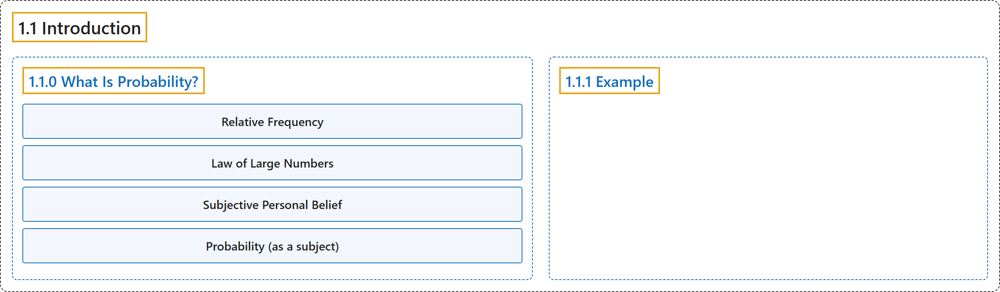

# 1.1 Introduction

## Classification

## Glossary

| Term | Definition | 中文翻译 | Source |
|---|---|---|---|
| **1.1 Introduction** 介绍 | (No definition) | （无定义） | [Pishro-Nik, 2014, section 1.1](https://www.probabilitycourse.com/chapter1/1_1_0_what_is_probability.php) |
| **1.1.0 What Is Probability?** 什么是概率？ | (No definition) | （无定义） | [Pishro-Nik, 2014, section 1.1.0](https://www.probabilitycourse.com/chapter1/1_1_0_what_is_probability.php) |
| **Relative Frequency** 相对频率 | "One is in terms of **relative frequency**. In other words, if we flip the coin a very large number of times, it will come up heads about $\frac{1}{2}$ of the time." | 一种是按**相对频率**来理解。换言之，如果将硬币抛掷很多次，约有 $\frac{1}{2}$ 的次数出现正面。 | [Pishro-Nik, 2014, section 1.1.0](https://www.probabilitycourse.com/chapter1/1_1_0_what_is_probability.php#:~:text=One%20is%20in%20terms%20of%20relative) |
| **Law of Large Numbers** 大数定律 | "In fact, this intuitive understanding of probability is a special case of the **law of large numbers**, which we will state and prove formally in later chapters of the book." | 事实上，这种对概率的直观理解是**大数定律**的一个特例，本书后面的章节将对其作出正式陈述并证明。 | [Pishro-Nik, 2014, section 1.1.0](https://www.probabilitycourse.com/chapter1/1_1_0_what_is_probability.php#:~:text=In%20fact%2C%20this%20intuitive%20understanding%20of) |
| **Subjective Personal Belief** 主观概率 | "A second interpretation of probability is that it is a quantification of our degree of **subjective personal belief** that something will happen." | 概率的第二种解释是，它是对我们认为某事将会发生的**主观个人信念**程度的量化。 | [Pishro-Nik, 2014, section 1.1.0](https://www.probabilitycourse.com/chapter1/1_1_0_what_is_probability.php#:~:text=A%20second%20interpretation%20of%20probability%20is) |
| **Probability (as a subject)** 概率（作为学科） | "Probability is the branch of mathematics that studies the **possible outcomes of given events** together with the outcomes' **relative likelihoods and distributions**." | 概率是数学的一个分支，研究**给定事件的可能结果**，以及这些结果的**相对可能性和分布**。 | [Weisstein, n.d.-d, "Probability" entry, para. 1](https://mathworld.wolfram.com/Probability.html#:~:text=Probability%20is%20the%20branch%20of%20mathematics%20that%20studies%20the%20possible%20outcomes) |
| **1.1.1 Example** 例子 | (No definition) | （无定义） | [Pishro-Nik, 2014, section 1.1.1](https://www.probabilitycourse.com/chapter1/1_1_1_example.php) |

## References

Pishro-Nik, H. (2014). *Introduction to probability, statistics, and random processes*. Kappa Research. Retrieved October 28, 2026, from <https://www.probabilitycourse.com/>

Weisstein, E. W. (n.d.-d). *Probability*. MathWorld: A Wolfram Resource. Retrieved October 27, 2026, from <https://mathworld.wolfram.com/Probability.html>
