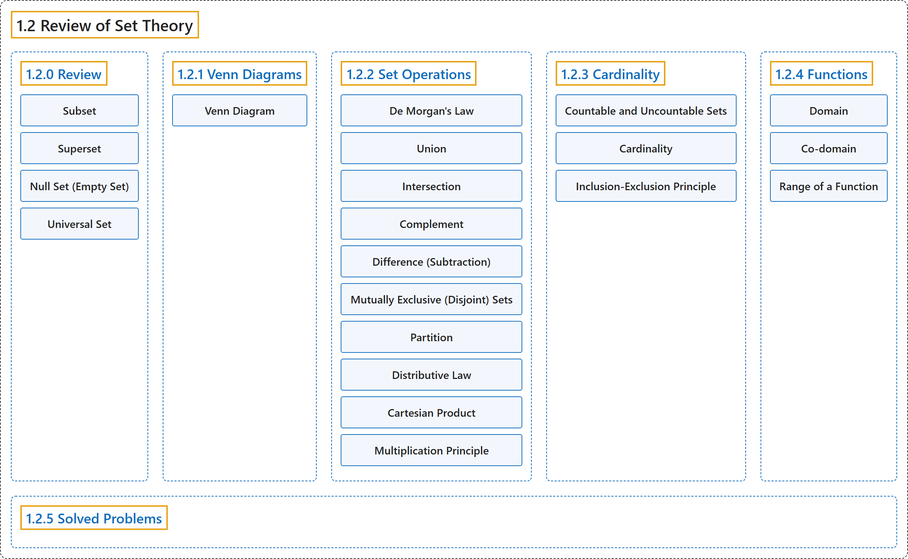

# 1.2 Review of Set Theory

## Classification

## Glossary

| Term | Definition | 中文翻译 | Source |
|---|---|---|---|
| **1.2 Review of Set Theory** 集合论回顾 | (No definition) | （无定义） | [Pishro-Nik, 2014, section 1.2](https://www.probabilitycourse.com/chapter1/1_2_0_review_set_theory.php) |
| **1.2.0 Review** 回顾 | (No definition) | （无定义） | [Pishro-Nik, 2014, section 1.2.0](https://www.probabilitycourse.com/chapter1/1_2_0_review_set_theory.php) |
| **Subset** 子集 | "Set $A$ is a **subset** of set $B$ if every element of $A$ is also an element of $B$." | 若 $A$ 的每个元素也都是 $B$ 的元素，则称集合 $A$ 是集合 $B$ 的**子集**。 | [Pishro-Nik, 2014, section 1.2.0](https://www.probabilitycourse.com/chapter1/1_2_0_review_set_theory.php#:~:text=Set%20is%20a%20subset%20of%20set) |
| **Superset** 超集 | "Equivalently, we say $B$ is a **superset** of $A$, or $B \supset A$." | 等价地，我们称 $B$ 是 $A$ 的**超集**，或写作 $B \supset A$。 | [Pishro-Nik, 2014, section 1.2.0](https://www.probabilitycourse.com/chapter1/1_2_0_review_set_theory.php#:~:text=Equivalently%2C%20we%20say%20is%20a%20superset) |
| **Null Set (Empty Set)** 空集 | "The set with no elements, i.e., $\emptyset=\{ \}$ is the **null set** or the **empty set**." | 没有任何元素的集合，即 $\emptyset=\{ \}$，称为**零集**或**空集**。 | [Pishro-Nik, 2014, section 1.2.0](https://www.probabilitycourse.com/chapter1/1_2_0_review_set_theory.php#:~:text=The%20set%20with%20no%20elements%2C%20i.e.%2C) |
| **Universal Set** 全集 | "The **universal set** is the set of all things that we could possibly consider in the context we are studying." | **全集**是在我们所研究的情境中可能考虑的所有事物构成的集合。 | [Pishro-Nik, 2014, section 1.2.0](https://www.probabilitycourse.com/chapter1/1_2_0_review_set_theory.php#:~:text=The%20universal%20set%20is%20the%20set) |
| **1.2.1 Venn Diagrams** 维恩图 | (No definition) | （无定义） | [Pishro-Nik, 2014, section 1.2.1](https://www.probabilitycourse.com/chapter1/1_2_1_venn.php) |
| **Venn Diagram** 韦恩图（Venn 图） | "**Venn diagrams** are very useful in visualizing relation between sets. In a Venn diagram any set is depicted by a closed region." | **韦恩图**非常适合直观表示集合之间的关系。在韦恩图中，任何集合都用一个封闭区域表示。 | [Pishro-Nik, 2014, section 1.2.1](https://www.probabilitycourse.com/chapter1/1_2_1_venn.php#:~:text=Venn%20diagrams%20are%20very%20useful%20in) |
| **1.2.2 Set Operations** 集合运算 | (No definition) | （无定义） | [Pishro-Nik, 2014, section 1.2.2](https://www.probabilitycourse.com/chapter1/1_2_2_set_operations.php) |
| **De Morgan's Law** 德摩根律 | "**De Morgan's law** For any sets $A_1$, $A_2$, $\cdots$, $A_n$, we have $(A_1 \cup A_2 \cup A_3 \cup \cdots A_n)^c=A_1^c \cap A_2^c \cap A_3^c\cdots \cap A_n^c$; $(A_1 \cap A_2 \cap A_3 \cap \cdots A_n)^c=A_1^c \cup A_2^c \cup A_3^c\cdots \cup A_n^c$." | **德摩根律**　对任意集合 $A_1$、$A_2$、$\cdots$、$A_n$，有 $(A_1 \cup A_2 \cup A_3 \cup \cdots A_n)^c=A_1^c \cap A_2^c \cap A_3^c\cdots \cap A_n^c$；$(A_1 \cap A_2 \cap A_3 \cap \cdots A_n)^c=A_1^c \cup A_2^c \cup A_3^c\cdots \cup A_n^c$。 | [Pishro-Nik, 2014, section 1.2.2](https://www.probabilitycourse.com/chapter1/1_2_2_set_operations.php#:~:text=De%20Morgan%27s%20law%20For%20any%20sets) |
| **Union** 并集 | "The **union** of two sets is a set containing all elements that are in $A$ or in $B$ (possibly both)." | 两个集合的**并集**是包含所有属于 $A$ 或属于 $B$（可以两者都属于）的元素的集合。 | [Pishro-Nik, 2014, section 1.2.2](https://www.probabilitycourse.com/chapter1/1_2_2_set_operations.php#:~:text=The%20union%20of%20two%20sets%20is) |
| **Intersection** 交集 | "The **intersection** of two sets $A$ and $B$, denoted by $A \cap B$, consists of all elements that are both in $A$ $\underline{\textrm{and}}$ $B$." | 集合 $A$ 与 $B$ 的**交集**记作 $A \cap B$，由既属于 $A$ 又属于 $B$ 的所有元素组成。 | [Pishro-Nik, 2014, section 1.2.2](https://www.probabilitycourse.com/chapter1/1_2_2_set_operations.php#:~:text=The%20intersection%20of%20two%20sets%20and) |
| **Complement** 补集 | "The **complement** of a set $A$, denoted by $A^c$ or $\bar{A}$, is the set of all elements that are in the universal set $S$ but are not in $A$." | 集合 $A$ 的**补集**记作 $A^c$ 或 $\bar{A}$，是全集 $S$ 中不属于 $A$ 的所有元素构成的集合。 | [Pishro-Nik, 2014, section 1.2.2](https://www.probabilitycourse.com/chapter1/1_2_2_set_operations.php#:~:text=The%20complement%20of%20a%20set%20%2C) |
| **Difference (Subtraction)** 差集 | "The **difference (subtraction)** is defined as follows. The set $A-B$ consists of elements that are in $A$ but not in $B$." | **差集**（减法）定义如下。集合 $A-B$ 由属于 $A$ 但不属于 $B$ 的元素组成。 | [Pishro-Nik, 2014, section 1.2.2](https://www.probabilitycourse.com/chapter1/1_2_2_set_operations.php#:~:text=The%20difference%20%28subtraction%29%20is%20defined%20as) |
| **Mutually Exclusive (Disjoint) Sets** 互斥集合（不相交集合） | "Two sets $A$ and $B$ are **mutually exclusive** or **disjoint** if they do not have any shared elements; i.e., their intersection is the empty set, $A \cap B=\emptyset$." | 若两个集合 $A$ 和 $B$ 没有任何公共元素，即它们的交集为空集 $A \cap B=\emptyset$，则称它们**互斥**或**不相交**。 | [Pishro-Nik, 2014, section 1.2.2](https://www.probabilitycourse.com/chapter1/1_2_2_set_operations.php#:~:text=Two%20sets%20and%20are%20mutually%20exclusive) |
| **Partition** 划分 | "In general, a collection of nonempty sets $A_1, A_2,\cdots$ is a **partition** of a set $A$ if they are disjoint and their union is $A$." | 一般地，若一族非空集合 $A_1, A_2,\cdots$ 互不相交且它们的并集为 $A$，则称其为集合 $A$ 的一个**划分**。 | [Pishro-Nik, 2014, section 1.2.2](https://www.probabilitycourse.com/chapter1/1_2_2_set_operations.php#:~:text=In%20general%2C%20a%20collection%20of%20nonempty) |
| **Distributive Law** 分配律 | "**Distributive law** For any sets $A$, $B$, and $C$ we have $A \cap (B \cup C)=(A \cap B) \cup (A\cap C)$; $A \cup (B \cap C)=(A \cup B) \cap (A\cup C)$." | **分配律**　对任意集合 $A$、$B$ 和 $C$，有 $A \cap (B \cup C)=(A \cap B) \cup (A\cap C)$；$A \cup (B \cap C)=(A \cup B) \cap (A\cup C)$。 | [Pishro-Nik, 2014, section 1.2.2](https://www.probabilitycourse.com/chapter1/1_2_2_set_operations.php#:~:text=Distributive%20law%20For%20any%20sets%20%2C) |
| **Cartesian Product** 笛卡尔积 | "A **Cartesian product** of two sets $A$ and $B$, written as $A\times B$, is the set containing **ordered pairs** from $A$ and $B$." | 集合 $A$ 与 $B$ 的**笛卡尔积**记作 $A\times B$，是由来自 $A$ 和 $B$ 的**有序对**构成的集合。 | [Pishro-Nik, 2014, section 1.2.2](https://www.probabilitycourse.com/chapter1/1_2_2_set_operations.php#:~:text=A%20Cartesian%20product%20of%20two%20sets) |
| **Multiplication Principle** 乘法原理 | "If you have two finite sets $A$ and $B$, where $A$ has $M$ elements and $B$ has $N$ elements, then $A \times B$ has $M \times N$ elements. This rule is called the **multiplication principle** and is very useful in counting the numbers of elements in sets." | 若有两个有限集合 $A$ 和 $B$，其中 $A$ 有 $M$ 个元素，$B$ 有 $N$ 个元素，则 $A \times B$ 有 $M \times N$ 个元素。这一规则称为**乘法原理**，在计算集合的元素个数时非常有用。 | [Pishro-Nik, 2014, section 1.2.2](https://www.probabilitycourse.com/chapter1/1_2_2_set_operations.php#:~:text=If%20you%20have%20two%20finite%20sets) |
| **1.2.3 Cardinality** 基数 | (No definition) | （无定义） | [Pishro-Nik, 2014, section 1.2.3](https://www.probabilitycourse.com/chapter1/1_2_3_cardinality.php) |
| **Countable and Uncountable Sets** 可数集与不可数集 | "Set $A$ is called **countable** if one of the following is true if it is a finite set, $\mid A \mid < \infty$; or it can be put in one-to-one correspondence with natural numbers $\mathbb{N}$, in which case the set is said to be countably infinite. A set is called **uncountable** if it is not countable." | 若满足下列条件之一，则称集合 $A$ **可数**：它是有限集，$\mid A \mid < \infty$；或者它可与自然数集 $\mathbb{N}$ 建立一一对应，此时称该集合为可数无限集。若集合不可数，则称其为**不可数**集。 | [Pishro-Nik, 2014, section 1.2.3](https://www.probabilitycourse.com/chapter1/1_2_3_cardinality.php#:~:text=Set%20is%20called%20countable%20if%20one) |
| **Cardinality** 基数 | "Here we need to talk about **cardinality** of a set, which is basically the size of the set. The cardinality of a set is denoted by $\vert A\vert$." | 这里需要谈谈集合的**基数**，它基本上就是集合的大小。集合的基数记作 $\vert A\vert$。 | [Pishro-Nik, 2014, section 1.2.3](https://www.probabilitycourse.com/chapter1/1_2_3_cardinality.php#:~:text=Here%20we%20need%20to%20talk%20about) |
| **Inclusion-Exclusion Principle** 容斥原理 | "Before discussing infinite sets, which is the main discussion of this section, we would like to talk about a very useful rule: the **inclusion-exclusion principle**. For two finite sets $A$ and $B$, we have $$\vert A \cup B \vert =\vert A\vert +\vert B\vert -\vert A \cap B\vert .$$" | 在讨论无限集（这是本节的主要内容）之前，我们先谈一条非常有用的规则：**容斥原理**。对于两个有限集合 $A$ 和 $B$，有 $$\vert A \cup B \vert =\vert A\vert +\vert B\vert -\vert A \cap B\vert .$$ | [Pishro-Nik, 2014, section 1.2.3](https://www.probabilitycourse.com/chapter1/1_2_3_cardinality.php#:~:text=Before%20discussing%20infinite%20sets%2C%20which%20is) |
| **1.2.4 Functions** 函数 | (No definition) | （无定义） | [Pishro-Nik, 2014, section 1.2.4](https://www.probabilitycourse.com/chapter1/1_2_4_functions.php) |
| **Domain** 定义域 | "A function $f$ is a rule that takes an input from a specific set, called the **domain**, and produces an output from another set, called co-domain." | 函数 $f$ 是一条规则，它从某个特定集合（称为**定义域**）中取一个输入，并在另一个集合（称为陪域）中产生一个输出。 | [Pishro-Nik, 2014, section 1.2.4](https://www.probabilitycourse.com/chapter1/1_2_4_functions.php#:~:text=A%20function%20is%20a%20rule%20that) |
| **Co-domain** 陪域 | "A function $f$ is a rule that takes an input from a specific set, called the domain, and produces an output from another set, called **co-domain**." | 函数 $f$ 是一条规则，它从某个特定集合（称为定义域）中取一个输入，并在另一个集合（称为**陪域**）中产生一个输出。 | [Pishro-Nik, 2014, section 1.2.4](https://www.probabilitycourse.com/chapter1/1_2_4_functions.php#:~:text=A%20function%20is%20a%20rule%20that) |
| **Range of a Function** 值域 | "We define the **range** of a function as the set containing all the possible values of $f(x)$. Thus, the range of a function is always a subset of its co-domain." | 我们将函数的**值域**定义为包含 $f(x)$ 所有可能取值的集合。因此，函数的值域总是其陪域的子集。 | [Pishro-Nik, 2014, section 1.2.4](https://www.probabilitycourse.com/chapter1/1_2_4_functions.php#:~:text=We%20define%20the%20range%20of%20a) |
| **1.2.5 Solved Problems** 例题详解 | (No definition) | （无定义） | [Pishro-Nik, 2014, section 1.2.5](https://www.probabilitycourse.com/chapter1/1_2_5_solved1.php) |

## References

Pishro-Nik, H. (2014). *Introduction to probability, statistics, and random processes*. Kappa Research. Retrieved October 28, 2026, from <https://www.probabilitycourse.com/>
