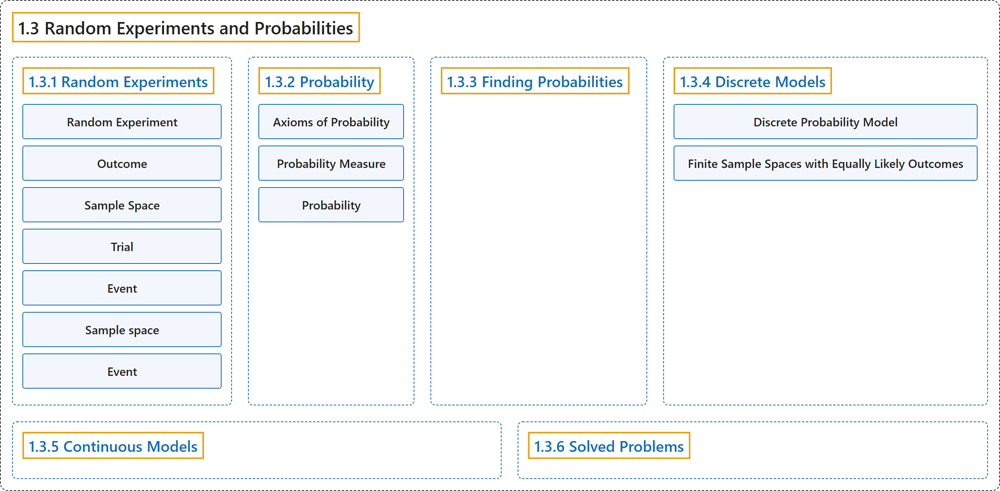

# 1.3 Random Experiments and Probabilities

## Classification

## Glossary

| Term | Definition | 中文翻译 | Source |
|---|---|---|---|
| **1.3 Random Experiments and Probabilities** 随机试验与概率 | (No definition) | （无定义） | [Pishro-Nik, 2014, section 1.3](https://www.probabilitycourse.com/chapter1/1_3_1_random_experiments.php) |
| **1.3.1 Random Experiments** 随机试验 | (No definition) | （无定义） | [Pishro-Nik, 2014, section 1.3.1](https://www.probabilitycourse.com/chapter1/1_3_1_random_experiments.php) |
| **Random Experiment** 随机试验 | "In particular, a **random experiment** is a process by which we observe something uncertain." | 具体地说，**随机试验**是我们观察某种不确定事物的一个过程。 | [Pishro-Nik, 2014, section 1.3.1](https://www.probabilitycourse.com/chapter1/1_3_1_random_experiments.php#:~:text=In%20particular%2C%20a%20random%20experiment%20is) |
| **Outcome** 结果（样本点） | "An **outcome** is a result of a random experiment." | **结果**（样本点）是随机试验的一个结果。 | [Pishro-Nik, 2014, section 1.3.1](https://www.probabilitycourse.com/chapter1/1_3_1_random_experiments.php#:~:text=An%20outcome%20is%20a%20result%20of) |
| **Sample Space** 样本空间 | "The set of all possible outcomes is called the **sample space**." | 所有可能结果构成的集合称为**样本空间**。 | [Pishro-Nik, 2014, section 1.3.1](https://www.probabilitycourse.com/chapter1/1_3_1_random_experiments.php#:~:text=The%20set%20of%20all%20possible%20outcomes) |
| **Trial** 试验（一次） | "When we repeat a random experiment several times, we call each one of them a **trial**." | 当我们把一个随机试验重复若干次时，把其中每一次称为一次**试验**。 | [Pishro-Nik, 2014, section 1.3.1](https://www.probabilitycourse.com/chapter1/1_3_1_random_experiments.php#:~:text=When%20we%20repeat%20a%20random%20experiment) |
| **Event** 事件 | "Thus an **event** is a collection of possible outcomes. In other words, an event is a subset of the sample space to which we assign a probability." | 因此，**事件**是可能结果的一个集合。换言之，事件是样本空间的一个子集，我们为它指派一个概率。 | [Pishro-Nik, 2014, section 1.3.1](https://www.probabilitycourse.com/chapter1/1_3_1_random_experiments.php#:~:text=Thus%20an%20event%20is%20a%20collection) |
| **Sample space** 样本空间 | "Informally, the sample space for a given set of events is the **set of all possible values** the events may assume." | 非正式地说，一组给定事件的样本空间是这些事件可能取的**所有可能值的集合**。 | [Weisstein, n.d.-e, "Sample space" entry, para. 1](https://mathworld.wolfram.com/SampleSpace.html#:~:text=the%20sample%20space%20for%20a%20given%20set%20of%20events) |
| **Event** 事件 | "An event is **a certain subset of a probability space**. Events are therefore **collections of outcomes** on which probabilities have been assigned." | 事件是**概率空间的某个子集**。因此，事件是一些已被赋予概率的**结果的汇集**。 | [Weisstein, n.d.-c, "Event" entry, para. 1](https://mathworld.wolfram.com/Event.html#:~:text=An%20event%20is%20a%20certain%20subset%20of%20a%20probability%20space) |
| **1.3.2 Probability** 概率 | (No definition) | （无定义） | [Pishro-Nik, 2014, section 1.3.2](https://www.probabilitycourse.com/chapter1/1_3_2_probability.php) |
| **Axioms of Probability** 概率公理 | "**Axiom 1**: For any event $A$, $P(A) \geq 0$. **Axiom 2**: Probability of the sample space $S$ is $P(S)=1$. **Axiom 3**: If $A_1, A_2, A_3, \cdots$ are disjoint events, then $P(A_1 \cup A_2 \cup A_3 \cdots)=P(A_1)+P(A_2)+P(A_3)+\cdots$" | **公理 1**：对任意事件 $A$，$P(A) \geq 0$。**公理 2**：样本空间 $S$ 的概率为 $P(S)=1$。**公理 3**：若 $A_1, A_2, A_3, \cdots$ 为互不相交的事件，则 $P(A_1 \cup A_2 \cup A_3 \cdots)=P(A_1)+P(A_2)+P(A_3)+\cdots$ | [Pishro-Nik, 2014, section 1.3.2](https://www.probabilitycourse.com/chapter1/1_3_2_probability.php#:~:text=Axiom%201%3A%20For%20any%20event%20%2C) |
| **Probability Measure** 概率测度 | "We assign a **probability measure** $P(A)$ to an event $A$. This is a value between $0$ and $1$ that shows how likely the event is." | 我们为事件 $A$ 指派一个**概率测度** $P(A)$。它是介于 $0$ 和 $1$ 之间的值，表示该事件有多大可能发生。 | [Pishro-Nik, 2014, section 1.3.2](https://www.probabilitycourse.com/chapter1/1_3_2_probability.php#:~:text=We%20assign%20a%20probability%20measure%20to) |
| **Probability** 概率 | "In common usage, the word 'probability' is used to mean **the chance that a particular event (or set of events) will occur** expressed on a **linear scale** from 0 (impossibility) to 1 (certainty), also expressed as a percentage between 0 and 100%." | 在日常用法中，“概率”一词指**某个特定事件（或一组事件）发生的可能性**，用从 0（不可能）到 1（必然）的**线性刻度**表示，也可表示为 0 到 100% 之间的百分比。 | [Weisstein, n.d.-d, "Probability" entry, para. 1](https://mathworld.wolfram.com/Probability.html#:~:text=is%20used%20to%20mean%20the%20chance%20that%20a%20particular%20event) |
| **1.3.3 Finding Probabilities** 求概率 | (No definition) | （无定义） | [Pishro-Nik, 2014, section 1.3.3](https://www.probabilitycourse.com/chapter1/1_3_3_finding_probabilities.php) |
| **1.3.4 Discrete Models** 离散模型 | (No definition) | （无定义） | [Pishro-Nik, 2014, section 1.3.4](https://www.probabilitycourse.com/chapter1/1_3_4_discrete_models.php) |
| **Discrete Probability Model** 离散概率模型 | "If $S$ is a countable set, this refers to a **discrete probability model**." | 若 $S$ 是可数集，则称为**离散概率模型**。 | [Pishro-Nik, 2014, section 1.3.4](https://www.probabilitycourse.com/chapter1/1_3_4_discrete_models.php#:~:text=If%20is%20a%20countable%20set%2C%20this) |
| **Finite Sample Spaces with Equally Likely Outcomes** 等可能的有限样本空间（古典概型） | "An important special case of discrete probability models is when we have a **finite sample space** $S$, where each outcome is **equally likely**, i.e., $$S=\{s_1,s_2,\cdots,s_N\}, \textrm{ where } P(s_i)=P(s_j) \textrm{ for all }i,j \in \{1,2,\cdots,N\}.$$" | 离散概率模型的一个重要特例是：有一个**有限样本空间** $S$，其中每个结果都**等可能**，即 $$S=\{s_1,s_2,\cdots,s_N\}, \textrm{ where } P(s_i)=P(s_j) \textrm{ for all }i,j \in \{1,2,\cdots,N\}.$$ | [Pishro-Nik, 2014, section 1.3.4](https://www.probabilitycourse.com/chapter1/1_3_4_discrete_models.php#:~:text=An%20important%20special%20case%20of%20discrete) |
| **1.3.5 Continuous Models** 连续模型 | (No definition) | （无定义） | [Pishro-Nik, 2014, section 1.3.5](https://www.probabilitycourse.com/chapter1/1_3_5_continuous_models.php) |
| **1.3.6 Solved Problems** 例题详解 | (No definition) | （无定义） | [Pishro-Nik, 2014, section 1.3.6](https://www.probabilitycourse.com/chapter1/1_3_6_solved2.php) |

## References

Pishro-Nik, H. (2014). *Introduction to probability, statistics, and random processes*. Kappa Research. Retrieved October 28, 2026, from <https://www.probabilitycourse.com/>

Weisstein, E. W. (n.d.-d). *Probability*. MathWorld: A Wolfram Resource. Retrieved October 27, 2026, from <https://mathworld.wolfram.com/Probability.html>

Weisstein, E. W. (n.d.-c). *Event*. MathWorld: A Wolfram Resource. Retrieved October 27, 2026, from <https://mathworld.wolfram.com/Event.html>

Weisstein, E. W. (n.d.-e). *Sample space*. MathWorld: A Wolfram Resource. Retrieved October 27, 2026, from <https://mathworld.wolfram.com/SampleSpace.html>
