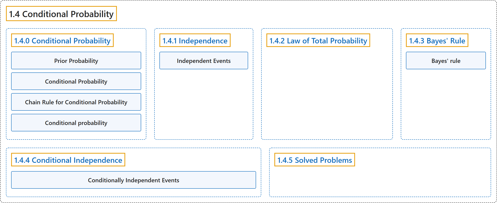

# 1.4 Conditional Probability

## Classification

## Glossary

| Term | Definition | 中文翻译 | Source |
|---|---|---|---|
| **1.4 Conditional Probability** 条件概率 | (No definition) | （无定义） | [Pishro-Nik, 2014, section 1.4](https://www.probabilitycourse.com/chapter1/1_4_0_conditional_probability.php) |
| **1.4.0 Conditional Probability** 条件概率 | (No definition) | （无定义） | [Pishro-Nik, 2014, section 1.4.0](https://www.probabilitycourse.com/chapter1/1_4_0_conditional_probability.php) |
| **Prior Probability** 先验概率 | "It is reasonable to assume that in this example, $P(R \vert  C)$ should be larger than the original $P(R)$, which is called the **prior probability** of $R$." | 在这个例子中，可以合理地假定 $P(R \vert  C)$ 应当大于原来的 $P(R)$，后者称为 $R$ 的**先验概率**。 | [Pishro-Nik, 2014, section 1.4.0](https://www.probabilitycourse.com/chapter1/1_4_0_conditional_probability.php#:~:text=It%20is%20reasonable%20to%20assume%20that) |
| **Conditional Probability** 条件概率 | "If $A$ and $B$ are two events in a sample space $S$, then the **conditional probability** of $A$ given $B$ is defined as" | 若 $A$ 和 $B$ 是样本空间 $S$ 中的两个事件，则给定 $B$ 时 $A$ 的**条件概率**定义为 | [Pishro-Nik, 2014, section 1.4.0](https://www.probabilitycourse.com/chapter1/1_4_0_conditional_probability.php#:~:text=If%20and%20are%20two%20events%20in) |
| **Chain Rule for Conditional Probability** 乘法公式（链式法则） | "**Chain rule for conditional probability**: Let us write the formula for conditional probability in the following format $$\hspace{100pt} P(A \cap B)=P(A)P(B\vert A)=P(B)P(A\vert B) \hspace{100pt} (1.5)$$" | **条件概率的链式法则**：把条件概率公式写成如下形式 $$\hspace{100pt} P(A \cap B)=P(A)P(B\vert A)=P(B)P(A\vert B) \hspace{100pt} (1.5)$$ | [Pishro-Nik, 2014, section 1.4.0](https://www.probabilitycourse.com/chapter1/1_4_0_conditional_probability.php#:~:text=Chain%20rule%20for%20conditional%20probability%3A%20Let) |
| **Conditional probability** 条件概率 | "The conditional probability of an event A **assuming that B has occurred** with P(B)>0, denoted P(A\|B), equals **P(A\|B) = P(A ∩ B)/P(B)**." | 事件 A 在**已知 B 已经发生**（P(B)>0）时的条件概率记为 P(A\|B)，等于 **P(A\|B) = P(A ∩ B)/P(B)**。 | [Weisstein, n.d.-b, "Conditional probability" entry, para. 1](https://mathworld.wolfram.com/ConditionalProbability.html#:~:text=The%20conditional%20probability%20of%20an%20event) |
| **1.4.1 Independence** 独立性 | (No definition) | （无定义） | [Pishro-Nik, 2014, section 1.4.1](https://www.probabilitycourse.com/chapter1/1_4_1_independence.php) |
| **Independent Events** 独立事件 | "Two events are **independent** if one does not convey any information about the other." | 若一个事件不提供关于另一个事件的任何信息，则称这两个事件**相互独立**。 | [Pishro-Nik, 2014, section 1.4.1](https://www.probabilitycourse.com/chapter1/1_4_1_independence.php#:~:text=Two%20events%20are%20independent%20if%20one) |
| **1.4.2 Law of Total Probability** 全概率公式 | (No definition) | （无定义） | [Pishro-Nik, 2014, section 1.4.2](https://www.probabilitycourse.com/chapter1/1_4_2_total_probability.php) |
| **1.4.3 Bayes' Rule** 贝叶斯法则 | (No definition) | （无定义） | [Pishro-Nik, 2014, section 1.4.3](https://www.probabilitycourse.com/chapter1/1_4_3_bayes_rule.php) |
| **Bayes' rule** 贝叶斯法则 | "Bayes' theorem, also called Bayes' rule, **expresses a conditional probability in terms of its reverse** and the corresponding **marginal probabilities**." | 贝叶斯定理也称为贝叶斯法则，它**用反向的条件概率来表示一个条件概率**，并用到相应的**边缘概率**。 | [Weisstein, n.d.-a, "Bayes' theorem" entry, para. 1](https://mathworld.wolfram.com/BayesTheorem.html#:~:text=also%20called%20Bayes) |
| **1.4.4 Conditional Independence** 条件独立性 | (No definition) | （无定义） | [Pishro-Nik, 2014, section 1.4.4](https://www.probabilitycourse.com/chapter1/1_4_4_conditional_independence.php) |
| **Conditionally Independent Events** 条件独立事件 | "Two events $A$ and $B$ are **conditionally independent** given an event $C$ with $P(C)>0$ if $$\hspace{100pt}P(A \cap B\vert C)=P(A\vert C)P(B\vert C) \hspace{100pt} (1.8)$$" | 对于满足 $P(C)>0$ 的事件 $C$，若 $$\hspace{100pt}P(A \cap B\vert C)=P(A\vert C)P(B\vert C) \hspace{100pt} (1.8)$$，则称两个事件 $A$ 和 $B$ 在给定 $C$ 的条件下**条件独立**。 | [Pishro-Nik, 2014, section 1.4.4](https://www.probabilitycourse.com/chapter1/1_4_4_conditional_independence.php#:~:text=Two%20events%20and%20are%20conditionally%20independent) |
| **1.4.5 Solved Problems** 例题详解 | (No definition) | （无定义） | [Pishro-Nik, 2014, section 1.4.5](https://www.probabilitycourse.com/chapter1/1_4_5_solved3.php) |

## References

Pishro-Nik, H. (2014). *Introduction to probability, statistics, and random processes*. Kappa Research. Retrieved October 28, 2026, from <https://www.probabilitycourse.com/>

Weisstein, E. W. (n.d.-b). *Conditional probability*. MathWorld: A Wolfram Resource. Retrieved October 27, 2026, from <https://mathworld.wolfram.com/ConditionalProbability.html>

Weisstein, E. W. (n.d.-a). *Bayes' theorem*. MathWorld: A Wolfram Resource. Retrieved October 27, 2026, from <https://mathworld.wolfram.com/BayesTheorem.html>
