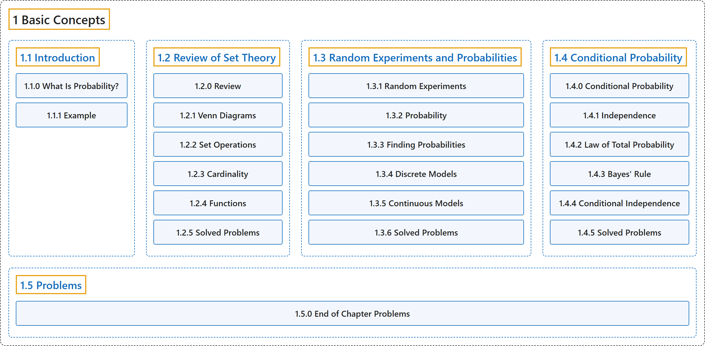

# 1 Basic Concepts

## Classification

## Glossary

| Term | Definition | 中文翻译 | Source |
|---|---|---|---|
| **1 Basic Concepts** 基本概念 | (No definition) | （无定义） | [Pishro-Nik, 2014, chapter 1](https://www.probabilitycourse.com/) |
| **[1.1 Introduction](1-1-introduction.md)** 介绍 | (No definition) | （无定义） | [Pishro-Nik, 2014, section 1.1](https://www.probabilitycourse.com/chapter1/1_1_0_what_is_probability.php) |
| **[1.2 Review of Set Theory](1-2-review-of-set-theory.md)** 集合论回顾 | (No definition) | （无定义） | [Pishro-Nik, 2014, section 1.2](https://www.probabilitycourse.com/chapter1/1_2_0_review_set_theory.php) |
| **[1.3 Random Experiments and Probabilities](1-3-random-experiments-and-probabilities.md)** 随机试验与概率 | (No definition) | （无定义） | [Pishro-Nik, 2014, section 1.3](https://www.probabilitycourse.com/chapter1/1_3_1_random_experiments.php) |
| **[1.4 Conditional Probability](1-4-conditional-probability.md)** 条件概率 | (No definition) | （无定义） | [Pishro-Nik, 2014, section 1.4](https://www.probabilitycourse.com/chapter1/1_4_0_conditional_probability.php) |
| **[1.5 Problems](1-5-problems.md)** 习题 | (No definition) | （无定义） | [Pishro-Nik, 2014, section 1.5](https://www.probabilitycourse.com/chapter1/1_5_0_chapter1_problems.php) |

## References

Pishro-Nik, H. (2014). *Introduction to probability, statistics, and random processes*. Kappa Research. Retrieved October 28, 2026, from <https://www.probabilitycourse.com/>
