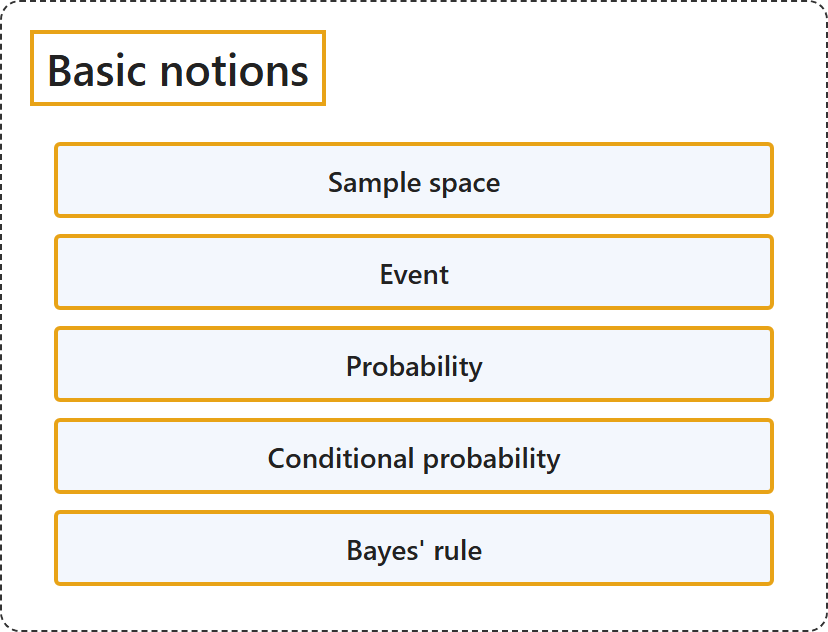

# 2.1 Basic Notions

## Classification

## Glossary

| Term | Definition | 中文翻译 | Source |
|---|---|---|---|
| **Sample space** 样本空间 | "Informally, the sample space for a given set of events is the **set of all possible values** the events may assume." | 非正式地说，一组给定事件的样本空间是这些事件可能取的**所有可能值的集合**。 | [Weisstein, n.d.-e, "Sample space" entry, para. 1](https://mathworld.wolfram.com/SampleSpace.html#:~:text=the%20sample%20space%20for%20a%20given%20set%20of%20events) |
| **Event** 事件 | "An event is **a certain subset of a probability space**. Events are therefore **collections of outcomes** on which probabilities have been assigned." | 事件是**概率空间的某个子集**。因此，事件是一些已被赋予概率的**结果的汇集**。 | [Weisstein, n.d.-c, "Event" entry, para. 1](https://mathworld.wolfram.com/Event.html#:~:text=An%20event%20is%20a%20certain%20subset%20of%20a%20probability%20space) |
| **Probability** 概率 | "In common usage, the word 'probability' is used to mean **the chance that a particular event (or set of events) will occur** expressed on a **linear scale** from 0 (impossibility) to 1 (certainty), also expressed as a percentage between 0 and 100%." | 在日常用法中，“概率”一词指**某个特定事件（或一组事件）发生的可能性**，用从 0（不可能）到 1（必然）的**线性刻度**表示，也可表示为 0 到 100% 之间的百分比。 | [Weisstein, n.d.-d, "Probability" entry, para. 1](https://mathworld.wolfram.com/Probability.html#:~:text=is%20used%20to%20mean%20the%20chance%20that%20a%20particular%20event) |
| **Conditional probability** 条件概率 | "The conditional probability of an event A **assuming that B has occurred** with P(B)>0, denoted P(A\|B), equals **P(A\|B) = P(A ∩ B)/P(B)**." | 事件 A 在**已知 B 已经发生**（P(B)>0）时的条件概率记为 P(A\|B)，等于 **P(A\|B) = P(A ∩ B)/P(B)**。 | [Weisstein, n.d.-b, "Conditional probability" entry, para. 1](https://mathworld.wolfram.com/ConditionalProbability.html#:~:text=The%20conditional%20probability%20of%20an%20event) |
| **Bayes' rule** 贝叶斯法则 | "Bayes' theorem, also called Bayes' rule, **expresses a conditional probability in terms of its reverse** and the corresponding **marginal probabilities**." | 贝叶斯定理也称为贝叶斯法则，它**用反向的条件概率来表示一个条件概率**，并用到相应的**边缘概率**。 | [Weisstein, n.d.-a, "Bayes' theorem" entry, para. 1](https://mathworld.wolfram.com/BayesTheorem.html#:~:text=also%20called%20Bayes) |

## References

- Joint Task Force on Computing Curricula. (2024). *Computer science curricula 2023*. Association for Computing Machinery. <https://doi.org/10.1145/3664191>
- Weisstein, E. W. (n.d.-a). *Bayes' theorem*. MathWorld: A Wolfram Resource. Retrieved October 27, 2026, from <https://mathworld.wolfram.com/BayesTheorem.html>
- Weisstein, E. W. (n.d.-b). *Conditional probability*. MathWorld: A Wolfram Resource. Retrieved October 27, 2026, from <https://mathworld.wolfram.com/ConditionalProbability.html>
- Weisstein, E. W. (n.d.-c). *Event*. MathWorld: A Wolfram Resource. Retrieved October 27, 2026, from <https://mathworld.wolfram.com/Event.html>
- Weisstein, E. W. (n.d.-d). *Probability*. MathWorld: A Wolfram Resource. Retrieved October 27, 2026, from <https://mathworld.wolfram.com/Probability.html>
- Weisstein, E. W. (n.d.-e). *Sample space*. MathWorld: A Wolfram Resource. Retrieved October 27, 2026, from <https://mathworld.wolfram.com/SampleSpace.html>
