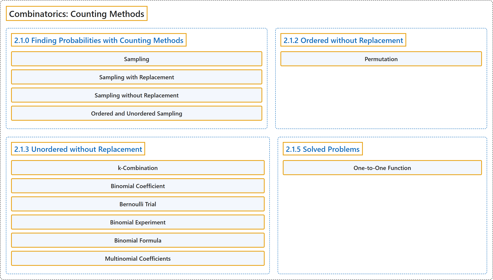

# 2 Combinatorics: Counting Methods

## Classification

## Glossary

| Term | Definition | 中文翻译 | Source |
|---|---|---|---|
| **2 Combinatorics: Counting Methods** 组合学：计数方法 | (No definition) | （无定义） | [Pishro-Nik, 2014, chapter 2](https://www.probabilitycourse.com/) |
| **2.1.0 Finding Probabilities with Counting Methods** 用计数方法求概率 | (No definition) | （无定义） | [Pishro-Nik, 2014, section 2.1.0](https://www.probabilitycourse.com/chapter2/2_1_0_counting.php) |
| **Sampling** 抽样 | "**sampling** from a set means choosing an element from that set. We often draw a sample at random from a given set in which each element of the set has equal chance of being chosen." | 从一个集合中**抽样**是指从该集合中选取一个元素。我们常从给定集合中随机抽取样本，集合中每个元素被选中的机会均等。 | [Pishro-Nik, 2014, section 2.1.0](https://www.probabilitycourse.com/chapter2/2_1_0_counting.php#:~:text=sampling%20from%20a%20set%20means%20choosing) |
| **Sampling with Replacement** 有放回抽样 | "If we put each object back after each draw, we call this **sampling with replacement**. In this case a single object can be possibly chosen multiple times." | 如果每次抽取后都把对象放回，我们称之为**有放回抽样**。此时同一个对象可能被多次选中。 | [Pishro-Nik, 2014, section 2.1.0](https://www.probabilitycourse.com/chapter2/2_1_0_counting.php#:~:text=If%20we%20put%20each%20object%20back) |
| **Sampling without Replacement** 无放回抽样 | "On the other hand, if repetition is not allowed, we call it **sampling without replacement**." | 另一方面，如果不允许重复，我们称之为**无放回抽样**。 | [Pishro-Nik, 2014, section 2.1.0](https://www.probabilitycourse.com/chapter2/2_1_0_counting.php#:~:text=On%20the%20other%20hand%2C%20if%20repetition) |
| **Ordered and Unordered Sampling** 有序抽样与无序抽样 | "If ordering matters (i.e.: $a_1, a_2, a_3 \neq a_2, a_3, a_1$), this is called **ordered sampling**. Otherwise, it is called **unordered**." | 如果顺序有影响（即 $a_1, a_2, a_3 \neq a_2, a_3, a_1$），则称为**有序抽样**；否则称为**无序**抽样。 | [Pishro-Nik, 2014, section 2.1.0](https://www.probabilitycourse.com/chapter2/2_1_0_counting.php#:~:text=If%20ordering%20matters%20%28i.e.%3A%20%29%2C%20this) |
| **2.1.2 Ordered without Replacement** 无放回的有序选取 | (No definition) | （无定义） | [Pishro-Nik, 2014, section 2.1.2](https://www.probabilitycourse.com/chapter2/2_1_2_ordered_without_replacement.php) |
| **Permutation** 排列 | "An $n$-permutation of $n$ elements is just called a **permutation of those elements**." | $n$ 个元素的 $n$-排列就简称为这些元素的**排列**。 | [Pishro-Nik, 2014, section 2.1.2](https://www.probabilitycourse.com/chapter2/2_1_2_ordered_without_replacement.php#:~:text=An%20-permutation%20of%20elements%20is%20just) |
| **2.1.3 Unordered without Replacement** 无放回的无序选取 | (No definition) | （无定义） | [Pishro-Nik, 2014, section 2.1.3](https://www.probabilitycourse.com/chapter2/2_1_3_unordered_without_replacement.php) |
| **k-Combination** k 组合 | "Thus, we basically want to choose a $k$-element subset of $A$, which we also call a $k$-**combination** of the set $A$." | 因此，我们基本上是要选出 $A$ 的一个含 $k$ 个元素的子集，也称为集合 $A$ 的一个 $k$-**组合**。 | [Pishro-Nik, 2014, section 2.1.3](https://www.probabilitycourse.com/chapter2/2_1_3_unordered_without_replacement.php#:~:text=Thus%2C%20we%20basically%20want%20to%20choose) |
| **Binomial Coefficient** 二项式系数 | "${n \choose k}$ is also called the **binomial coefficient**. This is because the coefficients in the binomial theorem are given by ${n \choose k}$." | ${n \choose k}$ 也称为**二项式系数**。这是因为二项式定理中的系数由 ${n \choose k}$ 给出。 | [Pishro-Nik, 2014, section 2.1.3](https://www.probabilitycourse.com/chapter2/2_1_3_unordered_without_replacement.php#:~:text=is%20also%20called%20the%20binomial%20coefficient.) |
| **Bernoulli Trial** 伯努利试验 | "A **Bernoulli Trial** is a random experiment that has two possible outcomes which we can label as "success" and "failure,"" | **伯努利试验**是只有两种可能结果的随机试验，这两种结果可记为“成功”和“失败”。 | [Pishro-Nik, 2014, section 2.1.3](https://www.probabilitycourse.com/chapter2/2_1_3_unordered_without_replacement.php#:~:text=A%20Bernoulli%20Trial%20is%20a%20random) |
| **Binomial Experiment** 二项试验 | "If we have an experiment in which we perform $n$ independent Bernoulli trials and count the total number of successes, we call it a **binomial experiment**." | 如果我们进行 $n$ 次独立的伯努利试验并统计成功的总次数，就称其为**二项试验**。 | [Pishro-Nik, 2014, section 2.1.3](https://www.probabilitycourse.com/chapter2/2_1_3_unordered_without_replacement.php#:~:text=If%20we%20have%20an%20experiment%20in) |
| **Binomial Formula** 二项公式 | "**Binomial Formula**: For $n$ independent Bernoulli trials where each trial has success probability $p$, the probability of $k$ successes is given by $$P(k)={n \choose k}p^k(1-p)^{n-k}.$$" | **二项公式**：对于 $n$ 次独立的伯努利试验，每次试验的成功概率为 $p$，则 $k$ 次成功的概率为 $$P(k)={n \choose k}p^k(1-p)^{n-k}.$$ | [Pishro-Nik, 2014, section 2.1.3](https://www.probabilitycourse.com/chapter2/2_1_3_unordered_without_replacement.php#:~:text=Binomial%20Formula%3A%20For%20independent%20Bernoulli%20trials) |
| **Multinomial Coefficients** 多项式系数 | "The number of ways in this case is given by the **multinomial coefficients**. In particular, if $n=n_1+n_2+...+n_r$, where all $n_i\geq 0$ are integers, then the number of ways to divide $n$ distinct objects to $r$ distinct groups of sizes $n_1, n_2,..., n_r$ is given by" | 此时的方法数由**多项式系数**给出。具体地说，若 $n=n_1+n_2+...+n_r$，其中所有 $n_i\geq 0$ 均为整数，则把 $n$ 个不同对象分成 $r$ 个大小分别为 $n_1, n_2,..., n_r$ 的不同组的方法数为 | [Pishro-Nik, 2014, section 2.1.3](https://www.probabilitycourse.com/chapter2/2_1_3_unordered_without_replacement.php#:~:text=The%20number%20of%20ways%20in%20this) |
| **2.1.5 Solved Problems** 例题详解 | (No definition) | （无定义） | [Pishro-Nik, 2014, section 2.1.5](https://www.probabilitycourse.com/chapter2/2_1_5_solved2_1.php) |
| **One-to-One Function** 一对一函数（单射） | "A function is said to be **one-to-one** if for all $x_1\neq x_2$, we have $f(x_1)\neq f(x_2)$." | 若对所有 $x_1\neq x_2$ 都有 $f(x_1)\neq f(x_2)$，则称函数是**一对一**的（单射）。 | [Pishro-Nik, 2014, section 2.1.5](https://www.probabilitycourse.com/chapter2/2_1_5_solved2_1.php#:~:text=A%20function%20is%20said%20to%20be) |

## References

Pishro-Nik, H. (2014). *Introduction to probability, statistics, and random processes*. Kappa Research. Retrieved October 28, 2026, from <https://www.probabilitycourse.com/>
