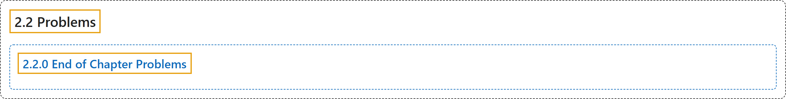

# 2.2 Problems

## Classification

## Glossary

| Term | Definition | 中文翻译 | Source |
|---|---|---|---|
| **2.2 Problems** 习题 | (No definition) | （无定义） | [Pishro-Nik, 2014, section 2.2](https://www.probabilitycourse.com/) |
| **2.2.0 End of Chapter Problems** 章末习题 | (No definition) | （无定义） | [Pishro-Nik, 2014, section 2.2.0](https://www.probabilitycourse.com/) |

## References

Pishro-Nik, H. (2014). *Introduction to probability, statistics, and random processes*. Kappa Research. Retrieved October 28, 2026, from <https://www.probabilitycourse.com/>
