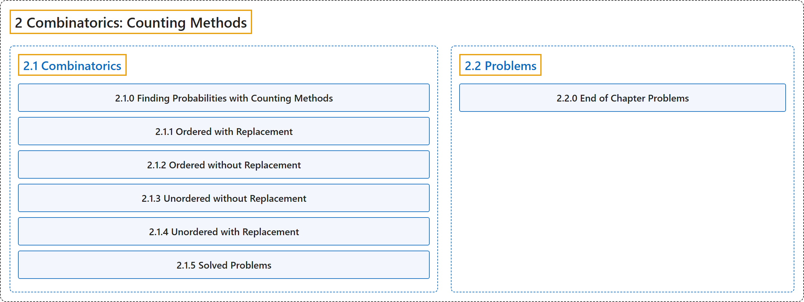

# 2 Combinatorics: Counting Methods

## Classification

## Glossary

| Term | Definition | 中文翻译 | Source |
|---|---|---|---|
| **2 Combinatorics: Counting Methods** 组合学：计数方法 | (No definition) | （无定义） | [Pishro-Nik, 2014, chapter 2](https://www.probabilitycourse.com/) |
| **[2.1 Combinatorics](2-1-combinatorics.md)** 组合 | (No definition) | （无定义） | [Pishro-Nik, 2014, section 2.1](https://www.probabilitycourse.com/chapter2/2_1_0_counting.php) |
| **[2.2 Problems](2-2-problems.md)** 习题 | (No definition) | （无定义） | [Pishro-Nik, 2014, section 2.2](https://www.probabilitycourse.com/) |

## References

Pishro-Nik, H. (2014). *Introduction to probability, statistics, and random processes*. Kappa Research. Retrieved October 28, 2026, from <https://www.probabilitycourse.com/>
