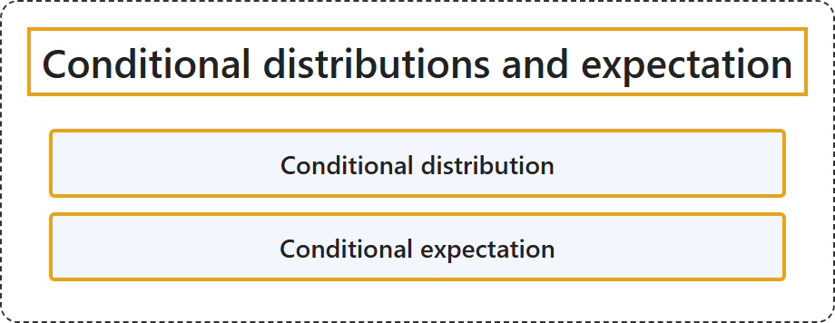

# 2.5 Conditional distributions and expectation

## Classification

## Glossary

| Term | Definition | 中文翻译 | Source |
|---|---|---|---|
| **Conditional distribution** 条件分布 | "A conditional distribution is the **statistical distribution of a random variable** given **specified information about another random variable or event**." | 条件分布是**一个随机变量的统计分布**，条件是已知**关于另一个随机变量或事件的特定信息**。 | [Weisstein, n.d.-a, "Conditional distribution" entry, para. 1](https://mathworld.wolfram.com/ConditionalDistribution.html#:~:text=A%20conditional%20distribution%20is%20the%20statistical%20distribution) |
| **Conditional expectation** 条件期望 | "The conditional expectation of **an integrable random variable** X on a probability space ... given a sigma-algebra G ... is a **G-measurable random variable**, denoted E[X\|G] ..." | **可积随机变量** X 在给定 σ 代数 G 时的条件期望……是一个 **G 可测的随机变量**，记为 E[X\|G]…… | [Weisstein, n.d.-b, "Conditional expectation" entry, para. 1](https://mathworld.wolfram.com/ConditionalExpectation.html#:~:text=The%20conditional%20expectation%20of%20an%20integrable%20random%20variable) |

## References

- Joint Task Force on Computing Curricula. (2024). *Computer science curricula 2023*. Association for Computing Machinery. <https://doi.org/10.1145/3664191>
- Weisstein, E. W. (n.d.-a). *Conditional distribution*. MathWorld: A Wolfram Resource. Retrieved October 27, 2026, from <https://mathworld.wolfram.com/ConditionalDistribution.html>
- Weisstein, E. W. (n.d.-b). *Conditional expectation*. MathWorld: A Wolfram Resource. Retrieved October 27, 2026, from <https://mathworld.wolfram.com/ConditionalExpectation.html>
