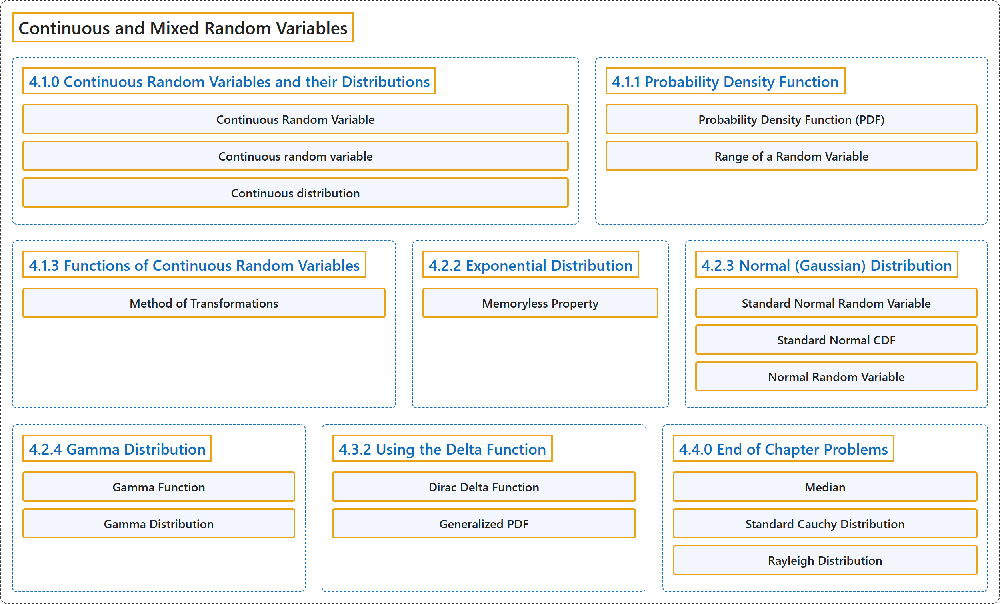

# 4 Continuous and Mixed Random Variables

## Classification

## Glossary

| Term | Definition | 中文翻译 | Source |
|---|---|---|---|
| **4 Continuous and Mixed Random Variables** 连续与混合随机变量 | (No definition) | （无定义） | [Pishro-Nik, 2014, chapter 4](https://www.probabilitycourse.com/) |
| **4.1.0 Continuous Random Variables and their Distributions** 连续随机变量及其分布 | (No definition) | （无定义） | [Pishro-Nik, 2014, section 4.1.0](https://www.probabilitycourse.com/chapter4/4_1_0_continuous_random_vars_distributions.php) |
| **Continuous Random Variable** 连续型随机变量 | "A random variable $X$ with CDF $F_X(x)$ is said to be **continuous** if $F_X(x)$ is a continuous function for all $x \in \mathbb{R}$." | 若随机变量 $X$ 的 CDF $F_X(x)$ 对所有 $x \in \mathbb{R}$ 都是连续函数，则称 $X$ 是**连续**的。 | [Pishro-Nik, 2014, section 4.1.0](https://www.probabilitycourse.com/chapter4/4_1_0_continuous_random_vars_distributions.php#:~:text=A%20random%20variable%20with%20CDF%20is) |
| **Continuous random variable** 连续随机变量 | (context) "A random variable is a **measurable function from a probability space** ... into **a measurable space** ... known as the state space ..." | （语境）随机变量是**从概率空间到可测空间的可测函数**……后者称为**状态空间**…… | [Weisstein, n.d.-b, "Random variable" entry, para. 1](https://mathworld.wolfram.com/RandomVariable.html#:~:text=A%20random%20variable%20is%20a%20measurable%20function) |
| **Continuous distribution** 连续分布 | "A continuous distribution is a statistical distribution for which the variables may take on a **continuous range of values**." | 连续分布是一种统计分布，其中变量可以在**连续的取值范围**内取值。 | [Weisstein, n.d.-a, "Continuous distribution" entry, para. 1](https://mathworld.wolfram.com/ContinuousDistribution.html#:~:text=A%20continuous%20distribution%20is%20a%20statistical%20distribution) |
| **4.1.1 Probability Density Function** 概率密度函数 | (No definition) | （无定义） | [Pishro-Nik, 2014, section 4.1.1](https://www.probabilitycourse.com/chapter4/4_1_1_pdf.php) |
| **Probability Density Function (PDF)** 概率密度函数（PDF） | "Consider a continuous random variable $X$ with an absolutely continuous CDF $F_X(x)$. The function $f_X(x)$ defined by $$f_X(x)=\frac{dF_X(x)}{dx}=F'_X(x), \hspace{20pt} \textrm{if }F_X(x) \textrm{ is differentiable at }x$$ is called the **probability density function (PDF)** of $X$." | 考虑具有绝对连续 CDF $F_X(x)$ 的连续型随机变量 $X$。由 $$f_X(x)=\frac{dF_X(x)}{dx}=F'_X(x), \hspace{20pt} \textrm{if }F_X(x) \textrm{ is differentiable at }x$$ 定义的函数 $f_X(x)$ 称为 $X$ 的**概率密度函数**（PDF）。 | [Pishro-Nik, 2014, section 4.1.1](https://www.probabilitycourse.com/chapter4/4_1_1_pdf.php#:~:text=Consider%20a%20continuous%20random%20variable%20with) |
| **Range of a Random Variable** 随机变量的值域 | "The **range** of a random variable $X$ is the set of possible values of the random variable." | 随机变量 $X$ 的**值域**是该随机变量所有可能取值构成的集合。 | [Pishro-Nik, 2014, section 4.1.1](https://www.probabilitycourse.com/chapter4/4_1_1_pdf.php#:~:text=The%20range%20of%20a%20random%20variable) |
| **4.1.3 Functions of Continuous Random Variables** 连续随机变量的函数 | (No definition) | （无定义） | [Pishro-Nik, 2014, section 4.1.3](https://www.probabilitycourse.com/chapter4/4_1_3_functions_continuous_var.php) |
| **Method of Transformations** 变换法 | "Suppose that $X$ is a continuous random variable and $g: \mathbb{R}\rightarrow \mathbb{R}$ is a **strictly monotonic differentiable function**." | 设 $X$ 为连续随机变量，$g: \mathbb{R}\rightarrow \mathbb{R}$ 为**严格单调可微函数**。 | [Pishro-Nik, 2014, section 4.1.3](https://www.probabilitycourse.com/chapter4/4_1_3_functions_continuous_var.php#:~:text=Suppose%20that%20is%20a%20continuous%20random) |
| **4.2.2 Exponential Distribution** 指数分布 | (No definition) | （无定义） | [Pishro-Nik, 2014, section 4.2.2](https://www.probabilitycourse.com/chapter4/4_2_2_exponential.php) |
| **Memoryless Property** 无记忆性 | "The most important of these properties is that the exponential distribution is **memoryless**." | 这些性质中最重要的是指数分布是**无记忆的**。 | [Pishro-Nik, 2014, section 4.2.2](https://www.probabilitycourse.com/chapter4/4_2_2_exponential.php#:~:text=The%20most%20important%20of%20these%20properties) |
| **4.2.3 Normal (Gaussian) Distribution** 正态（高斯）分布 | (No definition) | （无定义） | [Pishro-Nik, 2014, section 4.2.3](https://www.probabilitycourse.com/chapter4/4_2_3_normal.php) |
| **Standard Normal Random Variable** 标准正态随机变量 | "We first define the **standard normal random variable**." | 我们首先定义**标准正态随机变量**。 | [Pishro-Nik, 2014, section 4.2.3](https://www.probabilitycourse.com/chapter4/4_2_3_normal.php#:~:text=We%20first%20define%20the%20standard%20normal) |
| **Standard Normal CDF** 标准正态分布函数 | "We usually denote the **standard normal CDF** by $\Phi$." | 我们通常用 $\Phi$ 表示**标准正态分布函数**。 | [Pishro-Nik, 2014, section 4.2.3](https://www.probabilitycourse.com/chapter4/4_2_3_normal.php#:~:text=We%20usually%20denote%20the%20standard%20normal) |
| **Normal Random Variable** 正态随机变量 | "We say that $X$ is a **normal random variable** with mean $\mu$ and variance $\sigma^2$." | 我们称 $X$ 是均值为 $\mu$、方差为 $\sigma^2$ 的**正态随机变量**。 | [Pishro-Nik, 2014, section 4.2.3](https://www.probabilitycourse.com/chapter4/4_2_3_normal.php#:~:text=We%20say%20that%20is%20a%20normal) |
| **4.2.4 Gamma Distribution** 伽马分布 | (No definition) | （无定义） | [Pishro-Nik, 2014, section 4.2.4](https://www.probabilitycourse.com/chapter4/4_2_4_Gamma_distribution.php) |
| **Gamma Function** 伽马函数 | "The **gamma function** [ 10 ], shown by $\Gamma(x)$, is an **extension of the factorial function** to real (and complex) numbers." | **伽马函数** [ 10 ] 记作 $\Gamma(x)$，是**阶乘函数的推广**，定义域扩展到实数（和复数）。 | [Pishro-Nik, 2014, section 4.2.4](https://www.probabilitycourse.com/chapter4/4_2_4_Gamma_distribution.php#:~:text=The%20gamma%20function%20%5B%2010%20%5D%2C) |
| **Gamma Distribution** 伽马分布 | "The **gamma distribution** is another widely used distribution." | **伽马分布**是另一种应用广泛的分布。 | [Pishro-Nik, 2014, section 4.2.4](https://www.probabilitycourse.com/chapter4/4_2_4_Gamma_distribution.php#:~:text=The%20gamma%20distribution%20is%20another%20widely) |
| **4.3.2 Using the Delta Function** 使用狄拉克δ函数 | (No definition) | （无定义） | [Pishro-Nik, 2014, section 4.3.2](https://www.probabilitycourse.com/chapter4/4_3_2_delta_function.php) |
| **Dirac Delta Function** 狄拉克δ函数 | "We define the **delta function** $\delta(x)$ as an object with the following properties:" | 我们将**δ函数** $\delta(x)$ 定义为具有以下性质的对象： | [Pishro-Nik, 2014, section 4.3.2](https://www.probabilitycourse.com/chapter4/4_3_2_delta_function.php#:~:text=We%20define%20the%20delta%20function%20as) |
| **Generalized PDF** 广义概率密度函数 | "We call this the **generalized PDF**." | 我们称之为**广义概率密度函数**。 | [Pishro-Nik, 2014, section 4.3.2](https://www.probabilitycourse.com/chapter4/4_3_2_delta_function.php#:~:text=We%20call%20this%20the%20generalized%20PDF.) |
| **4.4.0 End of Chapter Problems** 章末习题 | (No definition) | （无定义） | [Pishro-Nik, 2014, section 4.4.0](https://www.probabilitycourse.com/chapter4/4_4_0_chapter4_problems.php) |
| **Median** 中位数 | "The **median** of a continuous random variable $X$ can be defined as the **unique real number m** that satisfies" | 连续随机变量 $X$ 的**中位数**可以定义为满足下式的**唯一实数 m** | [Pishro-Nik, 2014, section 4.4.0](https://www.probabilitycourse.com/chapter4/4_4_0_chapter4_problems.php#:~:text=The%20median%20of%20a%20continuous%20random) |
| **Standard Cauchy Distribution** 标准柯西分布 | "A continuous random variable is said to have the **standard Cauchy distribution** if its PDF is given by" | 若连续随机变量的概率密度函数由下式给出，则称其服从**标准柯西分布** | [Pishro-Nik, 2014, section 4.4.0](https://www.probabilitycourse.com/chapter4/4_4_0_chapter4_problems.php#:~:text=A%20continuous%20random%20variable%20is%20said) |
| **Rayleigh Distribution** 瑞利分布 | "A continuous random variable is said to have a **Rayleigh distribution** with parameter $\sigma$ if its PDF is given by" | 若连续随机变量的概率密度函数由下式给出，则称其服从参数为 $\sigma$ 的**瑞利分布** | [Pishro-Nik, 2014, section 4.4.0](https://www.probabilitycourse.com/chapter4/4_4_0_chapter4_problems.php#:~:text=A%20continuous%20random%20variable%20is%20said) |

## References

Pishro-Nik, H. (2014). *Introduction to probability, statistics, and random processes*. Kappa Research. Retrieved October 28, 2026, from <https://www.probabilitycourse.com/>

Weisstein, E. W. (n.d.-a). *Continuous distribution*. MathWorld: A Wolfram Resource. Retrieved October 27, 2026, from <https://mathworld.wolfram.com/ContinuousDistribution.html>

Weisstein, E. W. (n.d.-b). *Random variable*. MathWorld: A Wolfram Resource. Retrieved October 27, 2026, from <https://mathworld.wolfram.com/RandomVariable.html>
