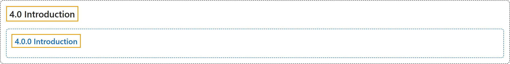

# 4.0 Introduction

## Classification

## Glossary

| Term | Definition | 中文翻译 | Source |
|---|---|---|---|
| **4.0 Introduction** 介绍 | (No definition) | （无定义） | [Pishro-Nik, 2014, section 4.0](https://www.probabilitycourse.com/chapter4/4_0_0_intro.php) |
| **4.0.0 Introduction** 介绍 | (No definition) | （无定义） | [Pishro-Nik, 2014, section 4.0.0](https://www.probabilitycourse.com/chapter4/4_0_0_intro.php) |

## References

Pishro-Nik, H. (2014). *Introduction to probability, statistics, and random processes*. Kappa Research. Retrieved October 28, 2026, from <https://www.probabilitycourse.com/>
