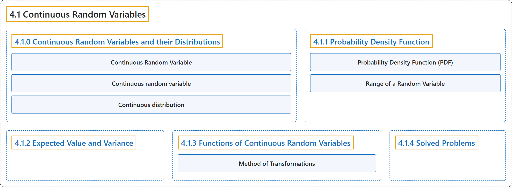

# 4.1 Continuous Random Variables

## Classification

## Glossary

| Term | Definition | 中文翻译 | Source |
|---|---|---|---|
| **4.1 Continuous Random Variables** 连续随机变量 | (No definition) | （无定义） | [Pishro-Nik, 2014, section 4.1](https://www.probabilitycourse.com/chapter4/4_1_0_continuous_random_vars_distributions.php) |
| **4.1.0 Continuous Random Variables and their Distributions** 连续随机变量及其分布 | (No definition) | （无定义） | [Pishro-Nik, 2014, section 4.1.0](https://www.probabilitycourse.com/chapter4/4_1_0_continuous_random_vars_distributions.php) |
| **Continuous Random Variable** 连续型随机变量 | "A random variable $X$ with CDF $F_X(x)$ is said to be **continuous** if $F_X(x)$ is a continuous function for all $x \in \mathbb{R}$." | 若随机变量 $X$ 的 CDF $F_X(x)$ 对所有 $x \in \mathbb{R}$ 都是连续函数，则称 $X$ 是**连续**的。 | [Pishro-Nik, 2014, section 4.1.0](https://www.probabilitycourse.com/chapter4/4_1_0_continuous_random_vars_distributions.php#:~:text=A%20random%20variable%20with%20CDF%20is) |
| **Continuous random variable** 连续随机变量 | (context) "A random variable is a **measurable function from a probability space** ... into **a measurable space** ... known as the state space ..." | （语境）随机变量是**从概率空间到可测空间的可测函数**……后者称为**状态空间**…… | [Weisstein, n.d.-b, "Random variable" entry, para. 1](https://mathworld.wolfram.com/RandomVariable.html#:~:text=A%20random%20variable%20is%20a%20measurable%20function) |
| **Continuous distribution** 连续分布 | "A continuous distribution is a statistical distribution for which the variables may take on a **continuous range of values**." | 连续分布是一种统计分布，其中变量可以在**连续的取值范围**内取值。 | [Weisstein, n.d.-a, "Continuous distribution" entry, para. 1](https://mathworld.wolfram.com/ContinuousDistribution.html#:~:text=A%20continuous%20distribution%20is%20a%20statistical%20distribution) |
| **4.1.1 Probability Density Function** 概率密度函数 | (No definition) | （无定义） | [Pishro-Nik, 2014, section 4.1.1](https://www.probabilitycourse.com/chapter4/4_1_1_pdf.php) |
| **Probability Density Function (PDF)** 概率密度函数（PDF） | "Consider a continuous random variable $X$ with an absolutely continuous CDF $F_X(x)$. The function $f_X(x)$ defined by $$f_X(x)=\frac{dF_X(x)}{dx}=F'_X(x), \hspace{20pt} \textrm{if }F_X(x) \textrm{ is differentiable at }x$$ is called the **probability density function (PDF)** of $X$." | 考虑具有绝对连续 CDF $F_X(x)$ 的连续型随机变量 $X$。由 $$f_X(x)=\frac{dF_X(x)}{dx}=F'_X(x), \hspace{20pt} \textrm{if }F_X(x) \textrm{ is differentiable at }x$$ 定义的函数 $f_X(x)$ 称为 $X$ 的**概率密度函数**（PDF）。 | [Pishro-Nik, 2014, section 4.1.1](https://www.probabilitycourse.com/chapter4/4_1_1_pdf.php#:~:text=Consider%20a%20continuous%20random%20variable%20with) |
| **Range of a Random Variable** 随机变量的值域 | "The **range** of a random variable $X$ is the set of possible values of the random variable." | 随机变量 $X$ 的**值域**是该随机变量所有可能取值构成的集合。 | [Pishro-Nik, 2014, section 4.1.1](https://www.probabilitycourse.com/chapter4/4_1_1_pdf.php#:~:text=The%20range%20of%20a%20random%20variable) |
| **4.1.2 Expected Value and Variance** 期望与方差 | (No definition) | （无定义） | [Pishro-Nik, 2014, section 4.1.2](https://www.probabilitycourse.com/chapter4/4_1_2_expected_val_variance.php) |
| **4.1.3 Functions of Continuous Random Variables** 连续随机变量的函数 | (No definition) | （无定义） | [Pishro-Nik, 2014, section 4.1.3](https://www.probabilitycourse.com/chapter4/4_1_3_functions_continuous_var.php) |
| **Method of Transformations** 变换法 | "Suppose that $X$ is a continuous random variable and $g: \mathbb{R}\rightarrow \mathbb{R}$ is a **strictly monotonic differentiable function**." | 设 $X$ 为连续随机变量，$g: \mathbb{R}\rightarrow \mathbb{R}$ 为**严格单调可微函数**。 | [Pishro-Nik, 2014, section 4.1.3](https://www.probabilitycourse.com/chapter4/4_1_3_functions_continuous_var.php#:~:text=Suppose%20that%20is%20a%20continuous%20random) |
| **4.1.4 Solved Problems** 例题详解 | (No definition) | （无定义） | [Pishro-Nik, 2014, section 4.1.4](https://www.probabilitycourse.com/chapter4/4_1_4_solved4_1.php) |

## References

Pishro-Nik, H. (2014). *Introduction to probability, statistics, and random processes*. Kappa Research. Retrieved October 28, 2026, from <https://www.probabilitycourse.com/>

Weisstein, E. W. (n.d.-a). *Continuous distribution*. MathWorld: A Wolfram Resource. Retrieved October 27, 2026, from <https://mathworld.wolfram.com/ContinuousDistribution.html>

Weisstein, E. W. (n.d.-b). *Random variable*. MathWorld: A Wolfram Resource. Retrieved October 27, 2026, from <https://mathworld.wolfram.com/RandomVariable.html>
