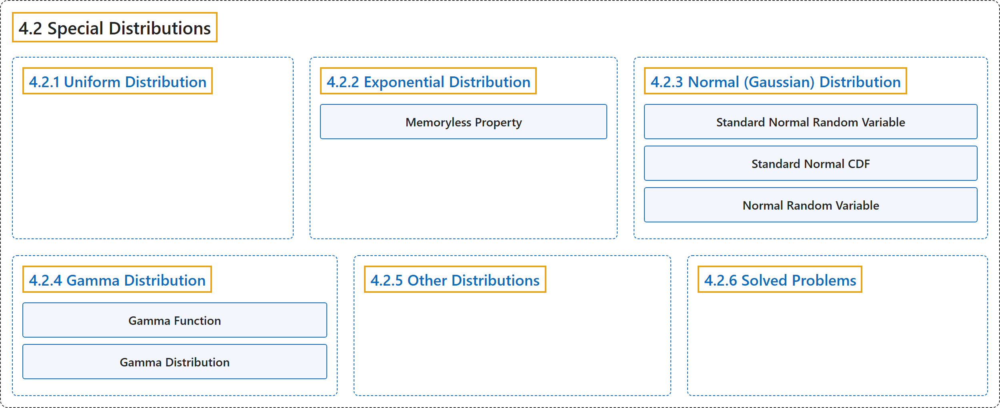

# 4.2 Special Distributions

## Classification

## Glossary

| Term | Definition | 中文翻译 | Source |
|---|---|---|---|
| **4.2 Special Distributions** 特殊分布 | (No definition) | （无定义） | [Pishro-Nik, 2014, section 4.2](https://www.probabilitycourse.com/chapter4/4_2_1_uniform.php) |
| **4.2.1 Uniform Distribution** 均匀分布 | (No definition) | （无定义） | [Pishro-Nik, 2014, section 4.2.1](https://www.probabilitycourse.com/chapter4/4_2_1_uniform.php) |
| **4.2.2 Exponential Distribution** 指数分布 | (No definition) | （无定义） | [Pishro-Nik, 2014, section 4.2.2](https://www.probabilitycourse.com/chapter4/4_2_2_exponential.php) |
| **Memoryless Property** 无记忆性 | "The most important of these properties is that the exponential distribution is **memoryless**." | 这些性质中最重要的是指数分布是**无记忆的**。 | [Pishro-Nik, 2014, section 4.2.2](https://www.probabilitycourse.com/chapter4/4_2_2_exponential.php#:~:text=The%20most%20important%20of%20these%20properties) |
| **4.2.3 Normal (Gaussian) Distribution** 正态（高斯）分布 | (No definition) | （无定义） | [Pishro-Nik, 2014, section 4.2.3](https://www.probabilitycourse.com/chapter4/4_2_3_normal.php) |
| **Standard Normal Random Variable** 标准正态随机变量 | "We first define the **standard normal random variable**." | 我们首先定义**标准正态随机变量**。 | [Pishro-Nik, 2014, section 4.2.3](https://www.probabilitycourse.com/chapter4/4_2_3_normal.php#:~:text=We%20first%20define%20the%20standard%20normal) |
| **Standard Normal CDF** 标准正态分布函数 | "We usually denote the **standard normal CDF** by $\Phi$." | 我们通常用 $\Phi$ 表示**标准正态分布函数**。 | [Pishro-Nik, 2014, section 4.2.3](https://www.probabilitycourse.com/chapter4/4_2_3_normal.php#:~:text=We%20usually%20denote%20the%20standard%20normal) |
| **Normal Random Variable** 正态随机变量 | "We say that $X$ is a **normal random variable** with mean $\mu$ and variance $\sigma^2$." | 我们称 $X$ 是均值为 $\mu$、方差为 $\sigma^2$ 的**正态随机变量**。 | [Pishro-Nik, 2014, section 4.2.3](https://www.probabilitycourse.com/chapter4/4_2_3_normal.php#:~:text=We%20say%20that%20is%20a%20normal) |
| **4.2.4 Gamma Distribution** 伽马分布 | (No definition) | （无定义） | [Pishro-Nik, 2014, section 4.2.4](https://www.probabilitycourse.com/chapter4/4_2_4_Gamma_distribution.php) |
| **Gamma Function** 伽马函数 | "The **gamma function** [ 10 ], shown by $\Gamma(x)$, is an **extension of the factorial function** to real (and complex) numbers." | **伽马函数** [ 10 ] 记作 $\Gamma(x)$，是**阶乘函数的推广**，定义域扩展到实数（和复数）。 | [Pishro-Nik, 2014, section 4.2.4](https://www.probabilitycourse.com/chapter4/4_2_4_Gamma_distribution.php#:~:text=The%20gamma%20function%20%5B%2010%20%5D%2C) |
| **Gamma Distribution** 伽马分布 | "The **gamma distribution** is another widely used distribution." | **伽马分布**是另一种应用广泛的分布。 | [Pishro-Nik, 2014, section 4.2.4](https://www.probabilitycourse.com/chapter4/4_2_4_Gamma_distribution.php#:~:text=The%20gamma%20distribution%20is%20another%20widely) |
| **4.2.5 Other Distributions** 其他分布 | (No definition) | （无定义） | [Pishro-Nik, 2014, section 4.2.5](https://www.probabilitycourse.com/chapter4/4_2_5_other_distr.php) |
| **4.2.6 Solved Problems** 例题详解 | (No definition) | （无定义） | [Pishro-Nik, 2014, section 4.2.6](https://www.probabilitycourse.com/chapter4/4_2_6_solved4_2.php) |

## References

Pishro-Nik, H. (2014). *Introduction to probability, statistics, and random processes*. Kappa Research. Retrieved October 28, 2026, from <https://www.probabilitycourse.com/>
