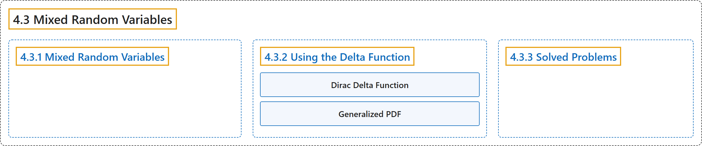

# 4.3 Mixed Random Variables

## Classification

## Glossary

| Term | Definition | 中文翻译 | Source |
|---|---|---|---|
| **4.3 Mixed Random Variables** 混合随机变量 | (No definition) | （无定义） | [Pishro-Nik, 2014, section 4.3](https://www.probabilitycourse.com/chapter4/4_3_1_mixed.php) |
| **4.3.1 Mixed Random Variables** 混合随机变量 | (No definition) | （无定义） | [Pishro-Nik, 2014, section 4.3.1](https://www.probabilitycourse.com/chapter4/4_3_1_mixed.php) |
| **4.3.2 Using the Delta Function** 使用狄拉克δ函数 | (No definition) | （无定义） | [Pishro-Nik, 2014, section 4.3.2](https://www.probabilitycourse.com/chapter4/4_3_2_delta_function.php) |
| **Dirac Delta Function** 狄拉克δ函数 | "We define the **delta function** $\delta(x)$ as an object with the following properties:" | 我们将**δ函数** $\delta(x)$ 定义为具有以下性质的对象： | [Pishro-Nik, 2014, section 4.3.2](https://www.probabilitycourse.com/chapter4/4_3_2_delta_function.php#:~:text=We%20define%20the%20delta%20function%20as) |
| **Generalized PDF** 广义概率密度函数 | "We call this the **generalized PDF**." | 我们称之为**广义概率密度函数**。 | [Pishro-Nik, 2014, section 4.3.2](https://www.probabilitycourse.com/chapter4/4_3_2_delta_function.php#:~:text=We%20call%20this%20the%20generalized%20PDF.) |
| **4.3.3 Solved Problems** 例题详解 | (No definition) | （无定义） | [Pishro-Nik, 2014, section 4.3.3](https://www.probabilitycourse.com/chapter4/4_3_3_solved4_3.php) |

## References

Pishro-Nik, H. (2014). *Introduction to probability, statistics, and random processes*. Kappa Research. Retrieved October 28, 2026, from <https://www.probabilitycourse.com/>
