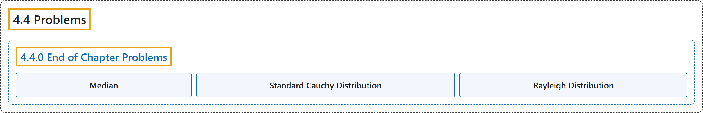

# 4.4 Problems

## Classification

## Glossary

| Term | Definition | 中文翻译 | Source |
|---|---|---|---|
| **4.4 Problems** 习题 | (No definition) | （无定义） | [Pishro-Nik, 2014, section 4.4](https://www.probabilitycourse.com/chapter4/4_4_0_chapter4_problems.php) |
| **4.4.0 End of Chapter Problems** 章末习题 | (No definition) | （无定义） | [Pishro-Nik, 2014, section 4.4.0](https://www.probabilitycourse.com/chapter4/4_4_0_chapter4_problems.php) |
| **Median** 中位数 | "The **median** of a continuous random variable $X$ can be defined as the **unique real number m** that satisfies" | 连续随机变量 $X$ 的**中位数**可以定义为满足下式的**唯一实数 m** | [Pishro-Nik, 2014, section 4.4.0](https://www.probabilitycourse.com/chapter4/4_4_0_chapter4_problems.php#:~:text=The%20median%20of%20a%20continuous%20random) |
| **Standard Cauchy Distribution** 标准柯西分布 | "A continuous random variable is said to have the **standard Cauchy distribution** if its PDF is given by" | 若连续随机变量的概率密度函数由下式给出，则称其服从**标准柯西分布** | [Pishro-Nik, 2014, section 4.4.0](https://www.probabilitycourse.com/chapter4/4_4_0_chapter4_problems.php#:~:text=A%20continuous%20random%20variable%20is%20said) |
| **Rayleigh Distribution** 瑞利分布 | "A continuous random variable is said to have a **Rayleigh distribution** with parameter $\sigma$ if its PDF is given by" | 若连续随机变量的概率密度函数由下式给出，则称其服从参数为 $\sigma$ 的**瑞利分布** | [Pishro-Nik, 2014, section 4.4.0](https://www.probabilitycourse.com/chapter4/4_4_0_chapter4_problems.php#:~:text=A%20continuous%20random%20variable%20is%20said) |

## References

Pishro-Nik, H. (2014). *Introduction to probability, statistics, and random processes*. Kappa Research. Retrieved October 28, 2026, from <https://www.probabilitycourse.com/>
