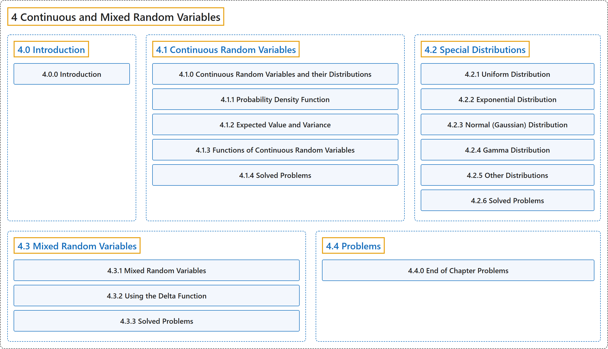

# 4 Continuous and Mixed Random Variables

## Classification

## Glossary

| Term | Definition | 中文翻译 | Source |
|---|---|---|---|
| **4 Continuous and Mixed Random Variables** 连续与混合随机变量 | (No definition) | （无定义） | [Pishro-Nik, 2014, chapter 4](https://www.probabilitycourse.com/) |
| **[4.0 Introduction](4-0-introduction.md)** 介绍 | (No definition) | （无定义） | [Pishro-Nik, 2014, section 4.0](https://www.probabilitycourse.com/chapter4/4_0_0_intro.php) |
| **[4.1 Continuous Random Variables](4-1-continuous-random-variables.md)** 连续随机变量 | (No definition) | （无定义） | [Pishro-Nik, 2014, section 4.1](https://www.probabilitycourse.com/chapter4/4_1_0_continuous_random_vars_distributions.php) |
| **[4.2 Special Distributions](4-2-special-distributions.md)** 特殊分布 | (No definition) | （无定义） | [Pishro-Nik, 2014, section 4.2](https://www.probabilitycourse.com/chapter4/4_2_1_uniform.php) |
| **[4.3 Mixed Random Variables](4-3-mixed-random-variables.md)** 混合随机变量 | (No definition) | （无定义） | [Pishro-Nik, 2014, section 4.3](https://www.probabilitycourse.com/chapter4/4_3_1_mixed.php) |
| **[4.4 Problems](4-4-problems.md)** 习题 | (No definition) | （无定义） | [Pishro-Nik, 2014, section 4.4](https://www.probabilitycourse.com/chapter4/4_4_0_chapter4_problems.php) |

## References

Pishro-Nik, H. (2014). *Introduction to probability, statistics, and random processes*. Kappa Research. Retrieved October 28, 2026, from <https://www.probabilitycourse.com/>
