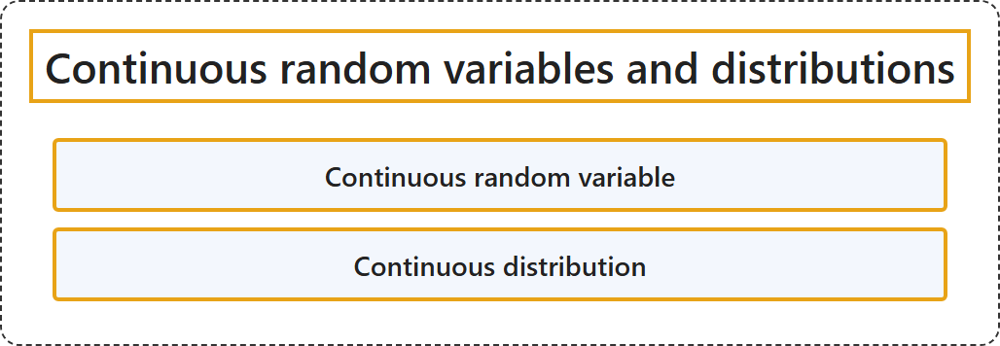

# 2.3 Continuous Random Variables and Distributions

## Classification

## Glossary

| Term | Definition | 中文翻译 | Source |
|---|---|---|---|
| **Continuous random variable** 连续随机变量 | (context) "A random variable is a **measurable function from a probability space** ... into **a measurable space** ... known as the state space ..." | （语境）随机变量是**从概率空间到可测空间的可测函数**……后者称为**状态空间**…… | [Weisstein, n.d.-b, "Random variable" entry, para. 1](https://mathworld.wolfram.com/RandomVariable.html#:~:text=A%20random%20variable%20is%20a%20measurable%20function) |
| **Continuous distribution** 连续分布 | "A continuous distribution is a statistical distribution for which the variables may take on a **continuous range of values**." | 连续分布是一种统计分布，其中变量可以在**连续的取值范围**内取值。 | [Weisstein, n.d.-a, "Continuous distribution" entry, para. 1](https://mathworld.wolfram.com/ContinuousDistribution.html#:~:text=A%20continuous%20distribution%20is%20a%20statistical%20distribution) |

## References

- Joint Task Force on Computing Curricula. (2024). *Computer science curricula 2023*. Association for Computing Machinery. <https://doi.org/10.1145/3664191>
- Weisstein, E. W. (n.d.-a). *Continuous distribution*. MathWorld: A Wolfram Resource. Retrieved October 27, 2026, from <https://mathworld.wolfram.com/ContinuousDistribution.html>
- Weisstein, E. W. (n.d.-b). *Random variable*. MathWorld: A Wolfram Resource. Retrieved October 27, 2026, from <https://mathworld.wolfram.com/RandomVariable.html>
