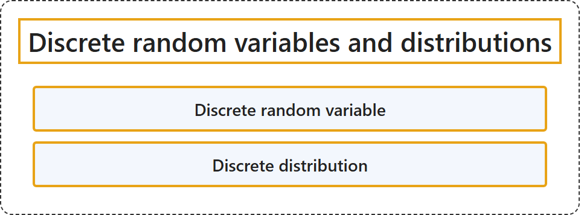

# 2.2 Discrete random variables and distributions

## Classification

## Glossary

| Term | Definition | 中文翻译 | Source |
|---|---|---|---|
| **Discrete random variable** 离散随机变量 | (context) "A random variable is a **measurable function from a probability space** ... into **a measurable space** ... known as the state space ..." | （语境）随机变量是**从概率空间到可测空间的可测函数**……后者称为**状态空间**…… | [Weisstein, n.d.-b, "Random variable" entry, para. 1](https://mathworld.wolfram.com/RandomVariable.html#:~:text=A%20random%20variable%20is%20a%20measurable%20function) |
| **Discrete distribution** 离散分布 | "A discrete distribution is a statistical distribution whose random variable takes values in a **countable set** almost surely." | 离散分布是一种统计分布，它的随机变量几乎必然在一个**可数集合**中取值。 | [Weisstein, n.d.-a, "Discrete distribution" entry, para. 1](https://mathworld.wolfram.com/DiscreteDistribution.html#:~:text=A%20discrete%20distribution%20is%20a%20statistical%20distribution) |

## References

- Joint Task Force on Computing Curricula. (2024). *Computer science curricula 2023*. Association for Computing Machinery. <https://doi.org/10.1145/3664191>
- Weisstein, E. W. (n.d.-a). *Discrete distribution*. MathWorld: A Wolfram Resource. Retrieved October 27, 2026, from <https://mathworld.wolfram.com/DiscreteDistribution.html>
- Weisstein, E. W. (n.d.-b). *Random variable*. MathWorld: A Wolfram Resource. Retrieved October 27, 2026, from <https://mathworld.wolfram.com/RandomVariable.html>
