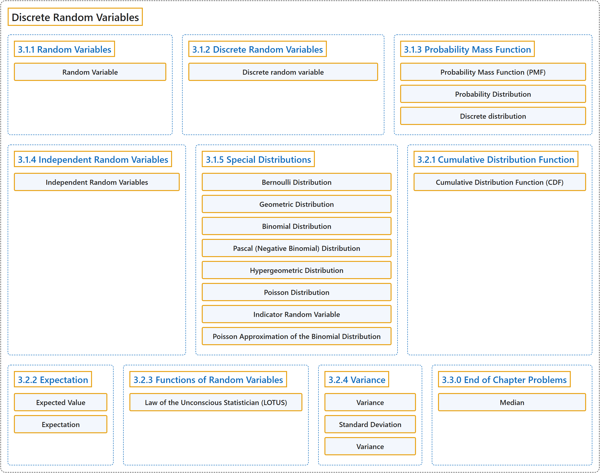

# 3 Discrete Random Variables

## Classification

## Glossary

| Term | Definition | 中文翻译 | Source |
|---|---|---|---|
| **3 Discrete Random Variables** 离散随机变量 | (No definition) | （无定义） | [Pishro-Nik, 2014, chapter 3](https://www.probabilitycourse.com/) |
| **3.1.1 Random Variables** 随机变量 | (No definition) | （无定义） | [Pishro-Nik, 2014, section 3.1.1](https://www.probabilitycourse.com/chapter3/3_1_1_random_variables.php) |
| **Random Variable** 随机变量 | "A **random variable** $X$ is a function from the sample space to the real numbers." | **随机变量** $X$ 是从样本空间到实数集的函数。 | [Pishro-Nik, 2014, section 3.1.1](https://www.probabilitycourse.com/chapter3/3_1_1_random_variables.php#:~:text=A%20random%20variable%20is%20a%20function) |
| **3.1.2 Discrete Random Variables** 离散随机变量 | (No definition) | （无定义） | [Pishro-Nik, 2014, section 3.1.2](https://www.probabilitycourse.com/chapter3/3_1_2_discrete_random_var.php) |
| **Discrete random variable** 离散随机变量 | (context) "A random variable is a **measurable function from a probability space** ... into **a measurable space** ... known as the state space ..." | （语境）随机变量是**从概率空间到可测空间的可测函数**……后者称为**状态空间**…… | [Weisstein, n.d.-c, "Random variable" entry, para. 1](https://mathworld.wolfram.com/RandomVariable.html#:~:text=A%20random%20variable%20is%20a%20measurable%20function) |
| **3.1.3 Probability Mass Function** 概率质量函数 | (No definition) | （无定义） | [Pishro-Nik, 2014, section 3.1.3](https://www.probabilitycourse.com/chapter3/3_1_3_pmf.php) |
| **Probability Mass Function (PMF)** 概率质量函数（PMF） | "Let $X$ be a discrete random variable with range $R_X=\{x_1,x_2,x_3,...\}$ (finite or countably infinite). The function $$P_X(x_k)=P(X=x_k), \textrm{ for } k=1,2,3,...,$$ is called the **probability mass function (PMF)** of $X$." | 设 $X$ 是取值范围为 $R_X=\{x_1,x_2,x_3,...\}$（有限或可数无限）的离散随机变量。函数 $$P_X(x_k)=P(X=x_k), \textrm{ for } k=1,2,3,...,$$ 称为 $X$ 的**概率质量函数**（PMF）。 | [Pishro-Nik, 2014, section 3.1.3](https://www.probabilitycourse.com/chapter3/3_1_3_pmf.php#:~:text=Let%20be%20a%20discrete%20random%20variable) |
| **Probability Distribution** 概率分布 | "For discrete random variables, the PMF is also called the **probability distribution**." | 对于离散随机变量，PMF 也称为**概率分布**。 | [Pishro-Nik, 2014, section 3.1.3](https://www.probabilitycourse.com/chapter3/3_1_3_pmf.php#:~:text=For%20discrete%20random%20variables%2C%20the%20PMF) |
| **Discrete distribution** 离散分布 | "A discrete distribution is a statistical distribution whose random variable takes values in a **countable set** almost surely." | 离散分布是一种统计分布，它的随机变量几乎必然在一个**可数集合**中取值。 | [Weisstein, n.d.-a, "Discrete distribution" entry, para. 1](https://mathworld.wolfram.com/DiscreteDistribution.html#:~:text=A%20discrete%20distribution%20is%20a%20statistical%20distribution) |
| **3.1.4 Independent Random Variables** 独立随机变量 | (No definition) | （无定义） | [Pishro-Nik, 2014, section 3.1.4](https://www.probabilitycourse.com/chapter3/3_1_4_independent_random_var.php) |
| **Independent Random Variables** 独立随机变量 | "Consider two discrete random variables $X$ and $Y$. We say that $X$ and $Y$ are **independent** if $$P\bigg(X=x,Y=y\bigg)=P(X=x) P(Y=y), \hspace{20pt} \textrm{ for all } x,y.$$" | 考虑两个离散随机变量 $X$ 和 $Y$。若 $$P\bigg(X=x,Y=y\bigg)=P(X=x) P(Y=y), \hspace{20pt} \textrm{ for all } x,y.$$ 则称 $X$ 和 $Y$ **相互独立**。 | [Pishro-Nik, 2014, section 3.1.4](https://www.probabilitycourse.com/chapter3/3_1_4_independent_random_var.php#:~:text=Consider%20two%20discrete%20random%20variables%20and) |
| **3.1.5 Special Distributions** 特殊分布 | (No definition) | （无定义） | [Pishro-Nik, 2014, section 3.1.5](https://www.probabilitycourse.com/chapter3/3_1_5_special_discrete_distr.php) |
| **Bernoulli Distribution** 伯努利分布 | "A random variable $X$ is said to be a **Bernoulli random variable** with parameter $p$, shown as $X \sim Bernoulli(p)$, if its PMF is given by $$\begin{equation} \nonumber P_X(x) = \left\{ \begin{array}{l l} p& \quad \text{for } x=1\\ 1-p & \quad \text{ for } x=0\\ 0 & \quad \text{ otherwise} \end{array} \right. \end{equation}$$ where $0 < p < 1$." | 若随机变量 $X$ 的 PMF 为 $$\begin{equation} \nonumber P_X(x) = \left\{ \begin{array}{l l} p& \quad \text{for } x=1\\ 1-p & \quad \text{ for } x=0\\ 0 & \quad \text{ otherwise} \end{array} \right. \end{equation}$$ 其中 $0 < p < 1$，则称 $X$ 为参数为 $p$ 的**伯努利随机变量**，记作 $X \sim Bernoulli(p)$。 | [Pishro-Nik, 2014, section 3.1.5](https://www.probabilitycourse.com/chapter3/3_1_5_special_discrete_distr.php#:~:text=A%20random%20variable%20is%20said%20to) |
| **Geometric Distribution** 几何分布 | "A random variable $X$ is said to be a **geometric random variable** with parameter $p$, shown as $X \sim Geometric(p)$, if its PMF is given by $$\begin{equation} \nonumber P_X(k) = \left\{ \begin{array}{l l} p(1-p)^{k-1}& \quad \text{for } k=1,2,3,...\\ 0 & \quad \text{ otherwise} \end{array} \right. \end{equation}$$ where $0 < p < 1$." | 若随机变量 $X$ 的 PMF 为 $$\begin{equation} \nonumber P_X(k) = \left\{ \begin{array}{l l} p(1-p)^{k-1}& \quad \text{for } k=1,2,3,...\\ 0 & \quad \text{ otherwise} \end{array} \right. \end{equation}$$ 其中 $0 < p < 1$，则称 $X$ 为参数为 $p$ 的**几何随机变量**，记作 $X \sim Geometric(p)$。 | [Pishro-Nik, 2014, section 3.1.5](https://www.probabilitycourse.com/chapter3/3_1_5_special_discrete_distr.php#:~:text=A%20random%20variable%20is%20said%20to) |
| **Binomial Distribution** 二项分布 | "A random variable $X$ is said to be a **binomial random variable** with parameters $n$ and $p$, shown as $X \sim Binomial(n,p)$, if its PMF is given by $$\begin{equation} \nonumber P_X(k) = \left\{ \begin{array}{l l} {n \choose k}p^k(1-p)^{n-k}& \quad \text{for } k=0,1,2,\cdots,n\\ 0 & \quad \text{otherwise} \end{array} \right. \end{equation}$$ where $0 < p < 1$." | 若随机变量 $X$ 的 PMF 为 $$\begin{equation} \nonumber P_X(k) = \left\{ \begin{array}{l l} {n \choose k}p^k(1-p)^{n-k}& \quad \text{for } k=0,1,2,\cdots,n\\ 0 & \quad \text{otherwise} \end{array} \right. \end{equation}$$ 其中 $0 < p < 1$，则称 $X$ 为参数为 $n$ 和 $p$ 的**二项随机变量**，记作 $X \sim Binomial(n,p)$。 | [Pishro-Nik, 2014, section 3.1.5](https://www.probabilitycourse.com/chapter3/3_1_5_special_discrete_distr.php#:~:text=A%20random%20variable%20is%20said%20to) |
| **Pascal (Negative Binomial) Distribution** 帕斯卡分布（负二项分布） | "A random variable $X$ is said to be a **Pascal random variable** with parameters $m$ and $p$, shown as $X \sim Pascal(m,p)$, if its PMF is given by $$\begin{equation} \nonumber P_X(k) = \left\{ \begin{array}{l l} {k-1 \choose m-1} p^{m}(1-p)^{k-m}& \quad \text{for } k=m,m+1,m+2,m+3,...\\ 0 & \quad \text{otherwise} \end{array} \right. \end{equation}$$ where $0 < p < 1$." | 若随机变量 $X$ 的 PMF 为 $$\begin{equation} \nonumber P_X(k) = \left\{ \begin{array}{l l} {k-1 \choose m-1} p^{m}(1-p)^{k-m}& \quad \text{for } k=m,m+1,m+2,m+3,...\\ 0 & \quad \text{otherwise} \end{array} \right. \end{equation}$$ 其中 $0 < p < 1$，则称 $X$ 为参数为 $m$ 和 $p$ 的**帕斯卡随机变量**，记作 $X \sim Pascal(m,p)$。 | [Pishro-Nik, 2014, section 3.1.5](https://www.probabilitycourse.com/chapter3/3_1_5_special_discrete_distr.php#:~:text=A%20random%20variable%20is%20said%20to) |
| **Hypergeometric Distribution** 超几何分布 | "A random variable $X$ is said to be a **Hypergeometric random variable** with parameters $b, r$ and $k$, shown as $X \sim Hypergeometric(b,r,k)$, if its range is $R_X=\{\max(0,k-r), \max(0,k-r)+1, \max(0,k-r)+2,..., \min(k,b)\}$, and its PMF is given by $$\begin{equation} \nonumber P_X(x) = \left\{ \begin{array}{l l} \frac{{b \choose x} {r \choose k-x}}{{b+r \choose k}}& \quad \text{for } x \in R_X\\ 0 & \quad \text{otherwise} \end{array} \right. \end{equation}$$" | 设随机变量 $X$ 的取值范围为 $R_X=\{\max(0,k-r), \max(0,k-r)+1, \max(0,k-r)+2,..., \min(k,b)\}$，其 PMF 为 $$\begin{equation} \nonumber P_X(x) = \left\{ \begin{array}{l l} \frac{{b \choose x} {r \choose k-x}}{{b+r \choose k}}& \quad \text{for } x \in R_X\\ 0 & \quad \text{otherwise} \end{array} \right. \end{equation}$$，则称 $X$ 为参数为 $b, r$ 和 $k$ 的**超几何随机变量**，记作 $X \sim Hypergeometric(b,r,k)$。 | [Pishro-Nik, 2014, section 3.1.5](https://www.probabilitycourse.com/chapter3/3_1_5_special_discrete_distr.php#:~:text=A%20random%20variable%20is%20said%20to) |
| **Poisson Distribution** 泊松分布 | "A random variable $X$ is said to be a **Poisson random variable** with parameter $\lambda$, shown as $X \sim Poisson(\lambda)$, if its range is $R_X=\{0,1,2,3,...\}$, and its PMF is given by $$\begin{equation} \nonumber P_X(k) = \left\{ \begin{array}{l l} \frac{e^{-\lambda} \lambda^k}{k!}& \quad \text{for } k \in R_X\\ 0 & \quad \text{ otherwise} \end{array} \right. \end{equation}$$" | 若随机变量 $X$ 的取值范围为 $R_X=\{0,1,2,3,...\}$，其 PMF 为 $$\begin{equation} \nonumber P_X(k) = \left\{ \begin{array}{l l} \frac{e^{-\lambda} \lambda^k}{k!}& \quad \text{for } k \in R_X\\ 0 & \quad \text{ otherwise} \end{array} \right. \end{equation}$$，则称 $X$ 为参数为 $\lambda$ 的**泊松随机变量**，记作 $X \sim Poisson(\lambda)$。 | [Pishro-Nik, 2014, section 3.1.5](https://www.probabilitycourse.com/chapter3/3_1_5_special_discrete_distr.php#:~:text=A%20random%20variable%20is%20said%20to) |
| **Indicator Random Variable** 示性随机变量（指示随机变量） | "For this reason the Bernoulli random variable, is also called the **indicator random variable**. In particular, the indicator random variable $I_A$ for an event $A$ is defined by" | 因此伯努利随机变量也称为**指示随机变量**。具体地说，事件 $A$ 的指示随机变量 $I_A$ 定义为 | [Pishro-Nik, 2014, section 3.1.5](https://www.probabilitycourse.com/chapter3/3_1_5_special_discrete_distr.php#:~:text=For%20this%20reason%20the%20Bernoulli%20random) |
| **Poisson Approximation of the Binomial Distribution** 泊松分布对二项分布的近似 | "The **Poisson distribution** can be viewed as the limit of **binomial distribution**. Suppose $X \sim Binomial(n,p)$ where $n$ is very large and $p$ is very small." | **泊松分布**可视为**二项分布**的极限。设 $X \sim Binomial(n,p)$，其中 $n$ 很大而 $p$ 很小。 | [Pishro-Nik, 2014, section 3.1.5](https://www.probabilitycourse.com/chapter3/3_1_5_special_discrete_distr.php#:~:text=The%20Poisson%20distribution%20can%20be%20viewed) |
| **3.2.1 Cumulative Distribution Function** 累积分布函数 | (No definition) | （无定义） | [Pishro-Nik, 2014, section 3.2.1](https://www.probabilitycourse.com/chapter3/3_2_1_cdf.php) |
| **Cumulative Distribution Function (CDF)** 累积分布函数（CDF） | "The **cumulative distribution function (CDF)** of random variable $X$ is defined as $$F_X(x) = P(X \leq x), \textrm{ for all }x \in \mathbb{R}.$$" | 随机变量 $X$ 的**累积分布函数**（CDF）定义为 $$F_X(x) = P(X \leq x), \textrm{ for all }x \in \mathbb{R}.$$ | [Pishro-Nik, 2014, section 3.2.1](https://www.probabilitycourse.com/chapter3/3_2_1_cdf.php#:~:text=The%20cumulative%20distribution%20function%20%28CDF%29%20of) |
| **3.2.2 Expectation** 期望 | (No definition) | （无定义） | [Pishro-Nik, 2014, section 3.2.2](https://www.probabilitycourse.com/chapter3/3_2_2_expectation.php) |
| **Expected Value** 期望值（数学期望） | "The **expected value** of $X$, denoted by $EX$ is defined as $$EX=\sum_{x_k \in R_X} x_k P(X=x_k)=\sum_{x_k \in R_X} x_k P_X(x_k).$$" | $X$ 的**期望值**记作 $EX$，定义为 $$EX=\sum_{x_k \in R_X} x_k P(X=x_k)=\sum_{x_k \in R_X} x_k P_X(x_k).$$ | [Pishro-Nik, 2014, section 3.2.2](https://www.probabilitycourse.com/chapter3/3_2_2_expectation.php#:~:text=The%20expected%20value%20of%20%2C%20denoted) |
| **Expectation** 期望 | "The expectation value, also called the expected value, mathematical expectation, or mean, of a random variable is its **probability-weighted average**." | 随机变量的期望值（也称为期望、数学期望或均值）是它的**按概率加权的平均值**。 | [Weisstein, n.d.-b, "Expectation value" entry, para. 1](https://mathworld.wolfram.com/ExpectationValue.html#:~:text=is%20its%20probability%2Dweighted%20average) |
| **3.2.3 Functions of Random Variables** 随机变量的函数 | (No definition) | （无定义） | [Pishro-Nik, 2014, section 3.2.3](https://www.probabilitycourse.com/chapter3/3_2_3_functions_random_var.php) |
| **Law of the Unconscious Statistician (LOTUS)** 无意识统计学家法则（LOTUS） | "But there is another way which is usually easier. It is called the **law of the unconscious statistician** (LOTUS)." | 但还有另一种通常更简便的方法，称为**无意识统计学家法则**（LOTUS）。 | [Pishro-Nik, 2014, section 3.2.3](https://www.probabilitycourse.com/chapter3/3_2_3_functions_random_var.php#:~:text=But%20there%20is%20another%20way%20which) |
| **3.2.4 Variance** 方差 | (No definition) | （无定义） | [Pishro-Nik, 2014, section 3.2.4](https://www.probabilitycourse.com/chapter3/3_2_4_variance.php) |
| **Variance** 方差 | "The **variance** of a random variable $X$, with mean $EX=\mu_X$, is defined as $$\textrm{Var}(X)=E\big[ (X-\mu_X)^2\big].$$" | 均值为 $EX=\mu_X$ 的随机变量 $X$ 的**方差**定义为 $$\textrm{Var}(X)=E\big[ (X-\mu_X)^2\big].$$ | [Pishro-Nik, 2014, section 3.2.4](https://www.probabilitycourse.com/chapter3/3_2_4_variance.php#:~:text=The%20variance%20of%20a%20random%20variable) |
| **Standard Deviation** 标准差 | "To solve this issue, we define another measure, called the **standard deviation**, usually shown as $\sigma_X$, which is simply the square root of variance." | 为解决这一问题，我们定义另一个度量，称为**标准差**，通常记作 $\sigma_X$，它就是方差的平方根。 | [Pishro-Nik, 2014, section 3.2.4](https://www.probabilitycourse.com/chapter3/3_2_4_variance.php#:~:text=To%20solve%20this%20issue%2C%20we%20define) |
| **Variance** 方差 | "For a single variate X having a distribution P(x) with known population mean μ, the **population variance** var(X), commonly also written σ2, is defined as **σ2 = ⟨(X − μ)2⟩**." | 对于一个分布为 P(x)、总体均值 μ 已知的单个变量 X，其**总体方差** var(X)（通常也写作 σ2）定义为 **σ2 = ⟨(X − μ)2⟩**。 | [Weisstein, n.d.-d, "Variance" entry, para. 1](https://mathworld.wolfram.com/Variance.html#:~:text=the%20population%20variance) |
| **3.3.0 End of Chapter Problems** 章末习题 | (No definition) | （无定义） | [Pishro-Nik, 2014, section 3.3.0](https://www.probabilitycourse.com/chapter3/3_3_0_chapter3_problems.php) |
| **Median** 中位数 | "The **median** of a random variable $X$ is defined as any number $m$ that satisfies both of the following conditions:" | 随机变量 $X$ 的**中位数**定义为满足以下两个条件的任意数 $m$： | [Pishro-Nik, 2014, section 3.3.0](https://www.probabilitycourse.com/chapter3/3_3_0_chapter3_problems.php#:~:text=The%20median%20of%20a%20random%20variable) |

## References

Pishro-Nik, H. (2014). *Introduction to probability, statistics, and random processes*. Kappa Research. Retrieved October 28, 2026, from <https://www.probabilitycourse.com/>

Weisstein, E. W. (n.d.-a). *Discrete distribution*. MathWorld: A Wolfram Resource. Retrieved October 27, 2026, from <https://mathworld.wolfram.com/DiscreteDistribution.html>

Weisstein, E. W. (n.d.-b). *Expectation value*. MathWorld: A Wolfram Resource. Retrieved October 27, 2026, from <https://mathworld.wolfram.com/ExpectationValue.html>

Weisstein, E. W. (n.d.-c). *Random variable*. MathWorld: A Wolfram Resource. Retrieved October 27, 2026, from <https://mathworld.wolfram.com/RandomVariable.html>

Weisstein, E. W. (n.d.-d). *Variance*. MathWorld: A Wolfram Resource. Retrieved October 27, 2026, from <https://mathworld.wolfram.com/Variance.html>
