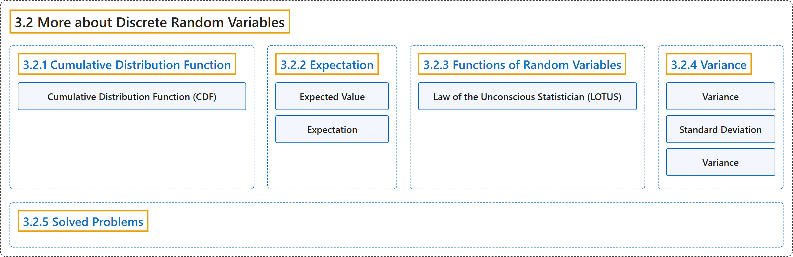

# 3.2 More about Discrete Random Variables

## Classification

## Glossary

| Term | Definition | 中文翻译 | Source |
|---|---|---|---|
| **3.2 More about Discrete Random Variables** 离散随机变量（续） | (No definition) | （无定义） | [Pishro-Nik, 2014, section 3.2](https://www.probabilitycourse.com/chapter3/3_2_1_cdf.php) |
| **3.2.1 Cumulative Distribution Function** 累积分布函数 | (No definition) | （无定义） | [Pishro-Nik, 2014, section 3.2.1](https://www.probabilitycourse.com/chapter3/3_2_1_cdf.php) |
| **Cumulative Distribution Function (CDF)** 累积分布函数（CDF） | "The **cumulative distribution function (CDF)** of random variable $X$ is defined as $$F_X(x) = P(X \leq x), \textrm{ for all }x \in \mathbb{R}.$$" | 随机变量 $X$ 的**累积分布函数**（CDF）定义为 $$F_X(x) = P(X \leq x), \textrm{ for all }x \in \mathbb{R}.$$ | [Pishro-Nik, 2014, section 3.2.1](https://www.probabilitycourse.com/chapter3/3_2_1_cdf.php#:~:text=The%20cumulative%20distribution%20function%20%28CDF%29%20of) |
| **3.2.2 Expectation** 期望 | (No definition) | （无定义） | [Pishro-Nik, 2014, section 3.2.2](https://www.probabilitycourse.com/chapter3/3_2_2_expectation.php) |
| **Expected Value** 期望值（数学期望） | "The **expected value** of $X$, denoted by $EX$ is defined as $$EX=\sum_{x_k \in R_X} x_k P(X=x_k)=\sum_{x_k \in R_X} x_k P_X(x_k).$$" | $X$ 的**期望值**记作 $EX$，定义为 $$EX=\sum_{x_k \in R_X} x_k P(X=x_k)=\sum_{x_k \in R_X} x_k P_X(x_k).$$ | [Pishro-Nik, 2014, section 3.2.2](https://www.probabilitycourse.com/chapter3/3_2_2_expectation.php#:~:text=The%20expected%20value%20of%20%2C%20denoted) |
| **Expectation** 期望 | "The expectation value, also called the expected value, mathematical expectation, or mean, of a random variable is its **probability-weighted average**." | 随机变量的期望值（也称为期望、数学期望或均值）是它的**按概率加权的平均值**。 | [Weisstein, n.d.-b, "Expectation value" entry, para. 1](https://mathworld.wolfram.com/ExpectationValue.html#:~:text=is%20its%20probability%2Dweighted%20average) |
| **3.2.3 Functions of Random Variables** 随机变量的函数 | (No definition) | （无定义） | [Pishro-Nik, 2014, section 3.2.3](https://www.probabilitycourse.com/chapter3/3_2_3_functions_random_var.php) |
| **Law of the Unconscious Statistician (LOTUS)** 无意识统计学家法则（LOTUS） | "But there is another way which is usually easier. It is called the **law of the unconscious statistician** (LOTUS)." | 但还有另一种通常更简便的方法，称为**无意识统计学家法则**（LOTUS）。 | [Pishro-Nik, 2014, section 3.2.3](https://www.probabilitycourse.com/chapter3/3_2_3_functions_random_var.php#:~:text=But%20there%20is%20another%20way%20which) |
| **3.2.4 Variance** 方差 | (No definition) | （无定义） | [Pishro-Nik, 2014, section 3.2.4](https://www.probabilitycourse.com/chapter3/3_2_4_variance.php) |
| **Variance** 方差 | "The **variance** of a random variable $X$, with mean $EX=\mu_X$, is defined as $$\textrm{Var}(X)=E\big[ (X-\mu_X)^2\big].$$" | 均值为 $EX=\mu_X$ 的随机变量 $X$ 的**方差**定义为 $$\textrm{Var}(X)=E\big[ (X-\mu_X)^2\big].$$ | [Pishro-Nik, 2014, section 3.2.4](https://www.probabilitycourse.com/chapter3/3_2_4_variance.php#:~:text=The%20variance%20of%20a%20random%20variable) |
| **Standard Deviation** 标准差 | "To solve this issue, we define another measure, called the **standard deviation**, usually shown as $\sigma_X$, which is simply the square root of variance." | 为解决这一问题，我们定义另一个度量，称为**标准差**，通常记作 $\sigma_X$，它就是方差的平方根。 | [Pishro-Nik, 2014, section 3.2.4](https://www.probabilitycourse.com/chapter3/3_2_4_variance.php#:~:text=To%20solve%20this%20issue%2C%20we%20define) |
| **Variance** 方差 | "For a single variate X having a distribution P(x) with known population mean μ, the **population variance** var(X), commonly also written σ2, is defined as **σ2 = ⟨(X − μ)2⟩**." | 对于一个分布为 P(x)、总体均值 μ 已知的单个变量 X，其**总体方差** var(X)（通常也写作 σ2）定义为 **σ2 = ⟨(X − μ)2⟩**。 | [Weisstein, n.d.-d, "Variance" entry, para. 1](https://mathworld.wolfram.com/Variance.html#:~:text=the%20population%20variance) |
| **3.2.5 Solved Problems** 例题详解 | (No definition) | （无定义） | [Pishro-Nik, 2014, section 3.2.5](https://www.probabilitycourse.com/chapter3/3_2_5_solved3_2.php) |

## References

Pishro-Nik, H. (2014). *Introduction to probability, statistics, and random processes*. Kappa Research. Retrieved October 28, 2026, from <https://www.probabilitycourse.com/>

Weisstein, E. W. (n.d.-b). *Expectation value*. MathWorld: A Wolfram Resource. Retrieved October 27, 2026, from <https://mathworld.wolfram.com/ExpectationValue.html>

Weisstein, E. W. (n.d.-d). *Variance*. MathWorld: A Wolfram Resource. Retrieved October 27, 2026, from <https://mathworld.wolfram.com/Variance.html>
