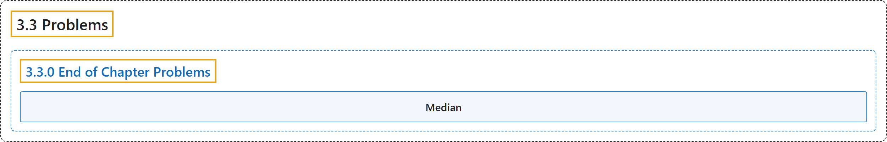

# 3.3 Problems

## Classification

## Glossary

| Term | Definition | 中文翻译 | Source |
|---|---|---|---|
| **3.3 Problems** 习题 | (No definition) | （无定义） | [Pishro-Nik, 2014, section 3.3](https://www.probabilitycourse.com/chapter3/3_3_0_chapter3_problems.php) |
| **3.3.0 End of Chapter Problems** 章末习题 | (No definition) | （无定义） | [Pishro-Nik, 2014, section 3.3.0](https://www.probabilitycourse.com/chapter3/3_3_0_chapter3_problems.php) |
| **Median** 中位数 | "The **median** of a random variable $X$ is defined as any number $m$ that satisfies both of the following conditions:" | 随机变量 $X$ 的**中位数**定义为满足以下两个条件的任意数 $m$： | [Pishro-Nik, 2014, section 3.3.0](https://www.probabilitycourse.com/chapter3/3_3_0_chapter3_problems.php#:~:text=The%20median%20of%20a%20random%20variable) |

## References

Pishro-Nik, H. (2014). *Introduction to probability, statistics, and random processes*. Kappa Research. Retrieved October 28, 2026, from <https://www.probabilitycourse.com/>
