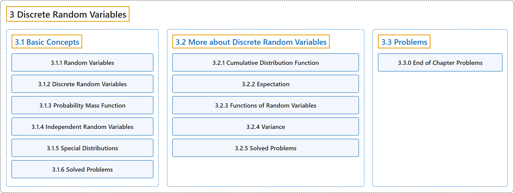

# 3 Discrete Random Variables

## Classification

## Glossary

| Term | Definition | 中文翻译 | Source |
|---|---|---|---|
| **3 Discrete Random Variables** 离散随机变量 | (No definition) | （无定义） | [Pishro-Nik, 2014, chapter 3](https://www.probabilitycourse.com/) |
| **[3.1 Basic Concepts](3-1-basic-concepts.md)** 基本概念 | (No definition) | （无定义） | [Pishro-Nik, 2014, section 3.1](https://www.probabilitycourse.com/chapter3/3_1_1_random_variables.php) |
| **[3.2 More about Discrete Random Variables](3-2-more-about-discrete-random-variables.md)** 离散随机变量（续） | (No definition) | （无定义） | [Pishro-Nik, 2014, section 3.2](https://www.probabilitycourse.com/chapter3/3_2_1_cdf.php) |
| **[3.3 Problems](3-3-problems.md)** 习题 | (No definition) | （无定义） | [Pishro-Nik, 2014, section 3.3](https://www.probabilitycourse.com/chapter3/3_3_0_chapter3_problems.php) |

## References

Pishro-Nik, H. (2014). *Introduction to probability, statistics, and random processes*. Kappa Research. Retrieved October 28, 2026, from <https://www.probabilitycourse.com/>
