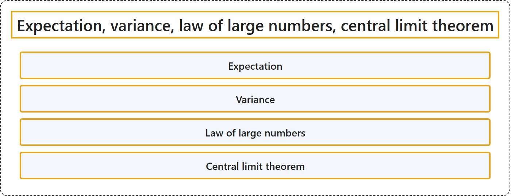

# 2.4 Expectation, Variance, Law of Large Numbers, Central Limit Theorem

## Classification

## Glossary

| Term | Definition | 中文翻译 | Source |
|---|---|---|---|
| **Expectation** 期望 | "The expectation value, also called the expected value, mathematical expectation, or mean, of a random variable is its **probability-weighted average**." | 随机变量的期望值（也称为期望、数学期望或均值）是它的**按概率加权的平均值**。 | [Weisstein, n.d.-b, "Expectation value" entry, para. 1](https://mathworld.wolfram.com/ExpectationValue.html#:~:text=is%20its%20probability%2Dweighted%20average) |
| **Variance** 方差 | "For a single variate X having a distribution P(x) with known population mean μ, the **population variance** var(X), commonly also written σ2, is defined as **σ2 = ⟨(X − μ)2⟩**." | 对于一个分布为 P(x)、总体均值 μ 已知的单个变量 X，其**总体方差** var(X)（通常也写作 σ2）定义为 **σ2 = ⟨(X − μ)2⟩**。 | [Weisstein, n.d.-d, "Variance" entry, para. 1](https://mathworld.wolfram.com/Variance.html#:~:text=the%20population%20variance) |
| **Law of large numbers** 大数定律 | "A 'law of large numbers' is one of several theorems expressing the idea that as **the number of trials of a random process increases**, **the percentage difference between the expected and actual values goes to zero**." | “大数定律”是若干定理之一，它们表达这样一个想法：随着**随机过程的试验次数增加**，**期望值与实际值之间的百分比差异趋于零**。 | [Weisstein, n.d.-c, "Law of large numbers" entry, para. 1](https://mathworld.wolfram.com/LawofLargeNumbers.html#:~:text=is%20one%20of%20several%20theorems%20expressing%20the%20idea) |
| **Central limit theorem** 中心极限定理 | "The central limit theorem states that **the normalized sum of independent random variates** with finite variances **approaches a normal distribution**." | 中心极限定理指出，方差有限的**独立随机变量经标准化后的和**会**趋近于正态分布**。 | [Weisstein, n.d.-a, "Central limit theorem" entry, para. 1](https://mathworld.wolfram.com/CentralLimitTheorem.html#:~:text=The%20central%20limit%20theorem%20states%20that%20the%20normalized%20sum) |

## References

- Joint Task Force on Computing Curricula. (2024). *Computer science curricula 2023*. Association for Computing Machinery. <https://doi.org/10.1145/3664191>
- Weisstein, E. W. (n.d.-a). *Central limit theorem*. MathWorld: A Wolfram Resource. Retrieved October 27, 2026, from <https://mathworld.wolfram.com/CentralLimitTheorem.html>
- Weisstein, E. W. (n.d.-b). *Expectation value*. MathWorld: A Wolfram Resource. Retrieved October 27, 2026, from <https://mathworld.wolfram.com/ExpectationValue.html>
- Weisstein, E. W. (n.d.-c). *Law of large numbers*. MathWorld: A Wolfram Resource. Retrieved October 27, 2026, from <https://mathworld.wolfram.com/LawofLargeNumbers.html>
- Weisstein, E. W. (n.d.-d). *Variance*. MathWorld: A Wolfram Resource. Retrieved October 27, 2026, from <https://mathworld.wolfram.com/Variance.html>
