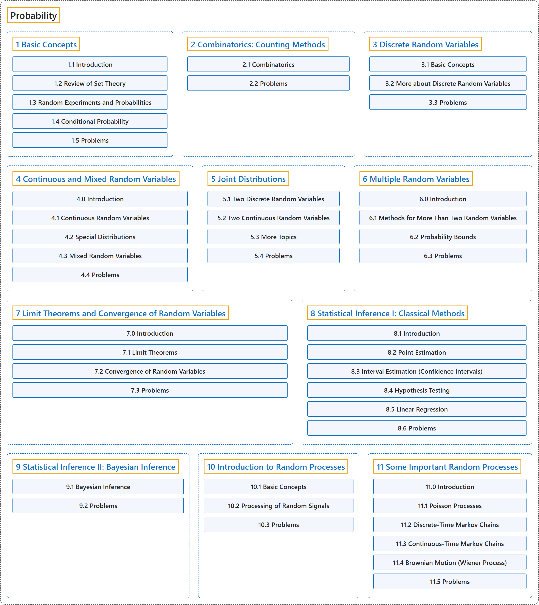

# 2. Probability

## Classification

## Glossary

| Term | Definition | 中文翻译 | Source |
|---|---|---|---|
| **Probability** 概率 | "Probability is the branch of mathematics that studies the **possible outcomes of given events** together with the outcomes' **relative likelihoods and distributions**." | 概率是数学的一个分支，研究**给定事件的可能结果**，以及这些结果的**相对可能性和分布**。 | [Weisstein, n.d., "Probability" entry, para. 1](https://mathworld.wolfram.com/Probability.html#:~:text=Probability%20is%20the%20branch%20of%20mathematics%20that%20studies%20the%20possible%20outcomes) |
| **[1 Basic Concepts](basic-concepts/index.md)** 基本概念 | (No definition) | （无定义） | [Pishro-Nik, 2014, chapter 1](https://www.probabilitycourse.com/) |
| **[2 Combinatorics: Counting Methods](combinatorics-counting-methods/index.md)** 组合学：计数方法 | (No definition) | （无定义） | [Pishro-Nik, 2014, chapter 2](https://www.probabilitycourse.com/) |
| **[3 Discrete Random Variables](discrete-random-variables/index.md)** 离散随机变量 | (No definition) | （无定义） | [Pishro-Nik, 2014, chapter 3](https://www.probabilitycourse.com/) |
| **[4 Continuous and Mixed Random Variables](continuous-and-mixed-random-variables/index.md)** 连续与混合随机变量 | (No definition) | （无定义） | [Pishro-Nik, 2014, chapter 4](https://www.probabilitycourse.com/) |
| **[5 Joint Distributions](joint-distributions/index.md)** 联合分布 | (No definition) | （无定义） | [Pishro-Nik, 2014, chapter 5](https://www.probabilitycourse.com/) |
| **[6 Multiple Random Variables](multiple-random-variables/index.md)** 多个随机变量 | (No definition) | （无定义） | [Pishro-Nik, 2014, chapter 6](https://www.probabilitycourse.com/) |
| **[7 Limit Theorems and Convergence of Random Variables](limit-theorems-and-convergence-of-random-variables/index.md)** 极限定理与随机变量的收敛 | (No definition) | （无定义） | [Pishro-Nik, 2014, chapter 7](https://www.probabilitycourse.com/) |
| **[8 Statistical Inference I: Classical Methods](statistical-inference-i-classical-methods/index.md)** 统计推断一：经典方法 | (No definition) | （无定义） | [Pishro-Nik, 2014, chapter 8](https://www.probabilitycourse.com/) |
| **[9 Statistical Inference II: Bayesian Inference](statistical-inference-ii-bayesian-inference/index.md)** 统计推断二：贝叶斯推断 | (No definition) | （无定义） | [Pishro-Nik, 2014, chapter 9](https://www.probabilitycourse.com/) |
| **[10 Introduction to Random Processes](introduction-to-random-processes/index.md)** 随机过程介绍 | (No definition) | （无定义） | [Pishro-Nik, 2014, chapter 10](https://www.probabilitycourse.com/) |
| **[11 Some Important Random Processes](some-important-random-processes/index.md)** 一些重要的随机过程 | (No definition) | （无定义） | [Pishro-Nik, 2014, chapter 11](https://www.probabilitycourse.com/) |

## References

Pishro-Nik, H. (2014). *Introduction to probability, statistics, and random processes*. Kappa Research. Retrieved October 28, 2026, from <https://www.probabilitycourse.com/>

Weisstein, E. W. (n.d.). *Probability*. MathWorld: A Wolfram Resource. Retrieved October 27, 2026, from <https://mathworld.wolfram.com/Probability.html>
