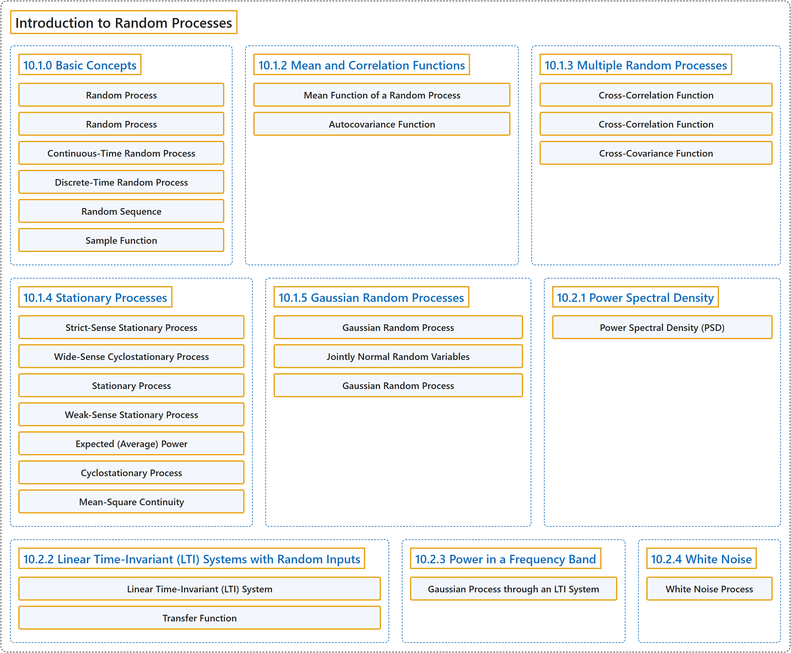

# 10 Introduction to Random Processes

## Classification

## Glossary

| Term | Definition | 中文翻译 | Source |
|---|---|---|---|
| **10 Introduction to Random Processes** 随机过程导论 | (No definition) | （无定义） | [Pishro-Nik, 2014, chapter 10](https://www.probabilitycourse.com/) |
| **10.1.0 Basic Concepts** 基本概念 | (No definition) | （无定义） | [Pishro-Nik, 2014, section 10.1.0](https://www.probabilitycourse.com/chapter10/10_1_0_basic_concepts.php) |
| **Random Process** 随机过程 | "A **random process** is a collection of random variables usually indexed by time." | **随机过程**是通常以时间为指标的随机变量集合。 | [Pishro-Nik, 2014, section 10.1.0](https://www.probabilitycourse.com/chapter10/10_1_0_basic_concepts.php#:~:text=A%20random%20process%20is%20a%20collection) |
| **Random Process** 随机过程 | "When we consider the values of $S(t)$ for $t \in [0,\infty)$ collectively, we say $S(t)$ is a **random process or a stochastic process**." | 当我们把 $S(t)$ 在 $t \in [0,\infty)$ 上的取值作为一个整体来考虑时，我们说 $S(t)$ 是**随机过程**（又称 stochastic process）。 | [Pishro-Nik, 2014, section 10.1.0](https://www.probabilitycourse.com/chapter10/10_1_0_basic_concepts.php#:~:text=When%20we%20consider%20the%20values%20of) |
| **Continuous-Time Random Process** 连续时间随机过程 | "In general, when we have a random process $X(t)$ where $t$ can take real values in an interval on the real line, then $X(t)$ is a **continuous-time random process**." | 一般地，若随机过程 $X(t)$ 中的 $t$ 可取实直线上某个区间内的实数值，则 $X(t)$ 是**连续时间随机过程**。 | [Pishro-Nik, 2014, section 10.1.0](https://www.probabilitycourse.com/chapter10/10_1_0_basic_concepts.php#:~:text=In%20general%2C%20when%20we%20have%20a) |
| **Discrete-Time Random Process** 离散时间随机过程 | "On the other hand, you can have a **discrete-time random process**." | 另一方面，也可以有**离散时间随机过程**。 | [Pishro-Nik, 2014, section 10.1.0](https://www.probabilitycourse.com/chapter10/10_1_0_basic_concepts.php#:~:text=On%20the%20other%20hand%2C%20you%20can) |
| **Random Sequence** 随机序列 | "Therefore, a discrete-time random process is just a **sequence of random variables**. For this reason, discrete-time random processes are sometimes referred to as **random sequences**." | 因此，离散时间随机过程就是一个**随机变量序列**。正因为如此，离散时间随机过程有时也称为**随机序列**。 | [Pishro-Nik, 2014, section 10.1.0](https://www.probabilitycourse.com/chapter10/10_1_0_basic_concepts.php#:~:text=Therefore%2C%20a%20discrete-time%20random%20process%20is) |
| **Sample Function** 样本函数 | "We call each of these possible functions of $X(t)$ a **sample function** or **sample path**. It is also called a **realization** of $X(t)$." | 我们把 $X(t)$ 的每一个这样的可能函数称为**样本函数**或**样本路径**。它也称为 $X(t)$ 的一次**实现**。 | [Pishro-Nik, 2014, section 10.1.0](https://www.probabilitycourse.com/chapter10/10_1_0_basic_concepts.php#:~:text=We%20call%20each%20of%20these%20possible) |
| **10.1.2 Mean and Correlation Functions** 均值函数与相关函数 | (No definition) | （无定义） | [Pishro-Nik, 2014, section 10.1.2](https://www.probabilitycourse.com/chapter10/10_1_2_mean_and_correlation_functions.php) |
| **Mean Function of a Random Process** 随机过程的均值函数 | "For a random process $\big\{X(t), t \in J \big\}$, the **mean function** $\mu_X(t):J \rightarrow \mathbb{R}$, is defined as $$\begin{align}%\label{} \mu_X(t)=E[X(t)] \end{align}$$" | 对于随机过程 $\big\{X(t), t \in J \big\}$，其**均值函数** $\mu_X(t):J \rightarrow \mathbb{R}$ 定义为 $$\begin{align}%\label{} \mu_X(t)=E[X(t)] \end{align}$$ | [Pishro-Nik, 2014, section 10.1.2](https://www.probabilitycourse.com/chapter10/10_1_2_mean_and_correlation_functions.php#:~:text=For%20a%20random%20process%20%2C%20the) |
| **Autocovariance Function** 自协方差函数 | "For a random process $\big\{X(t), t \in J \big\}$, the **auto**covariance function or, simply, the covariance function, $C_X(t_1,t_2)$, is defined by $$\begin{align}%\label{} C_X(t_1,t_2)&=\textrm{Cov}\big(X(t_1),X(t_2)\big)\\ &=R_X(t_1,t_2)-\mu_X(t_1) \mu_X(t_2), \quad \textrm{for }t_1,t_2 \in J. \end{align}$$" | 对于随机过程 $\big\{X(t), t \in J \big\}$，**自协方差函数**或简称**协方差函数** $C_X(t_1,t_2)$ 定义为 $$\begin{align}%\label{} C_X(t_1,t_2)&=\textrm{Cov}\big(X(t_1),X(t_2)\big)\\ &=R_X(t_1,t_2)-\mu_X(t_1) \mu_X(t_2), \quad \textrm{for }t_1,t_2 \in J. \end{align}$$ | [Pishro-Nik, 2014, section 10.1.2](https://www.probabilitycourse.com/chapter10/10_1_2_mean_and_correlation_functions.php#:~:text=For%20a%20random%20process%20%2C%20the) |
| **10.1.3 Multiple Random Processes** 多个随机过程 | (No definition) | （无定义） | [Pishro-Nik, 2014, section 10.1.3](https://www.probabilitycourse.com/chapter10/10_1_3_multiple_random_processes.php) |
| **Cross-Correlation Function** 互相关函数 | "the **cross-correlation function** $R_{XY}(t_1,t_2)$, is defined by" | **互相关函数** $R_{XY}(t_1,t_2)$ 定义为 | [Pishro-Nik, 2014, section 10.1.3](https://www.probabilitycourse.com/chapter10/10_1_3_multiple_random_processes.php#:~:text=the%20cross-correlation%20function%20%2C%20is%20defined) |
| **Cross-Correlation Function** 互相关函数 | "For two random processes $\big\{X(t), t \in J \big\}$ and $\big\{Y(t), t \in J \big\}$: $-$ the **cross-correlation function** $R_{XY}(t_1,t_2)$, is defined by $$\begin{align} R_{XY}(t_1,t_2)=E[X(t_1)Y(t_2)], \quad \textrm{for }t_1,t_2 \in J; \end{align}$$" | 对于两个随机过程 $\big\{X(t), t \in J \big\}$ 和 $\big\{Y(t), t \in J \big\}$：$-$ **互相关函数** $R_{XY}(t_1,t_2)$ 定义为 $$\begin{align} R_{XY}(t_1,t_2)=E[X(t_1)Y(t_2)], \quad \textrm{for }t_1,t_2 \in J; \end{align}$$ | [Pishro-Nik, 2014, section 10.1.3](https://www.probabilitycourse.com/chapter10/10_1_3_multiple_random_processes.php#:~:text=For%20two%20random%20processes%20and%20%3A) |
| **Cross-Covariance Function** 互协方差函数 | "the **cross-covariance function** $C_{XY}(t_1,t_2)$, is defined by $$\begin{align} C_{XY}(t_1,t_2)&=\textrm{Cov}\big(X(t_1),Y(t_2)\big)\\ &=R_{XY}(t_1,t_2)-\mu_X(t_1) \mu_Y(t_2), \quad \textrm{for }t_1,t_2 \in J. \end{align}$$" | **互协方差函数** $C_{XY}(t_1,t_2)$ 定义为 $$\begin{align} C_{XY}(t_1,t_2)&=\textrm{Cov}\big(X(t_1),Y(t_2)\big)\\ &=R_{XY}(t_1,t_2)-\mu_X(t_1) \mu_Y(t_2), \quad \textrm{for }t_1,t_2 \in J. \end{align}$$ | [Pishro-Nik, 2014, section 10.1.3](https://www.probabilitycourse.com/chapter10/10_1_3_multiple_random_processes.php#:~:text=the%20cross-covariance%20function%20%2C%20is%20defined) |
| **10.1.4 Stationary Processes** 平稳过程 | (No definition) | （无定义） | [Pishro-Nik, 2014, section 10.1.4](https://www.probabilitycourse.com/chapter10/10_1_4_stationary_processes.php) |
| **Strict-Sense Stationary Process** 严平稳过程 | "A continuous-time random process $\big\{X(t), t \in \mathbb{R}\big\}$ is **strict-sense stationary** or simply **stationary** if, for all $t_1,t_2,\cdots, t_r \in \mathbb{R}$ and all $\Delta \in \mathbb{R}$, the joint CDF of" | 连续时间随机过程 $\big\{X(t), t \in \mathbb{R}\big\}$ 称为**严平稳**或简称**平稳**的，若对所有 $t_1,t_2,\cdots, t_r \in \mathbb{R}$ 和所有 $\Delta \in \mathbb{R}$，其联合累积分布函数 | [Pishro-Nik, 2014, section 10.1.4](https://www.probabilitycourse.com/chapter10/10_1_4_stationary_processes.php#:~:text=A%20continuous-time%20random%20process%20is%20strict-sense) |
| **Wide-Sense Cyclostationary Process** 广义循环平稳过程 | "A continuous-time random process $\big\{X(t), t \in \mathbb{R}\big\}$ is **weak-sense cyclostationary** or **wide-sense cyclostationary** if there exists a positive real number $T$ such that $\mu_X(t+T)=\mu_X(t)$, for all $t\in \mathbb{R}$; $R_X(t_1+T,t_2+T)=R_X(t_1,t_2)$, for all $t_1,t_2 \in \mathbb{R}$." | 连续时间随机过程 $\big\{X(t), t \in \mathbb{R}\big\}$ 称为**弱循环平稳**或**广义循环平稳**，如果存在正实数 $T$，使得 $\mu_X(t+T)=\mu_X(t)$，对所有 $t\in \mathbb{R}$ 成立；$R_X(t_1+T,t_2+T)=R_X(t_1,t_2)$，对所有 $t_1,t_2 \in \mathbb{R}$ 成立。 | [Pishro-Nik, 2014, section 10.1.4](https://www.probabilitycourse.com/chapter10/10_1_4_stationary_processes.php#:~:text=A%20continuous-time%20random%20process%20is%20weak-sense) |
| **Stationary Process** 平稳过程 | "Intuitively, a random process $\big\{X(t), t \in J \big\}$ is **stationary** if its statistical properties do not change by time." | 直观地说，若随机过程 $\big\{X(t), t \in J \big\}$ 的统计性质不随时间改变，则它是**平稳**的。 | [Pishro-Nik, 2014, section 10.1.4](https://www.probabilitycourse.com/chapter10/10_1_4_stationary_processes.php#:~:text=Intuitively%2C%20a%20random%20process%20is%20stationary) |
| **Weak-Sense Stationary Process** 弱平稳过程（宽平稳过程） | "A random process is called **weak-sense stationary** or **wide-sense stationary (WSS)** if its mean function and its correlation function do not change by shifts in time." | 若一个随机过程的均值函数和相关函数不随时间平移而改变，则称其为**弱平稳**或**宽平稳**（WSS）过程。 | [Pishro-Nik, 2014, section 10.1.4](https://www.probabilitycourse.com/chapter10/10_1_4_stationary_processes.php#:~:text=A%20random%20process%20is%20called%20weak-sense) |
| **Expected (Average) Power** 期望（平均）功率 | "The quantity $E[X(t)^2]$ is called the **expected (average) power** in $X(t)$ at time $t$." | 量 $E[X(t)^2]$ 称为 $X(t)$ 在时刻 $t$ 的**期望（平均）功率**。 | [Pishro-Nik, 2014, section 10.1.4](https://www.probabilitycourse.com/chapter10/10_1_4_stationary_processes.php#:~:text=The%20quantity%20is%20called%20the%20expected) |
| **Cyclostationary Process** 循环平稳过程 | "In other words, the random variables $$\begin{align}%\label{} X(t_1), X(t_2), \cdots, X(t_r) \end{align}$$ have the **same joint CDF** as the random variables $$\begin{align}%\label{} X(t_1+T), X(t_2+T), \cdots, X(t_r+T). \end{align}$$ Such random variables are called **cyclostationary**." | 换言之，随机变量 $$\begin{align}%\label{} X(t_1), X(t_2), \cdots, X(t_r) \end{align}$$ 与随机变量 $$\begin{align}%\label{} X(t_1+T), X(t_2+T), \cdots, X(t_r+T). \end{align}$$ 具有**相同的联合 CDF**。这样的随机变量称为**循环平稳**的。 | [Pishro-Nik, 2014, section 10.1.4](https://www.probabilitycourse.com/chapter10/10_1_4_stationary_processes.php#:~:text=In%20other%20words%2C%20the%20random%20variables) |
| **Mean-Square Continuity** 均方连续 | "Let $X(t)$ be a continuous-time random process. We say that $X(t)$ is **mean-square continuous** at time $t$ if" | 设 $X(t)$ 为连续时间随机过程。我们说 $X(t)$ 在时刻 $t$ 是**均方连续**的，如果 | [Pishro-Nik, 2014, section 10.1.4](https://www.probabilitycourse.com/chapter10/10_1_4_stationary_processes.php#:~:text=Let%20be%20a%20continuous-time%20random%20process.) |
| **10.1.5 Gaussian Random Processes** 高斯随机过程 | (No definition) | （无定义） | [Pishro-Nik, 2014, section 10.1.5](https://www.probabilitycourse.com/chapter10/10_1_5_gaussian_random_processes.php) |
| **Gaussian Random Process** 高斯随机过程 | "A random process $\big\{X(t), t \in J \big\}$ is said to be a **Gaussian (normal) random process** if, for all" | 随机过程 $\big\{X(t), t \in J \big\}$ 称为**高斯（正态）随机过程**，若对所有 | [Pishro-Nik, 2014, section 10.1.5](https://www.probabilitycourse.com/chapter10/10_1_5_gaussian_random_processes.php#:~:text=A%20random%20process%20is%20said%20to) |
| **Jointly Normal Random Variables** 联合正态随机变量 | "As we saw before, random variables $X_1$, $X_2$,..., $X_n$ are said to be **jointly normal** if, for all $a_1$,$a_2$,..., $a_n$ $\in \mathbb{R}$, the random variable" | 如前所述，随机变量 $X_1$，$X_2$，……，$X_n$ 称为**联合正态**的，如果对所有 $a_1$，$a_2$，……，$a_n$ $\in \mathbb{R}$，随机变量 | [Pishro-Nik, 2014, section 10.1.5](https://www.probabilitycourse.com/chapter10/10_1_5_gaussian_random_processes.php#:~:text=As%20we%20saw%20before%2C%20random%20variables) |
| **Gaussian Random Process** 高斯随机过程（正态随机过程） | "A random process $\big\{X(t), t \in J \big\}$ is said to be a **Gaussian (normal) random process** if, for all $$\begin{align}%\label{} & t_1,t_2, \dots, t_n \in J, \end{align}$$ the random variables $X(t_1)$, $X(t_2)$,..., $X(t_n)$ are **jointly normal**." | 若对所有 $$\begin{align}%\label{} & t_1,t_2, \dots, t_n \in J, \end{align}$$，随机变量 $X(t_1)$，$X(t_2)$，……，$X(t_n)$ 是**联合正态**的，则称随机过程 $\big\{X(t), t \in J \big\}$ 为**高斯（正态）随机过程**。 | [Pishro-Nik, 2014, section 10.1.5](https://www.probabilitycourse.com/chapter10/10_1_5_gaussian_random_processes.php#:~:text=A%20random%20process%20is%20said%20to) |
| **10.2.1 Power Spectral Density** 功率谱密度 | (No definition) | （无定义） | [Pishro-Nik, 2014, section 10.2.1](https://www.probabilitycourse.com/chapter10/10_2_1_power_spectral_density.php) |
| **Power Spectral Density (PSD)** 功率谱密度 | "$$\begin{align*} S_X(f)=\mathcal{F} \{R_X(\tau) \}= \int_{-\infty}^{\infty} R_X(\tau) e^{-2 j \pi f \tau} \; d\tau, \quad \textrm{where $j=\sqrt{-1}$.} \end{align*}$$" | $$\begin{align*} S_X(f)=\mathcal{F} \{R_X(\tau) \}= \int_{-\infty}^{\infty} R_X(\tau) e^{-2 j \pi f \tau} \; d\tau, \quad \textrm{where $j=\sqrt{-1}$.} \end{align*}$$ | [Pishro-Nik, 2014, section 10.2.1](https://www.probabilitycourse.com/chapter10/10_2_1_power_spectral_density.php#:~:text=%5Cbegin%7Balign%2A%7D%20S_X%28f%29%3D%5Cmathcal%7BF%7D%20%5C%7BR_X%28%5Ctau%29%20%5C%7D%3D%20%5Cint_%7B-%5Cinfty%7D%5E%7B%5Cinfty%7D%20R_X%28%5Ctau%29) |
| **10.2.2 Linear Time-Invariant (LTI) Systems with Random Inputs** 随机输入的线性时不变（LTI）系统 | (No definition) | （无定义） | [Pishro-Nik, 2014, section 10.2.2](https://www.probabilitycourse.com/chapter10/10_2_2_LTI_systems_with_random_inputs.php) |
| **Linear Time-Invariant (LTI) System** 线性时不变系统 | "A **linear time-invariant (LTI) system** can be represented by its **impulse response** (Figure 10.6)." | **线性时不变（LTI）系统**可以用其**冲激响应**来表示（图 10.6）。 | [Pishro-Nik, 2014, section 10.2.2](https://www.probabilitycourse.com/chapter10/10_2_2_LTI_systems_with_random_inputs.php#:~:text=A%20linear%20time-invariant%20%28LTI%29%20system%20can) |
| **Transfer Function** 传递函数 | "Let $H(f)$ be the Fourier transform of $h(t)$, $$\begin{align*} H(f)=\mathcal{F} \{h(t) \}= \int_{-\infty}^{\infty} h(t) e^{-2 j \pi f t} \; dt. \end{align*}$$ $H(f)$ is called the **transfer function** of the system." | 设 $H(f)$ 为 $h(t)$ 的傅里叶变换，$$\begin{align*} H(f)=\mathcal{F} \{h(t) \}= \int_{-\infty}^{\infty} h(t) e^{-2 j \pi f t} \; dt. \end{align*}$$ $H(f)$ 称为该系统的**传递函数**。 | [Pishro-Nik, 2014, section 10.2.2](https://www.probabilitycourse.com/chapter10/10_2_2_LTI_systems_with_random_inputs.php#:~:text=Let%20be%20the%20Fourier%20transform%20of) |
| **10.2.3 Power in a Frequency Band** 频带内的功率 | (No definition) | （无定义） | [Pishro-Nik, 2014, section 10.2.3](https://www.probabilitycourse.com/chapter10/10_2_3_power_in_a_frequency_band.php) |
| **Gaussian Process through an LTI System** 高斯过程通过线性时不变系统 | "Let $X(t)$ be a stationary Gaussian process. If $X(t)$ is the input to an LTI system, then the output random process, $Y(t)$, is also a **stationary Gaussian process**." | 设 $X(t)$ 为平稳高斯过程。若 $X(t)$ 是线性时不变系统的输入，则输出随机过程 $Y(t)$ 也是**平稳高斯过程**。 | [Pishro-Nik, 2014, section 10.2.3](https://www.probabilitycourse.com/chapter10/10_2_3_power_in_a_frequency_band.php#:~:text=Let%20be%20a%20stationary%20Gaussian%20process.) |
| **10.2.4 White Noise** 白噪声 | (No definition) | （无定义） | [Pishro-Nik, 2014, section 10.2.4](https://www.probabilitycourse.com/chapter10/10_2_4_white_noise.php) |
| **White Noise Process** 白噪声过程 | "The random process $X(t)$ is called a **white noise process** if" | 随机过程 $X(t)$ 称为**白噪声过程**，若 | [Pishro-Nik, 2014, section 10.2.4](https://www.probabilitycourse.com/chapter10/10_2_4_white_noise.php#:~:text=The%20random%20process%20is%20called%20a) |

## References

Pishro-Nik, H. (2014). *Introduction to probability, statistics, and random processes*. Kappa Research. Retrieved October 28, 2026, from <https://www.probabilitycourse.com/>
