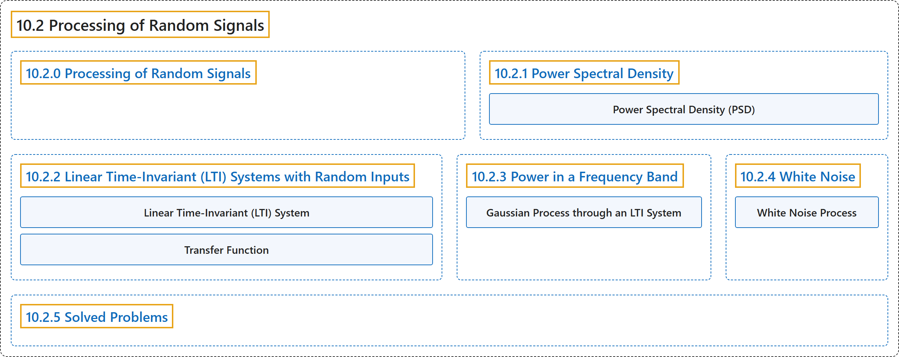

# 10.2 Processing of Random Signals

## Classification

## Glossary

| Term | Definition | 中文翻译 | Source |
|---|---|---|---|
| **10.2 Processing of Random Signals** 随机信号的处理 | (No definition) | （无定义） | [Pishro-Nik, 2014, section 10.2](https://www.probabilitycourse.com/chapter10/10_2_0_processing_of_random_signals.php) |
| **10.2.0 Processing of Random Signals** 随机信号的处理 | (No definition) | （无定义） | [Pishro-Nik, 2014, section 10.2.0](https://www.probabilitycourse.com/chapter10/10_2_0_processing_of_random_signals.php) |
| **10.2.1 Power Spectral Density** 功率谱密度 | (No definition) | （无定义） | [Pishro-Nik, 2014, section 10.2.1](https://www.probabilitycourse.com/chapter10/10_2_1_power_spectral_density.php) |
| **Power Spectral Density (PSD)** 功率谱密度 | "$$\begin{align*} S_X(f)=\mathcal{F} \{R_X(\tau) \}= \int_{-\infty}^{\infty} R_X(\tau) e^{-2 j \pi f \tau} \; d\tau, \quad \textrm{where $j=\sqrt{-1}$.} \end{align*}$$" | $$\begin{align*} S_X(f)=\mathcal{F} \{R_X(\tau) \}= \int_{-\infty}^{\infty} R_X(\tau) e^{-2 j \pi f \tau} \; d\tau, \quad \textrm{where $j=\sqrt{-1}$.} \end{align*}$$ | [Pishro-Nik, 2014, section 10.2.1](https://www.probabilitycourse.com/chapter10/10_2_1_power_spectral_density.php#:~:text=%5Cbegin%7Balign%2A%7D%20S_X%28f%29%3D%5Cmathcal%7BF%7D%20%5C%7BR_X%28%5Ctau%29%20%5C%7D%3D%20%5Cint_%7B-%5Cinfty%7D%5E%7B%5Cinfty%7D%20R_X%28%5Ctau%29) |
| **10.2.2 Linear Time-Invariant (LTI) Systems with Random Inputs** 随机输入的线性时不变（LTI）系统 | (No definition) | （无定义） | [Pishro-Nik, 2014, section 10.2.2](https://www.probabilitycourse.com/chapter10/10_2_2_LTI_systems_with_random_inputs.php) |
| **Linear Time-Invariant (LTI) System** 线性时不变系统 | "A **linear time-invariant (LTI) system** can be represented by its **impulse response** (Figure 10.6)." | **线性时不变（LTI）系统**可以用其**冲激响应**来表示（图 10.6）。 | [Pishro-Nik, 2014, section 10.2.2](https://www.probabilitycourse.com/chapter10/10_2_2_LTI_systems_with_random_inputs.php#:~:text=A%20linear%20time-invariant%20%28LTI%29%20system%20can) |
| **Transfer Function** 传递函数 | "Let $H(f)$ be the Fourier transform of $h(t)$, $$\begin{align*} H(f)=\mathcal{F} \{h(t) \}= \int_{-\infty}^{\infty} h(t) e^{-2 j \pi f t} \; dt. \end{align*}$$ $H(f)$ is called the **transfer function** of the system." | 设 $H(f)$ 为 $h(t)$ 的傅里叶变换，$$\begin{align*} H(f)=\mathcal{F} \{h(t) \}= \int_{-\infty}^{\infty} h(t) e^{-2 j \pi f t} \; dt. \end{align*}$$ $H(f)$ 称为该系统的**传递函数**。 | [Pishro-Nik, 2014, section 10.2.2](https://www.probabilitycourse.com/chapter10/10_2_2_LTI_systems_with_random_inputs.php#:~:text=Let%20be%20the%20Fourier%20transform%20of) |
| **10.2.3 Power in a Frequency Band** 频带内的功率 | (No definition) | （无定义） | [Pishro-Nik, 2014, section 10.2.3](https://www.probabilitycourse.com/chapter10/10_2_3_power_in_a_frequency_band.php) |
| **Gaussian Process through an LTI System** 高斯过程通过线性时不变系统 | "Let $X(t)$ be a stationary Gaussian process. If $X(t)$ is the input to an LTI system, then the output random process, $Y(t)$, is also a **stationary Gaussian process**." | 设 $X(t)$ 为平稳高斯过程。若 $X(t)$ 是线性时不变系统的输入，则输出随机过程 $Y(t)$ 也是**平稳高斯过程**。 | [Pishro-Nik, 2014, section 10.2.3](https://www.probabilitycourse.com/chapter10/10_2_3_power_in_a_frequency_band.php#:~:text=Let%20be%20a%20stationary%20Gaussian%20process.) |
| **10.2.4 White Noise** 白噪声 | (No definition) | （无定义） | [Pishro-Nik, 2014, section 10.2.4](https://www.probabilitycourse.com/chapter10/10_2_4_white_noise.php) |
| **White Noise Process** 白噪声过程 | "The random process $X(t)$ is called a **white noise process** if" | 随机过程 $X(t)$ 称为**白噪声过程**，若 | [Pishro-Nik, 2014, section 10.2.4](https://www.probabilitycourse.com/chapter10/10_2_4_white_noise.php#:~:text=The%20random%20process%20is%20called%20a) |
| **10.2.5 Solved Problems** 例题详解 | (No definition) | （无定义） | [Pishro-Nik, 2014, section 10.2.5](https://www.probabilitycourse.com/chapter10/10_2_5_solved_probs.php) |

## References

Pishro-Nik, H. (2014). *Introduction to probability, statistics, and random processes*. Kappa Research. Retrieved October 28, 2026, from <https://www.probabilitycourse.com/>
