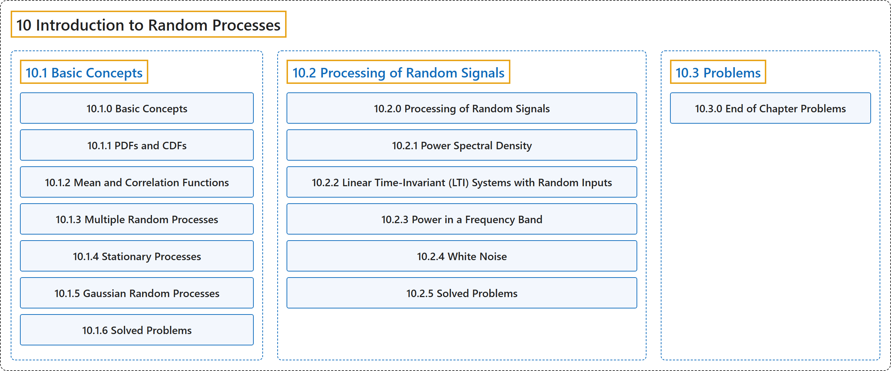

# 10 Introduction to Random Processes

## Classification

## Glossary

| Term | Definition | 中文翻译 | Source |
|---|---|---|---|
| **10 Introduction to Random Processes** 随机过程介绍 | (No definition) | （无定义） | [Pishro-Nik, 2014, chapter 10](https://www.probabilitycourse.com/) |
| **[10.1 Basic Concepts](10-1-basic-concepts.md)** 基本概念 | (No definition) | （无定义） | [Pishro-Nik, 2014, section 10.1](https://www.probabilitycourse.com/chapter10/10_1_0_basic_concepts.php) |
| **[10.2 Processing of Random Signals](10-2-processing-of-random-signals.md)** 随机信号的处理 | (No definition) | （无定义） | [Pishro-Nik, 2014, section 10.2](https://www.probabilitycourse.com/chapter10/10_2_0_processing_of_random_signals.php) |
| **[10.3 Problems](10-3-problems.md)** 习题 | (No definition) | （无定义） | [Pishro-Nik, 2014, section 10.3](https://www.probabilitycourse.com/chapter10/10_3_0_ch_probs.php) |

## References

Pishro-Nik, H. (2014). *Introduction to probability, statistics, and random processes*. Kappa Research. Retrieved October 28, 2026, from <https://www.probabilitycourse.com/>
