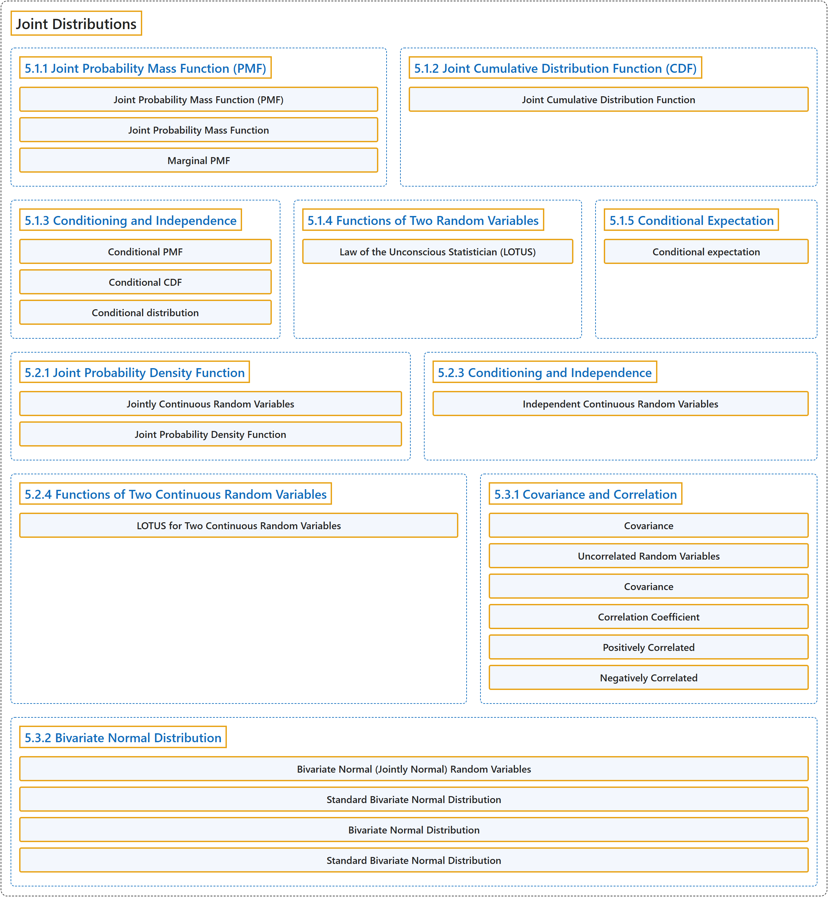

# 5 Joint Distributions

## Classification

## Glossary

| Term | Definition | 中文翻译 | Source |
|---|---|---|---|
| **5 Joint Distributions** 联合分布 | (No definition) | （无定义） | [Pishro-Nik, 2014, chapter 5](https://www.probabilitycourse.com/) |
| **5.1.1 Joint Probability Mass Function (PMF)** 联合概率质量函数（PMF） | (No definition) | （无定义） | [Pishro-Nik, 2014, section 5.1.1](https://www.probabilitycourse.com/chapter5/5_1_1_joint_pmf.php) |
| **Joint Probability Mass Function (PMF)** 联合概率质量函数 | "The **joint probability mass function** of two discrete random variables $X$ and $Y$ is defined as" | 两个离散随机变量 $X$ 和 $Y$ 的**联合概率质量函数**定义为 | [Pishro-Nik, 2014, section 5.1.1](https://www.probabilitycourse.com/chapter5/5_1_1_joint_pmf.php#:~:text=The%20joint%20probability%20mass%20function%20of) |
| **Joint Probability Mass Function** 联合概率质量函数 | "The **joint probability mass function** of two discrete random variables $X$ and $Y$ is defined as $$\begin{align}%\label{} \nonumber P_{XY}(x,y)=P(X=x, Y=y). \end{align}$$" | 两个离散随机变量 $X$ 和 $Y$ 的**联合概率质量函数**定义为 $$\begin{align}%\label{} \nonumber P_{XY}(x,y)=P(X=x, Y=y). \end{align}$$ | [Pishro-Nik, 2014, section 5.1.1](https://www.probabilitycourse.com/chapter5/5_1_1_joint_pmf.php#:~:text=The%20joint%20probability%20mass%20function%20of) |
| **Marginal PMF** 边缘概率质量函数 | "Here, we call $P_X(x)$ the **marginal PMF** of $X$." | 这里，我们称 $P_X(x)$ 为 $X$ 的**边缘概率质量函数**。 | [Pishro-Nik, 2014, section 5.1.1](https://www.probabilitycourse.com/chapter5/5_1_1_joint_pmf.php#:~:text=Here%2C%20we%20call%20the%20marginal%20PMF) |
| **5.1.2 Joint Cumulative Distribution Function (CDF)** 联合累积分布函数（CDF） | (No definition) | （无定义） | [Pishro-Nik, 2014, section 5.1.2](https://www.probabilitycourse.com/chapter5/5_1_2_joint_cdf.php) |
| **Joint Cumulative Distribution Function** 联合累积分布函数 | "Now, if we have two random variables $X$ and $Y$ and we would like to study them jointly, we can define the **joint cumulative function** as follows:" | 现在，若有两个随机变量 $X$ 和 $Y$，并希望将它们放在一起研究，我们可以如下定义**联合累积分布函数**： | [Pishro-Nik, 2014, section 5.1.2](https://www.probabilitycourse.com/chapter5/5_1_2_joint_cdf.php#:~:text=Now%2C%20if%20we%20have%20two%20random) |
| **5.1.3 Conditioning and Independence** 条件与独立性 | (No definition) | （无定义） | [Pishro-Nik, 2014, section 5.1.3](https://www.probabilitycourse.com/chapter5/5_1_3_conditioning_independence.php) |
| **Conditional PMF** 条件概率质量函数 | "For a discrete random variable $X$ and event $A$, the **conditional PMF** of $X$ given $A$ is defined as $$\begin{align}%\label{} \nonumber P_{X\vert A}(x_i)&=P(X=x_i\vert A) \\ \nonumber &=\frac{P(X=x_i \textrm{ and } A)}{P(A)}, \hspace{10pt} \textrm{for any $x_i \in R_X$}. \end{align}$$" | 对于离散随机变量 $X$ 和事件 $A$，$X$ 给定 $A$ 的**条件概率质量函数**定义为 $$\begin{align}%\label{} \nonumber P_{X\vert A}(x_i)&=P(X=x_i\vert A) \\ \nonumber &=\frac{P(X=x_i \textrm{ and } A)}{P(A)}, \hspace{10pt} \textrm{for any $x_i \in R_X$}. \end{align}$$ | [Pishro-Nik, 2014, section 5.1.3](https://www.probabilitycourse.com/chapter5/5_1_3_conditioning_independence.php#:~:text=For%20a%20discrete%20random%20variable%20and) |
| **Conditional CDF** 条件累积分布函数 | "Similarly, we define the **conditional CDF** of $X$ given $A$ as $$\begin{align}%\label{} \nonumber F_{X\vert A}(x)&=P(X \leq x\vert A). \end{align}$$" | 类似地，我们将 $X$ 给定 $A$ 的**条件累积分布函数**定义为 $$\begin{align}%\label{} \nonumber F_{X\vert A}(x)&=P(X \leq x\vert A). \end{align}$$ | [Pishro-Nik, 2014, section 5.1.3](https://www.probabilitycourse.com/chapter5/5_1_3_conditioning_independence.php#:~:text=Similarly%2C%20we%20define%20the%20conditional%20CDF) |
| **Conditional distribution** 条件分布 | "A conditional distribution is the **statistical distribution of a random variable** given **specified information about another random variable or event**." | 条件分布是**一个随机变量的统计分布**，条件是已知**关于另一个随机变量或事件的特定信息**。 | [Weisstein, n.d.-a, "Conditional distribution" entry, para. 1](https://mathworld.wolfram.com/ConditionalDistribution.html#:~:text=A%20conditional%20distribution%20is%20the%20statistical%20distribution) |
| **5.1.4 Functions of Two Random Variables** 两个随机变量的函数 | (No definition) | （无定义） | [Pishro-Nik, 2014, section 5.1.4](https://www.probabilitycourse.com/chapter5/5_1_4_functions_two_variables.php) |
| **Law of the Unconscious Statistician (LOTUS)** 无意识统计学家法则 | "**Law of the unconscious statistician (LOTUS)** for two discrete random variables: $$\begin{align}\label{eq:LOTUS-2D} E[g(X,Y)]=\sum_{(x_i,y_j) \in R_{XY}} g(x_i,y_j)P_{XY}(x_i,y_j) \hspace{20pt} (5.5) \end{align}$$" | 两个离散随机变量的**无意识统计学家法则**（LOTUS）：$$\begin{align}\label{eq:LOTUS-2D} E[g(X,Y)]=\sum_{(x_i,y_j) \in R_{XY}} g(x_i,y_j)P_{XY}(x_i,y_j) \hspace{20pt} (5.5) \end{align}$$ | [Pishro-Nik, 2014, section 5.1.4](https://www.probabilitycourse.com/chapter5/5_1_4_functions_two_variables.php#:~:text=Law%20of%20the%20unconscious%20statistician%20%28LOTUS%29) |
| **5.1.5 Conditional Expectation** 条件期望 | (No definition) | （无定义） | [Pishro-Nik, 2014, section 5.1.5](https://www.probabilitycourse.com/chapter5/5_1_5_conditional_expectation.php) |
| **Conditional expectation** 条件期望 | "The conditional expectation of **an integrable random variable** X on a probability space ... given a sigma-algebra G ... is a **G-measurable random variable**, denoted E[X\|G] ..." | **可积随机变量** X 在给定 σ 代数 G 时的条件期望……是一个 **G 可测的随机变量**，记为 E[X\|G]…… | [Weisstein, n.d.-b, "Conditional expectation" entry, para. 1](https://mathworld.wolfram.com/ConditionalExpectation.html#:~:text=The%20conditional%20expectation%20of%20an%20integrable%20random%20variable) |
| **5.2.1 Joint Probability Density Function** 联合概率密度函数 | (No definition) | （无定义） | [Pishro-Nik, 2014, section 5.2.1](https://www.probabilitycourse.com/chapter5/5_2_1_joint_pdf.php) |
| **Jointly Continuous Random Variables** 联合连续随机变量 | "Two random variables $X$ and $Y$ are **jointly continuous** if there exists a nonnegative function $f_{XY}:\mathbb{R}^2 \rightarrow \mathbb{R}$, such that, for any set $A\subset \mathbb{R}^2$, we have $$\begin{align}\label{eq:double-int} P\big((X,Y) \in A\big) =\iint \limits_A f_{XY}(x,y)dxdy \hspace{30pt} (5.15) \end{align}$$" | 若存在非负函数 $f_{XY}:\mathbb{R}^2 \rightarrow \mathbb{R}$，使得对任意集合 $A\subset \mathbb{R}^2$，都有 $$\begin{align}\label{eq:double-int} P\big((X,Y) \in A\big) =\iint \limits_A f_{XY}(x,y)dxdy \hspace{30pt} (5.15) \end{align}$$，则称两个随机变量 $X$ 和 $Y$ **联合连续** | [Pishro-Nik, 2014, section 5.2.1](https://www.probabilitycourse.com/chapter5/5_2_1_joint_pdf.php#:~:text=Two%20random%20variables%20and%20are%20jointly) |
| **Joint Probability Density Function** 联合概率密度函数 | "The function $f_{XY}(x,y)$ is called the **joint probability density function (PDF)** of $X$ and $Y$." | 函数 $f_{XY}(x,y)$ 称为 $X$ 和 $Y$ 的**联合概率密度函数**。 | [Pishro-Nik, 2014, section 5.2.1](https://www.probabilitycourse.com/chapter5/5_2_1_joint_pdf.php#:~:text=The%20function%20is%20called%20the%20joint) |
| **5.2.3 Conditioning and Independence** 条件与独立性 | (No definition) | （无定义） | [Pishro-Nik, 2014, section 5.2.3](https://www.probabilitycourse.com/chapter5/5_2_3_conditioning_independence.php) |
| **Independent Continuous Random Variables** 连续随机变量的独立性 | "Two continuous random variables $X$ and $Y$ are **independent** if" | 两个连续随机变量 $X$ 和 $Y$ 称为**独立**的，若 | [Pishro-Nik, 2014, section 5.2.3](https://www.probabilitycourse.com/chapter5/5_2_3_conditioning_independence.php#:~:text=Two%20continuous%20random%20variables%20and%20are) |
| **5.2.4 Functions of Two Continuous Random Variables** 两个连续随机变量的函数 | (No definition) | （无定义） | [Pishro-Nik, 2014, section 5.2.4](https://www.probabilitycourse.com/chapter5/5_2_4_functions.php) |
| **LOTUS for Two Continuous Random Variables** 二维连续随机变量的 LOTUS | "**LOTUS** for two continuous random variables:" | 两个连续随机变量的 **LOTUS**： | [Pishro-Nik, 2014, section 5.2.4](https://www.probabilitycourse.com/chapter5/5_2_4_functions.php#:~:text=LOTUS%20for%20two%20continuous%20random%20variables%3A) |
| **5.3.1 Covariance and Correlation** 协方差与相关 | (No definition) | （无定义） | [Pishro-Nik, 2014, section 5.3.1](https://www.probabilitycourse.com/chapter5/5_3_1_covariance_correlation.php) |
| **Covariance** 协方差 | "The **covariance** between $X$ and $Y$ is defined as" | $X$ 与 $Y$ 之间的**协方差**定义为 | [Pishro-Nik, 2014, section 5.3.1](https://www.probabilitycourse.com/chapter5/5_3_1_covariance_correlation.php#:~:text=The%20covariance%20between%20and%20is%20defined) |
| **Uncorrelated Random Variables** 不相关随机变量 | "If $\rho(X,Y)=0$, we say that $X$ and $Y$ are **uncorrelated**." | 若 $\rho(X,Y)=0$，则称 $X$ 和 $Y$ **不相关**。 | [Pishro-Nik, 2014, section 5.3.1](https://www.probabilitycourse.com/chapter5/5_3_1_covariance_correlation.php#:~:text=If%20%2C%20we%20say%20that%20and) |
| **Covariance** 协方差 | "The **covariance** between $X$ and $Y$ is defined as $$\begin{align}%\label{} \nonumber \textrm{Cov}(X,Y)&=E\big[(X-EX)(Y-EY)\big]=E[XY]-(EX)(EY). \end{align}$$" | $X$ 与 $Y$ 之间的**协方差**定义为 $$\begin{align}%\label{} \nonumber \textrm{Cov}(X,Y)&=E\big[(X-EX)(Y-EY)\big]=E[XY]-(EX)(EY). \end{align}$$ | [Pishro-Nik, 2014, section 5.3.1](https://www.probabilitycourse.com/chapter5/5_3_1_covariance_correlation.php#:~:text=The%20covariance%20between%20and%20is%20defined) |
| **Correlation Coefficient** 相关系数 | "The **correlation coefficient**, denoted by $\rho_{XY}$ or $\rho(X,Y)$, is obtained by **normalizing the covariance**." | **相关系数**记作 $\rho_{XY}$ 或 $\rho(X,Y)$，由**协方差标准化**得到。 | [Pishro-Nik, 2014, section 5.3.1](https://www.probabilitycourse.com/chapter5/5_3_1_covariance_correlation.php#:~:text=The%20correlation%20coefficient%2C%20denoted%20by%20or) |
| **Positively Correlated** 正相关 | "In this case, the covariance is positive and we say $X$ and $Y$ are **positively correlated**." | 在这种情况下，协方差为正，我们说 $X$ 和 $Y$ **正相关**。 | [Pishro-Nik, 2014, section 5.3.1](https://www.probabilitycourse.com/chapter5/5_3_1_covariance_correlation.php#:~:text=In%20this%20case%2C%20the%20covariance%20is) |
| **Negatively Correlated** 负相关 | "In this case, the covariance is negative and we say $X$ and $Y$ are **negatively correlated**." | 在这种情况下，协方差为负，我们说 $X$ 和 $Y$ **负相关**。 | [Pishro-Nik, 2014, section 5.3.1](https://www.probabilitycourse.com/chapter5/5_3_1_covariance_correlation.php#:~:text=In%20this%20case%2C%20the%20covariance%20is) |
| **5.3.2 Bivariate Normal Distribution** 二元正态分布 | (No definition) | （无定义） | [Pishro-Nik, 2014, section 5.3.2](https://www.probabilitycourse.com/chapter5/5_3_2_bivariate_normal_dist.php) |
| **Bivariate Normal (Jointly Normal) Random Variables** 二元正态（联合正态）随机变量 | "Two random variables $X$ and $Y$ are said to be **bivariate normal**, or **jointly normal**, if $aX+bY$ has a normal distribution for all $a,b \in \mathbb{R}$." | 若对所有 $a,b \in \mathbb{R}$，$aX+bY$ 都服从正态分布，则称两个随机变量 $X$ 和 $Y$ **服从二元正态分布**，或**联合正态**。 | [Pishro-Nik, 2014, section 5.3.2](https://www.probabilitycourse.com/chapter5/5_3_2_bivariate_normal_dist.php#:~:text=Two%20random%20variables%20and%20are%20said) |
| **Standard Bivariate Normal Distribution** 标准二元正态分布 | "Two random variables $X$ and $Y$ are said to have the **standard bivariate normal distribution** with correlation coefficient $\mathbf{\rho}$ if their joint PDF is given by" | 若两个随机变量 $X$ 和 $Y$ 的联合概率密度函数为如下形式，则称它们服从相关系数为 $\mathbf{\rho}$ 的**标准二元正态分布** | [Pishro-Nik, 2014, section 5.3.2](https://www.probabilitycourse.com/chapter5/5_3_2_bivariate_normal_dist.php#:~:text=Two%20random%20variables%20and%20are%20said) |
| **Bivariate Normal Distribution** 二元正态分布 | "Two random variables $X$ and $Y$ are said to have a **bivariate normal distribution** with parameters $\mu_X$, $\sigma^2_X$, $\mu_Y$, $\sigma^2_Y$, and $\rho$, if their joint PDF is given by $$\begin{align} \label{eq:bivariate-normal} \nonumber &f_{XY}(x,y)=\frac{1}{2 \pi \sigma_X \sigma_Y \sqrt{1-\rho^2}} \cdot\\ &\exp \left\{-\frac{1}{2 (1-\rho^2)}\bigg[\bigg(\frac{x-\mu_X}{\sigma_X}\bigg)^2 +\bigg(\frac{y-\mu_Y}{\sigma_Y}\bigg)^2-2\rho \frac{(x-\mu_X)(y-\mu_Y)}{\sigma_X \sigma_Y} \bigg] \right\} (5.24) \end{align}$$" | 若两个随机变量 $X$ 和 $Y$ 的联合概率密度函数由 $$\begin{align} \label{eq:bivariate-normal} \nonumber &f_{XY}(x,y)=\frac{1}{2 \pi \sigma_X \sigma_Y \sqrt{1-\rho^2}} \cdot\\ &\exp \left\{-\frac{1}{2 (1-\rho^2)}\bigg[\bigg(\frac{x-\mu_X}{\sigma_X}\bigg)^2 +\bigg(\frac{y-\mu_Y}{\sigma_Y}\bigg)^2-2\rho \frac{(x-\mu_X)(y-\mu_Y)}{\sigma_X \sigma_Y} \bigg] \right\} (5.24) \end{align}$$ 给出，则称它们服从参数为 $\mu_X$、$\sigma^2_X$、$\mu_Y$、$\sigma^2_Y$ 和 $\rho$ 的**二元正态分布** | [Pishro-Nik, 2014, section 5.3.2](https://www.probabilitycourse.com/chapter5/5_3_2_bivariate_normal_dist.php#:~:text=Two%20random%20variables%20and%20are%20said) |
| **Standard Bivariate Normal Distribution** 标准二元正态分布 | "Similar to our discussion on normal random variables, we start by introducing the **standard bivariate normal distribution** and then obtain the general case from the standard one." | 与我们对正态随机变量的讨论类似，我们从引入**标准二元正态分布**开始，然后由标准情形得到一般情形。 | [Pishro-Nik, 2014, section 5.3.2](https://www.probabilitycourse.com/chapter5/5_3_2_bivariate_normal_dist.php#:~:text=Similar%20to%20our%20discussion%20on%20normal) |

## References

Pishro-Nik, H. (2014). *Introduction to probability, statistics, and random processes*. Kappa Research. Retrieved October 28, 2026, from <https://www.probabilitycourse.com/>

Weisstein, E. W. (n.d.-a). *Conditional distribution*. MathWorld: A Wolfram Resource. Retrieved October 27, 2026, from <https://mathworld.wolfram.com/ConditionalDistribution.html>

Weisstein, E. W. (n.d.-b). *Conditional expectation*. MathWorld: A Wolfram Resource. Retrieved October 27, 2026, from <https://mathworld.wolfram.com/ConditionalExpectation.html>
