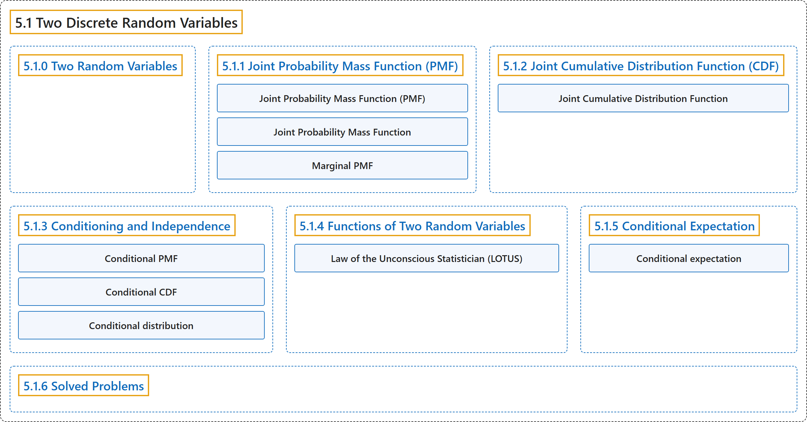

# 5.1 Two Discrete Random Variables

## Classification

## Glossary

| Term | Definition | 中文翻译 | Source |
|---|---|---|---|
| **5.1 Two Discrete Random Variables** 两个离散随机变量 | (No definition) | （无定义） | [Pishro-Nik, 2014, section 5.1](https://www.probabilitycourse.com/chapter5/5_1_0_joint_distributions.php) |
| **5.1.0 Two Random Variables** 两个随机变量 | (No definition) | （无定义） | [Pishro-Nik, 2014, section 5.1.0](https://www.probabilitycourse.com/chapter5/5_1_0_joint_distributions.php) |
| **5.1.1 Joint Probability Mass Function (PMF)** 联合概率质量函数（PMF） | (No definition) | （无定义） | [Pishro-Nik, 2014, section 5.1.1](https://www.probabilitycourse.com/chapter5/5_1_1_joint_pmf.php) |
| **Joint Probability Mass Function (PMF)** 联合概率质量函数 | "The **joint probability mass function** of two discrete random variables $X$ and $Y$ is defined as" | 两个离散随机变量 $X$ 和 $Y$ 的**联合概率质量函数**定义为 | [Pishro-Nik, 2014, section 5.1.1](https://www.probabilitycourse.com/chapter5/5_1_1_joint_pmf.php#:~:text=The%20joint%20probability%20mass%20function%20of) |
| **Joint Probability Mass Function** 联合概率质量函数 | "The **joint probability mass function** of two discrete random variables $X$ and $Y$ is defined as $$\begin{align} \nonumber P_{XY}(x,y)=P(X=x, Y=y). \end{align}$$" | 两个离散随机变量 $X$ 和 $Y$ 的**联合概率质量函数**定义为 $$\begin{align} \nonumber P_{XY}(x,y)=P(X=x, Y=y). \end{align}$$ | [Pishro-Nik, 2014, section 5.1.1](https://www.probabilitycourse.com/chapter5/5_1_1_joint_pmf.php#:~:text=The%20joint%20probability%20mass%20function%20of) |
| **Marginal PMF** 边缘概率质量函数 | "Here, we call $P_X(x)$ the **marginal PMF** of $X$." | 这里，我们称 $P_X(x)$ 为 $X$ 的**边缘概率质量函数**。 | [Pishro-Nik, 2014, section 5.1.1](https://www.probabilitycourse.com/chapter5/5_1_1_joint_pmf.php#:~:text=Here%2C%20we%20call%20the%20marginal%20PMF) |
| **5.1.2 Joint Cumulative Distribution Function (CDF)** 联合累积分布函数（CDF） | (No definition) | （无定义） | [Pishro-Nik, 2014, section 5.1.2](https://www.probabilitycourse.com/chapter5/5_1_2_joint_cdf.php) |
| **Joint Cumulative Distribution Function** 联合累积分布函数 | "Now, if we have two random variables $X$ and $Y$ and we would like to study them jointly, we can define the **joint cumulative function** as follows:" | 现在，若有两个随机变量 $X$ 和 $Y$，并希望将它们放在一起研究，我们可以如下定义**联合累积分布函数**： | [Pishro-Nik, 2014, section 5.1.2](https://www.probabilitycourse.com/chapter5/5_1_2_joint_cdf.php#:~:text=Now%2C%20if%20we%20have%20two%20random) |
| **5.1.3 Conditioning and Independence** 条件与独立性 | (No definition) | （无定义） | [Pishro-Nik, 2014, section 5.1.3](https://www.probabilitycourse.com/chapter5/5_1_3_conditioning_independence.php) |
| **Conditional PMF** 条件概率质量函数 | "For a discrete random variable $X$ and event $A$, the **conditional PMF** of $X$ given $A$ is defined as $$\begin{align} \nonumber P_{X\vert A}(x_i)&=P(X=x_i\vert A) \\ \nonumber &=\frac{P(X=x_i \textrm{ and } A)}{P(A)}, \hspace{10pt} \textrm{for any $x_i \in R_X$}. \end{align}$$" | 对于离散随机变量 $X$ 和事件 $A$，$X$ 给定 $A$ 的**条件概率质量函数**定义为 $$\begin{align} \nonumber P_{X\vert A}(x_i)&=P(X=x_i\vert A) \\ \nonumber &=\frac{P(X=x_i \textrm{ and } A)}{P(A)}, \hspace{10pt} \textrm{for any $x_i \in R_X$}. \end{align}$$ | [Pishro-Nik, 2014, section 5.1.3](https://www.probabilitycourse.com/chapter5/5_1_3_conditioning_independence.php#:~:text=For%20a%20discrete%20random%20variable%20and) |
| **Conditional CDF** 条件累积分布函数 | "Similarly, we define the **conditional CDF** of $X$ given $A$ as $$\begin{align} \nonumber F_{X\vert A}(x)&=P(X \leq x\vert A). \end{align}$$" | 类似地，我们将 $X$ 给定 $A$ 的**条件累积分布函数**定义为 $$\begin{align} \nonumber F_{X\vert A}(x)&=P(X \leq x\vert A). \end{align}$$ | [Pishro-Nik, 2014, section 5.1.3](https://www.probabilitycourse.com/chapter5/5_1_3_conditioning_independence.php#:~:text=Similarly%2C%20we%20define%20the%20conditional%20CDF) |
| **Conditional distribution** 条件分布 | "A conditional distribution is the **statistical distribution of a random variable** given **specified information about another random variable or event**." | 条件分布是**一个随机变量的统计分布**，条件是已知**关于另一个随机变量或事件的特定信息**。 | [Weisstein, n.d.-a, "Conditional distribution" entry, para. 1](https://mathworld.wolfram.com/ConditionalDistribution.html#:~:text=A%20conditional%20distribution%20is%20the%20statistical%20distribution) |
| **5.1.4 Functions of Two Random Variables** 两个随机变量的函数 | (No definition) | （无定义） | [Pishro-Nik, 2014, section 5.1.4](https://www.probabilitycourse.com/chapter5/5_1_4_functions_two_variables.php) |
| **Law of the Unconscious Statistician (LOTUS)** 无意识统计学家法则 | "**Law of the unconscious statistician (LOTUS)** for two discrete random variables: $$\begin{align} E[g(X,Y)]=\sum_{(x_i,y_j) \in R_{XY}} g(x_i,y_j)P_{XY}(x_i,y_j) \hspace{20pt} (5.5) \end{align}$$" | 两个离散随机变量的**无意识统计学家法则**（LOTUS）：$$\begin{align} E[g(X,Y)]=\sum_{(x_i,y_j) \in R_{XY}} g(x_i,y_j)P_{XY}(x_i,y_j) \hspace{20pt} (5.5) \end{align}$$ | [Pishro-Nik, 2014, section 5.1.4](https://www.probabilitycourse.com/chapter5/5_1_4_functions_two_variables.php#:~:text=Law%20of%20the%20unconscious%20statistician%20%28LOTUS%29) |
| **5.1.5 Conditional Expectation** 条件期望 | (No definition) | （无定义） | [Pishro-Nik, 2014, section 5.1.5](https://www.probabilitycourse.com/chapter5/5_1_5_conditional_expectation.php) |
| **Conditional expectation** 条件期望 | "The conditional expectation of **an integrable random variable** X on a probability space ... given a sigma-algebra G ... is a **G-measurable random variable**, denoted E[X\|G] ..." | **可积随机变量** X 在给定 σ 代数 G 时的条件期望……是一个 **G 可测的随机变量**，记为 E[X\|G]…… | [Weisstein, n.d.-b, "Conditional expectation" entry, para. 1](https://mathworld.wolfram.com/ConditionalExpectation.html#:~:text=The%20conditional%20expectation%20of%20an%20integrable%20random%20variable) |
| **5.1.6 Solved Problems** 例题详解 | (No definition) | （无定义） | [Pishro-Nik, 2014, section 5.1.6](https://www.probabilitycourse.com/chapter5/5_1_6_solved_prob.php) |

## References

Pishro-Nik, H. (2014). *Introduction to probability, statistics, and random processes*. Kappa Research. Retrieved October 28, 2026, from <https://www.probabilitycourse.com/>

Weisstein, E. W. (n.d.-a). *Conditional distribution*. MathWorld: A Wolfram Resource. Retrieved October 27, 2026, from <https://mathworld.wolfram.com/ConditionalDistribution.html>

Weisstein, E. W. (n.d.-b). *Conditional expectation*. MathWorld: A Wolfram Resource. Retrieved October 27, 2026, from <https://mathworld.wolfram.com/ConditionalExpectation.html>
