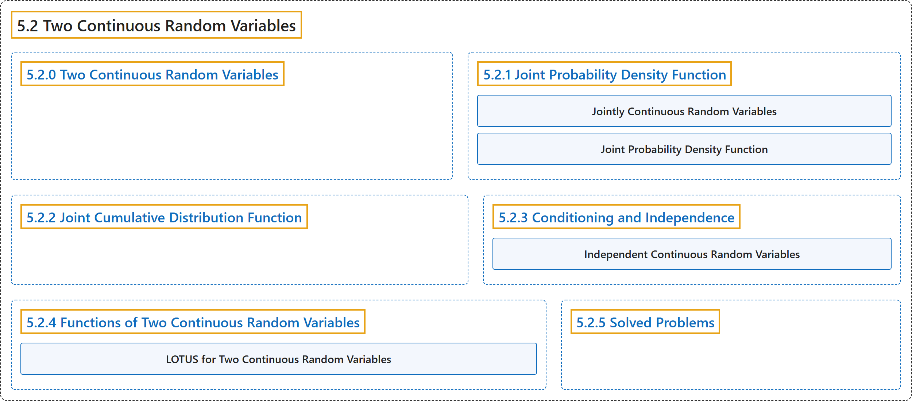

# 5.2 Two Continuous Random Variables

## Classification

## Glossary

| Term | Definition | 中文翻译 | Source |
|---|---|---|---|
| **5.2 Two Continuous Random Variables** 两个连续随机变量 | (No definition) | （无定义） | [Pishro-Nik, 2014, section 5.2](https://www.probabilitycourse.com/chapter5/5_2_0_continuous_vars.php) |
| **5.2.0 Two Continuous Random Variables** 两个连续随机变量 | (No definition) | （无定义） | [Pishro-Nik, 2014, section 5.2.0](https://www.probabilitycourse.com/chapter5/5_2_0_continuous_vars.php) |
| **5.2.1 Joint Probability Density Function** 联合概率密度函数 | (No definition) | （无定义） | [Pishro-Nik, 2014, section 5.2.1](https://www.probabilitycourse.com/chapter5/5_2_1_joint_pdf.php) |
| **Jointly Continuous Random Variables** 联合连续随机变量 | "Two random variables $X$ and $Y$ are **jointly continuous** if there exists a nonnegative function $f_{XY}:\mathbb{R}^2 \rightarrow \mathbb{R}$, such that, for any set $A\subset \mathbb{R}^2$, we have $$\begin{align} P\big((X,Y) \in A\big) =\iint \limits_A f_{XY}(x,y)dxdy \hspace{30pt} (5.15) \end{align}$$" | 若存在非负函数 $f_{XY}:\mathbb{R}^2 \rightarrow \mathbb{R}$，使得对任意集合 $A\subset \mathbb{R}^2$，都有 $$\begin{align} P\big((X,Y) \in A\big) =\iint \limits_A f_{XY}(x,y)dxdy \hspace{30pt} (5.15) \end{align}$$，则称两个随机变量 $X$ 和 $Y$ **联合连续** | [Pishro-Nik, 2014, section 5.2.1](https://www.probabilitycourse.com/chapter5/5_2_1_joint_pdf.php#:~:text=Two%20random%20variables%20and%20are%20jointly) |
| **Joint Probability Density Function** 联合概率密度函数 | "The function $f_{XY}(x,y)$ is called the **joint probability density function (PDF)** of $X$ and $Y$." | 函数 $f_{XY}(x,y)$ 称为 $X$ 和 $Y$ 的**联合概率密度函数**。 | [Pishro-Nik, 2014, section 5.2.1](https://www.probabilitycourse.com/chapter5/5_2_1_joint_pdf.php#:~:text=The%20function%20is%20called%20the%20joint) |
| **5.2.2 Joint Cumulative Distribution Function** 联合累积分布函数 | (No definition) | （无定义） | [Pishro-Nik, 2014, section 5.2.2](https://www.probabilitycourse.com/chapter5/5_2_2_joint_cdf.php) |
| **5.2.3 Conditioning and Independence** 条件与独立性 | (No definition) | （无定义） | [Pishro-Nik, 2014, section 5.2.3](https://www.probabilitycourse.com/chapter5/5_2_3_conditioning_independence.php) |
| **Independent Continuous Random Variables** 连续随机变量的独立性 | "Two continuous random variables $X$ and $Y$ are **independent** if" | 两个连续随机变量 $X$ 和 $Y$ 称为**独立**的，若 | [Pishro-Nik, 2014, section 5.2.3](https://www.probabilitycourse.com/chapter5/5_2_3_conditioning_independence.php#:~:text=Two%20continuous%20random%20variables%20and%20are) |
| **5.2.4 Functions of Two Continuous Random Variables** 两个连续随机变量的函数 | (No definition) | （无定义） | [Pishro-Nik, 2014, section 5.2.4](https://www.probabilitycourse.com/chapter5/5_2_4_functions.php) |
| **LOTUS for Two Continuous Random Variables** 二维连续随机变量的 LOTUS | "**LOTUS** for two continuous random variables:" | 两个连续随机变量的 **LOTUS**： | [Pishro-Nik, 2014, section 5.2.4](https://www.probabilitycourse.com/chapter5/5_2_4_functions.php#:~:text=LOTUS%20for%20two%20continuous%20random%20variables%3A) |
| **5.2.5 Solved Problems** 例题详解 | (No definition) | （无定义） | [Pishro-Nik, 2014, section 5.2.5](https://www.probabilitycourse.com/chapter5/5_2_5_solved_prob.php) |

## References

Pishro-Nik, H. (2014). *Introduction to probability, statistics, and random processes*. Kappa Research. Retrieved October 28, 2026, from <https://www.probabilitycourse.com/>
