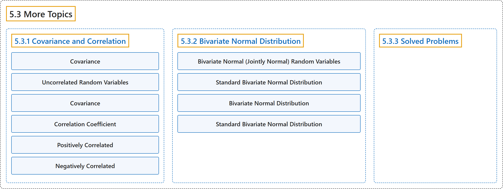

# 5.3 More Topics

## Classification

## Glossary

| Term | Definition | 中文翻译 | Source |
|---|---|---|---|
| **5.3 More Topics** 更多专题 | (No definition) | （无定义） | [Pishro-Nik, 2014, section 5.3](https://www.probabilitycourse.com/chapter5/5_3_1_covariance_correlation.php) |
| **5.3.1 Covariance and Correlation** 协方差与相关 | (No definition) | （无定义） | [Pishro-Nik, 2014, section 5.3.1](https://www.probabilitycourse.com/chapter5/5_3_1_covariance_correlation.php) |
| **Covariance** 协方差 | "The **covariance** between $X$ and $Y$ is defined as" | $X$ 与 $Y$ 之间的**协方差**定义为 | [Pishro-Nik, 2014, section 5.3.1](https://www.probabilitycourse.com/chapter5/5_3_1_covariance_correlation.php#:~:text=The%20covariance%20between%20and%20is%20defined) |
| **Uncorrelated Random Variables** 不相关随机变量 | "If $\rho(X,Y)=0$, we say that $X$ and $Y$ are **uncorrelated**." | 若 $\rho(X,Y)=0$，则称 $X$ 和 $Y$ **不相关**。 | [Pishro-Nik, 2014, section 5.3.1](https://www.probabilitycourse.com/chapter5/5_3_1_covariance_correlation.php#:~:text=If%20%2C%20we%20say%20that%20and) |
| **Covariance** 协方差 | "The **covariance** between $X$ and $Y$ is defined as $$\begin{align} \nonumber \textrm{Cov}(X,Y)&=E\big[(X-EX)(Y-EY)\big]=E[XY]-(EX)(EY). \end{align}$$" | $X$ 与 $Y$ 之间的**协方差**定义为 $$\begin{align} \nonumber \textrm{Cov}(X,Y)&=E\big[(X-EX)(Y-EY)\big]=E[XY]-(EX)(EY). \end{align}$$ | [Pishro-Nik, 2014, section 5.3.1](https://www.probabilitycourse.com/chapter5/5_3_1_covariance_correlation.php#:~:text=The%20covariance%20between%20and%20is%20defined) |
| **Correlation Coefficient** 相关系数 | "The **correlation coefficient**, denoted by $\rho_{XY}$ or $\rho(X,Y)$, is obtained by **normalizing the covariance**." | **相关系数**记作 $\rho_{XY}$ 或 $\rho(X,Y)$，由**协方差标准化**得到。 | [Pishro-Nik, 2014, section 5.3.1](https://www.probabilitycourse.com/chapter5/5_3_1_covariance_correlation.php#:~:text=The%20correlation%20coefficient%2C%20denoted%20by%20or) |
| **Positively Correlated** 正相关 | "In this case, the covariance is positive and we say $X$ and $Y$ are **positively correlated**." | 在这种情况下，协方差为正，我们说 $X$ 和 $Y$ **正相关**。 | [Pishro-Nik, 2014, section 5.3.1](https://www.probabilitycourse.com/chapter5/5_3_1_covariance_correlation.php#:~:text=In%20this%20case%2C%20the%20covariance%20is) |
| **Negatively Correlated** 负相关 | "In this case, the covariance is negative and we say $X$ and $Y$ are **negatively correlated**." | 在这种情况下，协方差为负，我们说 $X$ 和 $Y$ **负相关**。 | [Pishro-Nik, 2014, section 5.3.1](https://www.probabilitycourse.com/chapter5/5_3_1_covariance_correlation.php#:~:text=In%20this%20case%2C%20the%20covariance%20is) |
| **5.3.2 Bivariate Normal Distribution** 二元正态分布 | (No definition) | （无定义） | [Pishro-Nik, 2014, section 5.3.2](https://www.probabilitycourse.com/chapter5/5_3_2_bivariate_normal_dist.php) |
| **Bivariate Normal (Jointly Normal) Random Variables** 二元正态（联合正态）随机变量 | "Two random variables $X$ and $Y$ are said to be **bivariate normal**, or **jointly normal**, if $aX+bY$ has a normal distribution for all $a,b \in \mathbb{R}$." | 若对所有 $a,b \in \mathbb{R}$，$aX+bY$ 都服从正态分布，则称两个随机变量 $X$ 和 $Y$ **服从二元正态分布**，或**联合正态**。 | [Pishro-Nik, 2014, section 5.3.2](https://www.probabilitycourse.com/chapter5/5_3_2_bivariate_normal_dist.php#:~:text=Two%20random%20variables%20and%20are%20said) |
| **Standard Bivariate Normal Distribution** 标准二元正态分布 | "Two random variables $X$ and $Y$ are said to have the **standard bivariate normal distribution** with correlation coefficient $\mathbf{\rho}$ if their joint PDF is given by" | 若两个随机变量 $X$ 和 $Y$ 的联合概率密度函数为如下形式，则称它们服从相关系数为 $\mathbf{\rho}$ 的**标准二元正态分布** | [Pishro-Nik, 2014, section 5.3.2](https://www.probabilitycourse.com/chapter5/5_3_2_bivariate_normal_dist.php#:~:text=Two%20random%20variables%20and%20are%20said) |
| **Bivariate Normal Distribution** 二元正态分布 | "Two random variables $X$ and $Y$ are said to have a **bivariate normal distribution** with parameters $\mu_X$, $\sigma^2_X$, $\mu_Y$, $\sigma^2_Y$, and $\rho$, if their joint PDF is given by $$\begin{align} \nonumber &f_{XY}(x,y)=\frac{1}{2 \pi \sigma_X \sigma_Y \sqrt{1-\rho^2}} \cdot\\ &\exp \left\{-\frac{1}{2 (1-\rho^2)}\bigg[\bigg(\frac{x-\mu_X}{\sigma_X}\bigg)^2 +\bigg(\frac{y-\mu_Y}{\sigma_Y}\bigg)^2-2\rho \frac{(x-\mu_X)(y-\mu_Y)}{\sigma_X \sigma_Y} \bigg] \right\} (5.24) \end{align}$$" | 若两个随机变量 $X$ 和 $Y$ 的联合概率密度函数由 $$\begin{align} \nonumber &f_{XY}(x,y)=\frac{1}{2 \pi \sigma_X \sigma_Y \sqrt{1-\rho^2}} \cdot\\ &\exp \left\{-\frac{1}{2 (1-\rho^2)}\bigg[\bigg(\frac{x-\mu_X}{\sigma_X}\bigg)^2 +\bigg(\frac{y-\mu_Y}{\sigma_Y}\bigg)^2-2\rho \frac{(x-\mu_X)(y-\mu_Y)}{\sigma_X \sigma_Y} \bigg] \right\} (5.24) \end{align}$$ 给出，则称它们服从参数为 $\mu_X$、$\sigma^2_X$、$\mu_Y$、$\sigma^2_Y$ 和 $\rho$ 的**二元正态分布** | [Pishro-Nik, 2014, section 5.3.2](https://www.probabilitycourse.com/chapter5/5_3_2_bivariate_normal_dist.php#:~:text=Two%20random%20variables%20and%20are%20said) |
| **Standard Bivariate Normal Distribution** 标准二元正态分布 | "Similar to our discussion on normal random variables, we start by introducing the **standard bivariate normal distribution** and then obtain the general case from the standard one." | 与我们对正态随机变量的讨论类似，我们从引入**标准二元正态分布**开始，然后由标准情形得到一般情形。 | [Pishro-Nik, 2014, section 5.3.2](https://www.probabilitycourse.com/chapter5/5_3_2_bivariate_normal_dist.php#:~:text=Similar%20to%20our%20discussion%20on%20normal) |
| **5.3.3 Solved Problems** 例题详解 | (No definition) | （无定义） | [Pishro-Nik, 2014, section 5.3.3](https://www.probabilitycourse.com/chapter5/5_3_3_solved_probs.php) |

## References

Pishro-Nik, H. (2014). *Introduction to probability, statistics, and random processes*. Kappa Research. Retrieved October 28, 2026, from <https://www.probabilitycourse.com/>
