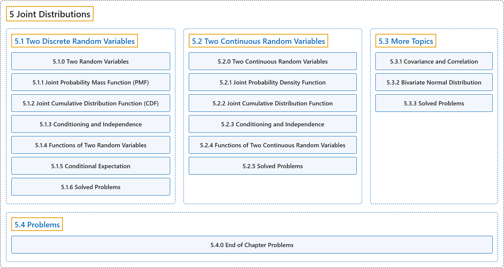

# 5 Joint Distributions

## Classification

## Glossary

| Term | Definition | 中文翻译 | Source |
|---|---|---|---|
| **5 Joint Distributions** 联合分布 | (No definition) | （无定义） | [Pishro-Nik, 2014, chapter 5](https://www.probabilitycourse.com/) |
| **[5.1 Two Discrete Random Variables](5-1-two-discrete-random-variables.md)** 两个离散随机变量 | (No definition) | （无定义） | [Pishro-Nik, 2014, section 5.1](https://www.probabilitycourse.com/chapter5/5_1_0_joint_distributions.php) |
| **[5.2 Two Continuous Random Variables](5-2-two-continuous-random-variables.md)** 两个连续随机变量 | (No definition) | （无定义） | [Pishro-Nik, 2014, section 5.2](https://www.probabilitycourse.com/chapter5/5_2_0_continuous_vars.php) |
| **[5.3 More Topics](5-3-more-topics.md)** 更多专题 | (No definition) | （无定义） | [Pishro-Nik, 2014, section 5.3](https://www.probabilitycourse.com/chapter5/5_3_1_covariance_correlation.php) |
| **[5.4 Problems](5-4-problems.md)** 习题 | (No definition) | （无定义） | [Pishro-Nik, 2014, section 5.4](https://www.probabilitycourse.com/chapter5/5_4_0_chapter_problems.php) |

## References

Pishro-Nik, H. (2014). *Introduction to probability, statistics, and random processes*. Kappa Research. Retrieved October 28, 2026, from <https://www.probabilitycourse.com/>
