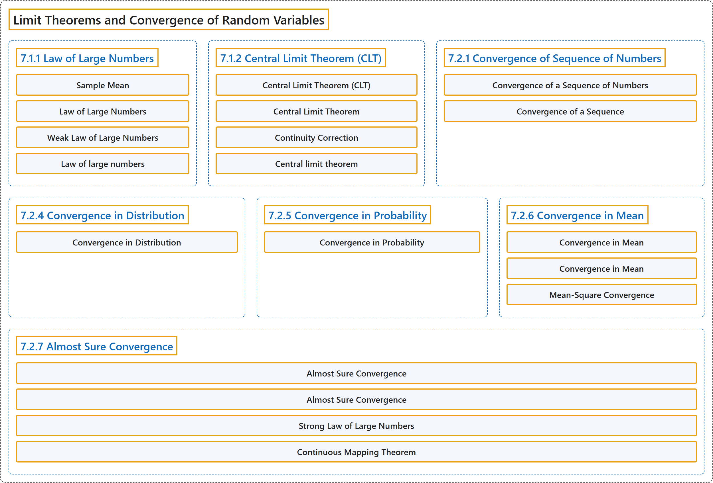

# 7 Limit Theorems and Convergence of Random Variables

## Classification

## Glossary

| Term | Definition | 中文翻译 | Source |
|---|---|---|---|
| **7 Limit Theorems and Convergence of Random Variables** 极限定理与随机变量的收敛 | (No definition) | （无定义） | [Pishro-Nik, 2014, chapter 7](https://www.probabilitycourse.com/) |
| **7.1.1 Law of Large Numbers** 大数定律 | (No definition) | （无定义） | [Pishro-Nik, 2014, section 7.1.1](https://www.probabilitycourse.com/chapter7/7_1_1_law_of_large_numbers.php) |
| **Sample Mean** 样本均值 | "For i.i.d. random variables $X_1, X_2,..., X_{\large n}$, the **sample mean**, denoted by $\overline{X}$, is defined as" | 对于独立同分布随机变量 $X_1, X_2,..., X_{\large n}$，**样本均值**记为 $\overline{X}$，定义为 | [Pishro-Nik, 2014, section 7.1.1](https://www.probabilitycourse.com/chapter7/7_1_1_law_of_large_numbers.php#:~:text=For%20i.i.d.%20random%20variables%20%2C%20the) |
| **Law of Large Numbers** 大数定律 | "The **law of large numbers** has a very central role in probability and statistics. It states that if you **repeat an experiment independently** a large number of times and average the result, what you obtain should be **close to the expected value**." | **大数定律**在概率论与统计学中处于非常核心的地位。它指出，如果**独立重复一个试验**很多次并对结果取平均，所得结果应当**接近期望值**。 | [Pishro-Nik, 2014, section 7.1.1](https://www.probabilitycourse.com/chapter7/7_1_1_law_of_large_numbers.php#:~:text=The%20law%20of%20large%20numbers%20has) |
| **Weak Law of Large Numbers** 弱大数定律 | "Now let us state and prove the **weak law of large numbers** (WLLN)." | 现在我们来陈述并证明**弱大数定律**（WLLN）。 | [Pishro-Nik, 2014, section 7.1.1](https://www.probabilitycourse.com/chapter7/7_1_1_law_of_large_numbers.php#:~:text=Now%20let%20us%20state%20and%20prove) |
| **Law of large numbers** 大数定律 | "A 'law of large numbers' is one of several theorems expressing the idea that as **the number of trials of a random process increases**, **the percentage difference between the expected and actual values goes to zero**." | “大数定律”是若干定理之一，它们表达这样一个想法：随着**随机过程的试验次数增加**，**期望值与实际值之间的百分比差异趋于零**。 | [Weisstein, n.d.-b, "Law of large numbers" entry, para. 1](https://mathworld.wolfram.com/LawofLargeNumbers.html#:~:text=is%20one%20of%20several%20theorems%20expressing%20the%20idea) |
| **7.1.2 Central Limit Theorem (CLT)** 中心极限定理（CLT） | (No definition) | （无定义） | [Pishro-Nik, 2014, section 7.1.2](https://www.probabilitycourse.com/chapter7/7_1_2_central_limit_theorem.php) |
| **Central Limit Theorem (CLT)** 中心极限定理 | "The **Central Limit Theorem (CLT)** Let $X_1$,$X_2$,...,$X_{\large n}$ be i.i.d. random variables with expected value $EX_{\large i}=\mu <\infty$ and variance $0<\mathrm{Var}(X_{\large i})=\sigma^2 < \infty$." | **中心极限定理**（CLT） 设 $X_1$,$X_2$,...,$X_{\large n}$ 为独立同分布随机变量，期望 $EX_{\large i}=\mu <\infty$，方差 $0<\mathrm{Var}(X_{\large i})=\sigma^2 < \infty$。 | [Pishro-Nik, 2014, section 7.1.2](https://www.probabilitycourse.com/chapter7/7_1_2_central_limit_theorem.php#:~:text=The%20Central%20Limit%20Theorem%20%28CLT%29%20Let) |
| **Central Limit Theorem** 中心极限定理 | "The **central limit theorem** (CLT) is one of the most important results in probability theory. It states that, under certain conditions, the sum of a large number of random variables is **approximately normal**." | **中心极限定理**（CLT）是概率论中最重要的结果之一。它指出，在一定条件下，大量随机变量之和**近似服从正态分布**。 | [Pishro-Nik, 2014, section 7.1.2](https://www.probabilitycourse.com/chapter7/7_1_2_central_limit_theorem.php#:~:text=The%20central%20limit%20theorem%20%28CLT%29%20is) |
| **Continuity Correction** 连续性修正 | "Here is a trick to get a better approximation, called **continuity correction**." | 这里有一个得到更好近似的技巧，称为**连续性修正**。 | [Pishro-Nik, 2014, section 7.1.2](https://www.probabilitycourse.com/chapter7/7_1_2_central_limit_theorem.php#:~:text=Here%20is%20a%20trick%20to%20get) |
| **Central limit theorem** 中心极限定理 | "The central limit theorem states that **the normalized sum of independent random variates** with finite variances **approaches a normal distribution**." | 中心极限定理指出，方差有限的**独立随机变量经标准化后的和**会**趋近于正态分布**。 | [Weisstein, n.d.-a, "Central limit theorem" entry, para. 1](https://mathworld.wolfram.com/CentralLimitTheorem.html#:~:text=The%20central%20limit%20theorem%20states%20that%20the%20normalized%20sum) |
| **7.2.1 Convergence of Sequence of Numbers** 数列的收敛 | (No definition) | （无定义） | [Pishro-Nik, 2014, section 7.2.1](https://www.probabilitycourse.com/chapter7/7_2_1_convergence_of_a_seq_of_nums.php) |
| **Convergence of a Sequence of Numbers** 数列的收敛 | "A sequence $a_1$, $a_2$, $a_3$, $\cdots$ **converges** to a **limit** $L$ if" | 数列 $a_1$, $a_2$, $a_3$, $\cdots$ **收敛**于**极限** $L$，若 | [Pishro-Nik, 2014, section 7.2.1](https://www.probabilitycourse.com/chapter7/7_2_1_convergence_of_a_seq_of_nums.php#:~:text=A%20sequence%20%2C%20%2C%20%2C%20converges) |
| **Convergence of a Sequence** 数列的收敛 | "A sequence $a_1$, $a_2$, $a_3$, $\cdots$ **converges** to a **limit** $L$ if" | 如果数列 $a_1$, $a_2$, $a_3$, $\cdots$ **收敛**到**极限** $L$，当且仅当 | [Pishro-Nik, 2014, section 7.2.1](https://www.probabilitycourse.com/chapter7/7_2_1_convergence_of_a_seq_of_nums.php#:~:text=A%20sequence%20%2C%20%2C%20%2C%20converges) |
| **7.2.4 Convergence in Distribution** 依分布收敛 | (No definition) | （无定义） | [Pishro-Nik, 2014, section 7.2.4](https://www.probabilitycourse.com/chapter7/7_2_4_convergence_in_distribution.php) |
| **Convergence in Distribution** 依分布收敛 | "A sequence of random variables $X_1$, $X_2$, $X_3$, $\cdots$ **converges in distribution** to a random variable $X$, shown by $X_n \ \xrightarrow{d}\ X$, if" | 随机变量序列 $X_1$, $X_2$, $X_3$, $\cdots$ **依分布收敛**于随机变量 $X$，记作 $X_n \ \xrightarrow{d}\ X$，若 | [Pishro-Nik, 2014, section 7.2.4](https://www.probabilitycourse.com/chapter7/7_2_4_convergence_in_distribution.php#:~:text=A%20sequence%20of%20random%20variables%20%2C) |
| **7.2.5 Convergence in Probability** 依概率收敛 | (No definition) | （无定义） | [Pishro-Nik, 2014, section 7.2.5](https://www.probabilitycourse.com/chapter7/7_2_5_convergence_in_probability.php) |
| **Convergence in Probability** 依概率收敛 | "A sequence of random variables $X_1$, $X_2$, $X_3$, $\cdots$ **converges in probability** to a random variable $X$, shown by $X_n \ \xrightarrow{p}\ X$, if" | 随机变量序列 $X_1$, $X_2$, $X_3$, $\cdots$ **依概率收敛**于随机变量 $X$，记作 $X_n \ \xrightarrow{p}\ X$，若 | [Pishro-Nik, 2014, section 7.2.5](https://www.probabilitycourse.com/chapter7/7_2_5_convergence_in_probability.php#:~:text=A%20sequence%20of%20random%20variables%20%2C) |
| **7.2.6 Convergence in Mean** 均值收敛 | (No definition) | （无定义） | [Pishro-Nik, 2014, section 7.2.6](https://www.probabilitycourse.com/chapter7/7_2_6_convergence_in_mean.php) |
| **Convergence in Mean** 均值收敛（r 阶矩收敛） | "If $r=2$, it is called the **mean-square convergence**, and it is shown by $X_n \ \xrightarrow{m.s.}\ X$." | 若 $r=2$，则称为**均方收敛**，记作 $X_n \ \xrightarrow{m.s.}\ X$。 | [Pishro-Nik, 2014, section 7.2.6](https://www.probabilitycourse.com/chapter7/7_2_6_convergence_in_mean.php#:~:text=If%20%2C%20it%20is%20called%20the) |
| **Convergence in Mean** 均值收敛 | "where $r \geq 1$ is a fixed number. This refers to **convergence in mean**." | 其中 $r \geq 1$ 是固定的数。这称为**均值收敛**。 | [Pishro-Nik, 2014, section 7.2.6](https://www.probabilitycourse.com/chapter7/7_2_6_convergence_in_mean.php#:~:text=where%20is%20a%20fixed%20number.%20This) |
| **Mean-Square Convergence** 均方收敛 | "The most common choice is $r=2$, in which case it is called the **mean-square convergence**." | 最常见的选择是 $r=2$，此时称为**均方收敛**。 | [Pishro-Nik, 2014, section 7.2.6](https://www.probabilitycourse.com/chapter7/7_2_6_convergence_in_mean.php#:~:text=The%20most%20common%20choice%20is%20%2C) |
| **7.2.7 Almost Sure Convergence** 几乎必然收敛 | (No definition) | （无定义） | [Pishro-Nik, 2014, section 7.2.7](https://www.probabilitycourse.com/chapter7/7_2_7_almost_sure_convergence.php) |
| **Almost Sure Convergence** 几乎必然收敛 | "A sequence of random variables $X_1$, $X_2$, $X_3$, $\cdots$ **converges almost surely** to a random variable $X$, shown by $X_n \ \xrightarrow{a.s.}\ X$, if" | 随机变量序列 $X_1$, $X_2$, $X_3$, $\cdots$ **几乎必然收敛**于随机变量 $X$，记作 $X_n \ \xrightarrow{a.s.}\ X$，若 | [Pishro-Nik, 2014, section 7.2.7](https://www.probabilitycourse.com/chapter7/7_2_7_almost_sure_convergence.php#:~:text=A%20sequence%20of%20random%20variables%20%2C) |
| **Almost Sure Convergence** 几乎必然收敛 | "In general, if the probability that the sequence $X_{n}(s)$ converges to $X(s)$ is equal to $1$, we say that $X_n$ converges to $X$ **almost surely**" | 一般地，如果序列 $X_{n}(s)$ 收敛到 $X(s)$ 的概率等于 $1$，我们就说 $X_n$ **几乎必然**收敛到 $X$ | [Pishro-Nik, 2014, section 7.2.7](https://www.probabilitycourse.com/chapter7/7_2_7_almost_sure_convergence.php#:~:text=In%20general%2C%20if%20the%20probability%20that) |
| **Strong Law of Large Numbers** 强大数定律 | "An important example for almost sure convergence is the **strong law of large numbers** (SLLN)." | 几乎必然收敛的一个重要例子是**强大数定律**（SLLN）。 | [Pishro-Nik, 2014, section 7.2.7](https://www.probabilitycourse.com/chapter7/7_2_7_almost_sure_convergence.php#:~:text=An%20important%20example%20for%20almost%20sure) |
| **Continuous Mapping Theorem** 连续映射定理 | "We end this section by stating a version of the **continuous mapping theorem**. This theorem is sometimes useful when proving the convergence of random variables." | 本节最后陈述**连续映射定理**的一个版本。该定理在证明随机变量的收敛时有时很有用。 | [Pishro-Nik, 2014, section 7.2.7](https://www.probabilitycourse.com/chapter7/7_2_7_almost_sure_convergence.php#:~:text=We%20end%20this%20section%20by%20stating) |

## References

Pishro-Nik, H. (2014). *Introduction to probability, statistics, and random processes*. Kappa Research. Retrieved October 28, 2026, from <https://www.probabilitycourse.com/>

Weisstein, E. W. (n.d.-a). *Central limit theorem*. MathWorld: A Wolfram Resource. Retrieved October 27, 2026, from <https://mathworld.wolfram.com/CentralLimitTheorem.html>

Weisstein, E. W. (n.d.-b). *Law of large numbers*. MathWorld: A Wolfram Resource. Retrieved October 27, 2026, from <https://mathworld.wolfram.com/LawofLargeNumbers.html>
