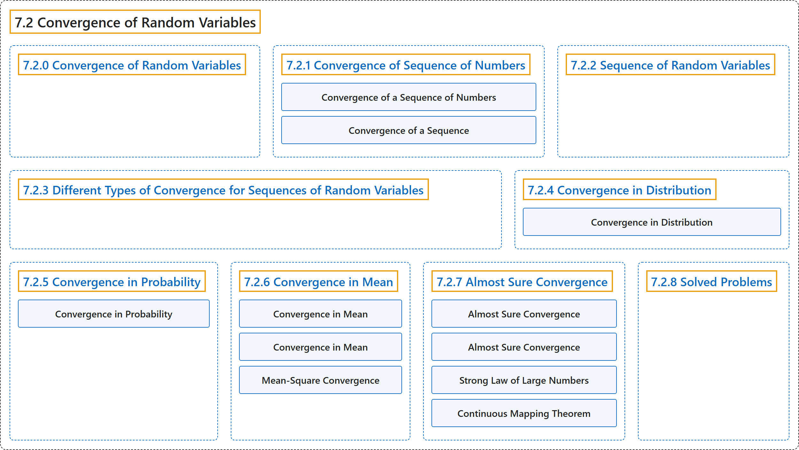

# 7.2 Convergence of Random Variables

## Classification

## Glossary

| Term | Definition | 中文翻译 | Source |
|---|---|---|---|
| **7.2 Convergence of Random Variables** 随机变量的收敛 | (No definition) | （无定义） | [Pishro-Nik, 2014, section 7.2](https://www.probabilitycourse.com/chapter7/7_2_0_convergence_of_random_variables.php) |
| **7.2.0 Convergence of Random Variables** 随机变量的收敛 | (No definition) | （无定义） | [Pishro-Nik, 2014, section 7.2.0](https://www.probabilitycourse.com/chapter7/7_2_0_convergence_of_random_variables.php) |
| **7.2.1 Convergence of Sequence of Numbers** 数列的收敛 | (No definition) | （无定义） | [Pishro-Nik, 2014, section 7.2.1](https://www.probabilitycourse.com/chapter7/7_2_1_convergence_of_a_seq_of_nums.php) |
| **Convergence of a Sequence of Numbers** 数列的收敛 | "A sequence $a_1$, $a_2$, $a_3$, $\cdots$ **converges** to a **limit** $L$ if" | 数列 $a_1$, $a_2$, $a_3$, $\cdots$ **收敛**于**极限** $L$，若 | [Pishro-Nik, 2014, section 7.2.1](https://www.probabilitycourse.com/chapter7/7_2_1_convergence_of_a_seq_of_nums.php#:~:text=A%20sequence%20%2C%20%2C%20%2C%20converges) |
| **Convergence of a Sequence** 数列的收敛 | "A sequence $a_1$, $a_2$, $a_3$, $\cdots$ **converges** to a **limit** $L$ if" | 如果数列 $a_1$, $a_2$, $a_3$, $\cdots$ **收敛**到**极限** $L$，当且仅当 | [Pishro-Nik, 2014, section 7.2.1](https://www.probabilitycourse.com/chapter7/7_2_1_convergence_of_a_seq_of_nums.php#:~:text=A%20sequence%20%2C%20%2C%20%2C%20converges) |
| **7.2.2 Sequence of Random Variables** 随机变量序列 | (No definition) | （无定义） | [Pishro-Nik, 2014, section 7.2.2](https://www.probabilitycourse.com/chapter7/7_2_2_sequence_of_random_variables.php) |
| **7.2.3 Different Types of Convergence for Sequences of Random Variables** 随机变量序列的不同收敛类型 | (No definition) | （无定义） | [Pishro-Nik, 2014, section 7.2.3](https://www.probabilitycourse.com/chapter7/7_2_3_different_types_of_convergence_for_sequences_of_random_variables.php) |
| **7.2.4 Convergence in Distribution** 依分布收敛 | (No definition) | （无定义） | [Pishro-Nik, 2014, section 7.2.4](https://www.probabilitycourse.com/chapter7/7_2_4_convergence_in_distribution.php) |
| **Convergence in Distribution** 依分布收敛 | "A sequence of random variables $X_1$, $X_2$, $X_3$, $\cdots$ **converges in distribution** to a random variable $X$, shown by $X_n \ \xrightarrow{d}\ X$, if" | 随机变量序列 $X_1$, $X_2$, $X_3$, $\cdots$ **依分布收敛**于随机变量 $X$，记作 $X_n \ \xrightarrow{d}\ X$，若 | [Pishro-Nik, 2014, section 7.2.4](https://www.probabilitycourse.com/chapter7/7_2_4_convergence_in_distribution.php#:~:text=A%20sequence%20of%20random%20variables%20%2C) |
| **7.2.5 Convergence in Probability** 依概率收敛 | (No definition) | （无定义） | [Pishro-Nik, 2014, section 7.2.5](https://www.probabilitycourse.com/chapter7/7_2_5_convergence_in_probability.php) |
| **Convergence in Probability** 依概率收敛 | "A sequence of random variables $X_1$, $X_2$, $X_3$, $\cdots$ **converges in probability** to a random variable $X$, shown by $X_n \ \xrightarrow{p}\ X$, if" | 随机变量序列 $X_1$, $X_2$, $X_3$, $\cdots$ **依概率收敛**于随机变量 $X$，记作 $X_n \ \xrightarrow{p}\ X$，若 | [Pishro-Nik, 2014, section 7.2.5](https://www.probabilitycourse.com/chapter7/7_2_5_convergence_in_probability.php#:~:text=A%20sequence%20of%20random%20variables%20%2C) |
| **7.2.6 Convergence in Mean** 均值收敛 | (No definition) | （无定义） | [Pishro-Nik, 2014, section 7.2.6](https://www.probabilitycourse.com/chapter7/7_2_6_convergence_in_mean.php) |
| **Convergence in Mean** 均值收敛（r 阶矩收敛） | "If $r=2$, it is called the **mean-square convergence**, and it is shown by $X_n \ \xrightarrow{m.s.}\ X$." | 若 $r=2$，则称为**均方收敛**，记作 $X_n \ \xrightarrow{m.s.}\ X$。 | [Pishro-Nik, 2014, section 7.2.6](https://www.probabilitycourse.com/chapter7/7_2_6_convergence_in_mean.php#:~:text=If%20%2C%20it%20is%20called%20the) |
| **Convergence in Mean** 均值收敛 | "where $r \geq 1$ is a fixed number. This refers to **convergence in mean**." | 其中 $r \geq 1$ 是固定的数。这称为**均值收敛**。 | [Pishro-Nik, 2014, section 7.2.6](https://www.probabilitycourse.com/chapter7/7_2_6_convergence_in_mean.php#:~:text=where%20is%20a%20fixed%20number.%20This) |
| **Mean-Square Convergence** 均方收敛 | "The most common choice is $r=2$, in which case it is called the **mean-square convergence**." | 最常见的选择是 $r=2$，此时称为**均方收敛**。 | [Pishro-Nik, 2014, section 7.2.6](https://www.probabilitycourse.com/chapter7/7_2_6_convergence_in_mean.php#:~:text=The%20most%20common%20choice%20is%20%2C) |
| **7.2.7 Almost Sure Convergence** 几乎必然收敛 | (No definition) | （无定义） | [Pishro-Nik, 2014, section 7.2.7](https://www.probabilitycourse.com/chapter7/7_2_7_almost_sure_convergence.php) |
| **Almost Sure Convergence** 几乎必然收敛 | "A sequence of random variables $X_1$, $X_2$, $X_3$, $\cdots$ **converges almost surely** to a random variable $X$, shown by $X_n \ \xrightarrow{a.s.}\ X$, if" | 随机变量序列 $X_1$, $X_2$, $X_3$, $\cdots$ **几乎必然收敛**于随机变量 $X$，记作 $X_n \ \xrightarrow{a.s.}\ X$，若 | [Pishro-Nik, 2014, section 7.2.7](https://www.probabilitycourse.com/chapter7/7_2_7_almost_sure_convergence.php#:~:text=A%20sequence%20of%20random%20variables%20%2C) |
| **Almost Sure Convergence** 几乎必然收敛 | "In general, if the probability that the sequence $X_{n}(s)$ converges to $X(s)$ is equal to $1$, we say that $X_n$ converges to $X$ **almost surely**" | 一般地，如果序列 $X_{n}(s)$ 收敛到 $X(s)$ 的概率等于 $1$，我们就说 $X_n$ **几乎必然**收敛到 $X$ | [Pishro-Nik, 2014, section 7.2.7](https://www.probabilitycourse.com/chapter7/7_2_7_almost_sure_convergence.php#:~:text=In%20general%2C%20if%20the%20probability%20that) |
| **Strong Law of Large Numbers** 强大数定律 | "An important example for almost sure convergence is the **strong law of large numbers** (SLLN)." | 几乎必然收敛的一个重要例子是**强大数定律**（SLLN）。 | [Pishro-Nik, 2014, section 7.2.7](https://www.probabilitycourse.com/chapter7/7_2_7_almost_sure_convergence.php#:~:text=An%20important%20example%20for%20almost%20sure) |
| **Continuous Mapping Theorem** 连续映射定理 | "We end this section by stating a version of the **continuous mapping theorem**. This theorem is sometimes useful when proving the convergence of random variables." | 本节最后陈述**连续映射定理**的一个版本。该定理在证明随机变量的收敛时有时很有用。 | [Pishro-Nik, 2014, section 7.2.7](https://www.probabilitycourse.com/chapter7/7_2_7_almost_sure_convergence.php#:~:text=We%20end%20this%20section%20by%20stating) |
| **7.2.8 Solved Problems** 例题详解 | (No definition) | （无定义） | [Pishro-Nik, 2014, section 7.2.8](https://www.probabilitycourse.com/chapter7/7_2_8_solved_probs.php) |

## References

Pishro-Nik, H. (2014). *Introduction to probability, statistics, and random processes*. Kappa Research. Retrieved October 28, 2026, from <https://www.probabilitycourse.com/>
