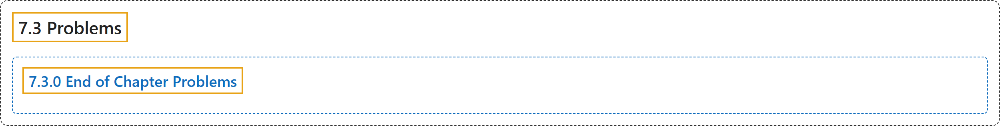

# 7.3 Problems

## Classification

## Glossary

| Term | Definition | 中文翻译 | Source |
|---|---|---|---|
| **7.3 Problems** 习题 | (No definition) | （无定义） | [Pishro-Nik, 2014, section 7.3](https://www.probabilitycourse.com/chapter7/7_3_0_chapter_problem.php) |
| **7.3.0 End of Chapter Problems** 章末习题 | (No definition) | （无定义） | [Pishro-Nik, 2014, section 7.3.0](https://www.probabilitycourse.com/chapter7/7_3_0_chapter_problem.php) |

## References

Pishro-Nik, H. (2014). *Introduction to probability, statistics, and random processes*. Kappa Research. Retrieved October 28, 2026, from <https://www.probabilitycourse.com/>
