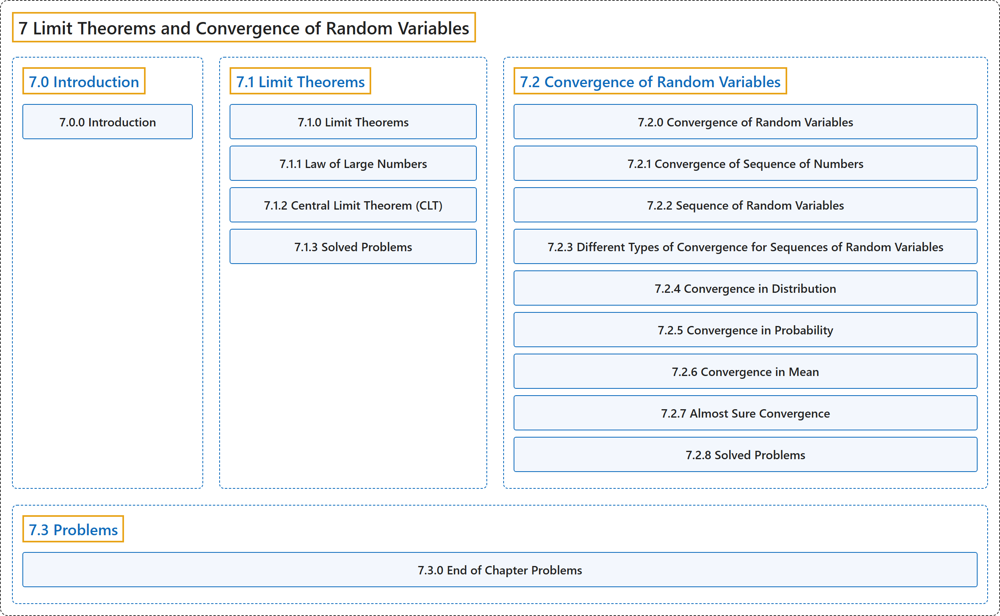

# 7 Limit Theorems and Convergence of Random Variables

## Classification

## Glossary

| Term | Definition | 中文翻译 | Source |
|---|---|---|---|
| **7 Limit Theorems and Convergence of Random Variables** 极限定理与随机变量的收敛 | (No definition) | （无定义） | [Pishro-Nik, 2014, chapter 7](https://www.probabilitycourse.com/) |
| **[7.0 Introduction](7-0-introduction.md)** 介绍 | (No definition) | （无定义） | [Pishro-Nik, 2014, section 7.0](https://www.probabilitycourse.com/chapter7/7_0_0_intro.php) |
| **[7.1 Limit Theorems](7-1-limit-theorems.md)** 极限定理 | (No definition) | （无定义） | [Pishro-Nik, 2014, section 7.1](https://www.probabilitycourse.com/chapter7/7_1_0_limit_theorems.php) |
| **[7.2 Convergence of Random Variables](7-2-convergence-of-random-variables.md)** 随机变量的收敛 | (No definition) | （无定义） | [Pishro-Nik, 2014, section 7.2](https://www.probabilitycourse.com/chapter7/7_2_0_convergence_of_random_variables.php) |
| **[7.3 Problems](7-3-problems.md)** 习题 | (No definition) | （无定义） | [Pishro-Nik, 2014, section 7.3](https://www.probabilitycourse.com/chapter7/7_3_0_chapter_problem.php) |

## References

Pishro-Nik, H. (2014). *Introduction to probability, statistics, and random processes*. Kappa Research. Retrieved October 28, 2026, from <https://www.probabilitycourse.com/>
