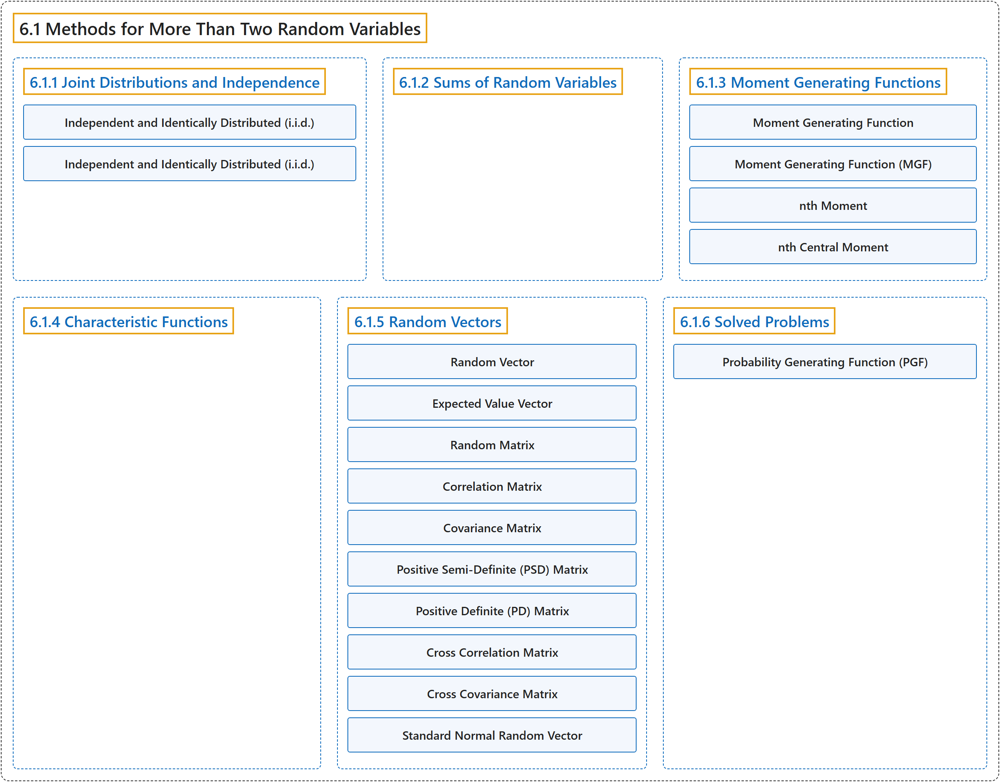

# 6.1 Methods for More Than Two Random Variables

## Classification

## Glossary

| Term | Definition | 中文翻译 | Source |
|---|---|---|---|
| **6.1 Methods for More Than Two Random Variables** 多于两个随机变量的方法 | (No definition) | （无定义） | [Pishro-Nik, 2014, section 6.1](https://www.probabilitycourse.com/chapter6/6_1_1_joint_distributions_independence.php) |
| **6.1.1 Joint Distributions and Independence** 联合分布与独立性 | (No definition) | （无定义） | [Pishro-Nik, 2014, section 6.1.1](https://www.probabilitycourse.com/chapter6/6_1_1_joint_distributions_independence.php) |
| **Independent and Identically Distributed (i.i.d.)** 独立同分布 | "Random variables $X_1$, $X_2$,..., $X_n$ are said to be **independent and identically distributed (i.i.d.)** if they are independent, and they have the same marginal distributions:" | 若随机变量 $X_1$, $X_2$,..., $X_n$ 相互独立且具有相同的边缘分布，则称它们**独立同分布**（i.i.d.）： | [Pishro-Nik, 2014, section 6.1.1](https://www.probabilitycourse.com/chapter6/6_1_1_joint_distributions_independence.php#:~:text=Random%20variables%20%2C%20%2C...%2C%20are%20said) |
| **Independent and Identically Distributed (i.i.d.)** 独立同分布 | "Random variables $X_1$, $X_2$,..., $X_n$ are said to be **independent and identically distributed (i.i.d.)** if they are independent, and they have the same marginal distributions: $$\begin{align} \nonumber F_{X_1}(x)=F_{X_2}(x)=...=F_{X_n}(x), \textrm{ for all }x \in \mathbb{R}. \end{align}$$" | 若随机变量 $X_1$、$X_2$、...、$X_n$ 相互独立且具有相同的边缘分布 $$\begin{align} \nonumber F_{X_1}(x)=F_{X_2}(x)=...=F_{X_n}(x), \textrm{ for all }x \in \mathbb{R}. \end{align}$$，则称它们**独立同分布**（i.i.d.） | [Pishro-Nik, 2014, section 6.1.1](https://www.probabilitycourse.com/chapter6/6_1_1_joint_distributions_independence.php#:~:text=Random%20variables%20%2C%20%2C...%2C%20are%20said) |
| **6.1.2 Sums of Random Variables** 随机变量之和 | (No definition) | （无定义） | [Pishro-Nik, 2014, section 6.1.2](https://www.probabilitycourse.com/chapter6/6_1_2_sums_random_variables.php) |
| **6.1.3 Moment Generating Functions** 矩母函数 | (No definition) | （无定义） | [Pishro-Nik, 2014, section 6.1.3](https://www.probabilitycourse.com/chapter6/6_1_3_moment_functions.php) |
| **Moment Generating Function** 矩母函数 | "The **moment generating function (MGF)** of a random variable $X$ is a function $M_X(s)$ defined as $$\begin{align} \nonumber M_X(s)=E\left[e^{sX}\right]. \end{align}$$" | 随机变量 $X$ 的**矩母函数**（MGF）是定义为 $$\begin{align} \nonumber M_X(s)=E\left[e^{sX}\right]. \end{align}$$ 的函数 $M_X(s)$ | [Pishro-Nik, 2014, section 6.1.3](https://www.probabilitycourse.com/chapter6/6_1_3_moment_functions.php#:~:text=The%20moment%20generating%20function%20%28MGF%29%20of) |
| **Moment Generating Function (MGF)** 矩母函数 | "The **moment generating function (MGF)** of a random variable $X$ is a function $M_X(s)$ defined as" | 随机变量 $X$ 的**矩母函数**（MGF）是定义为如下形式的函数 $M_X(s)$ | [Pishro-Nik, 2014, section 6.1.3](https://www.probabilitycourse.com/chapter6/6_1_3_moment_functions.php#:~:text=The%20moment%20generating%20function%20%28MGF%29%20of) |
| **nth Moment** n 阶矩 | "The **n th moment** of a random variable $X$ is defined to be $E[X^n]$." | 随机变量 $X$ 的 **n 阶矩**定义为 $E[X^n]$。 | [Pishro-Nik, 2014, section 6.1.3](https://www.probabilitycourse.com/chapter6/6_1_3_moment_functions.php#:~:text=The%20n%20th%20moment%20of%20a) |
| **nth Central Moment** n 阶中心矩 | "The **n th central moment** of $X$ is defined to be $E[(X-EX)^n]$." | $X$ 的 **n 阶中心矩**定义为 $E[(X-EX)^n]$。 | [Pishro-Nik, 2014, section 6.1.3](https://www.probabilitycourse.com/chapter6/6_1_3_moment_functions.php#:~:text=The%20n%20th%20central%20moment%20of) |
| **6.1.4 Characteristic Functions** 特征函数 | (No definition) | （无定义） | [Pishro-Nik, 2014, section 6.1.4](https://www.probabilitycourse.com/chapter6/6_1_4_characteristic_functions.php) |
| **6.1.5 Random Vectors** 随机向量 | (No definition) | （无定义） | [Pishro-Nik, 2014, section 6.1.5](https://www.probabilitycourse.com/chapter6/6_1_5_random_vectors.php) |
| **Random Vector** 随机向量 | "We call $\textbf{X}$ a **random vector**." | 我们称 $\textbf{X}$ 为**随机向量**。 | [Pishro-Nik, 2014, section 6.1.5](https://www.probabilitycourse.com/chapter6/6_1_5_random_vectors.php#:~:text=We%20call%20a%20random%20vector.) |
| **Expected Value Vector** 期望向量（均值向量） | "The **expected value vector** or the **mean vector** of the random vector X is defined as $$\begin{align} \nonumber E\mathbf{X} = \begin{bmatrix} EX_1 \\ EX_2 \\. \\[-10pt]. \\[-10pt]. \\[5pt] EX_n \end{bmatrix}. \end{align}$$" | 随机向量 X 的**期望向量**或**均值向量**定义为 $$\begin{align} \nonumber E\mathbf{X} = \begin{bmatrix} EX_1 \\ EX_2 \\. \\[-10pt]. \\[-10pt]. \\[5pt] EX_n \end{bmatrix}. \end{align}$$ | [Pishro-Nik, 2014, section 6.1.5](https://www.probabilitycourse.com/chapter6/6_1_5_random_vectors.php#:~:text=The%20expected%20value%20vector%20or%20the) |
| **Random Matrix** 随机矩阵 | "Similarly, a **random matrix** is a matrix whose elements are random variables." | 类似地，**随机矩阵**是其元素为随机变量的矩阵。 | [Pishro-Nik, 2014, section 6.1.5](https://www.probabilitycourse.com/chapter6/6_1_5_random_vectors.php#:~:text=Similarly%2C%20a%20random%20matrix%20is%20a) |
| **Correlation Matrix** 相关矩阵 | "For a random vector $\mathbf{X}$, we define the **correlation matrix**, $\mathbf{R_X}$, as" | 对于随机向量 $\mathbf{X}$，我们将**相关矩阵** $\mathbf{R_X}$ 定义为 | [Pishro-Nik, 2014, section 6.1.5](https://www.probabilitycourse.com/chapter6/6_1_5_random_vectors.php#:~:text=For%20a%20random%20vector%20%2C%20we) |
| **Covariance Matrix** 协方差矩阵 | "The **covariance matrix**, $C_X$, is" | **协方差矩阵** $C_X$ 为 | [Pishro-Nik, 2014, section 6.1.5](https://www.probabilitycourse.com/chapter6/6_1_5_random_vectors.php#:~:text=The%20covariance%20matrix%2C%20%2C%20is) |
| **Positive Semi-Definite (PSD) Matrix** 半正定矩阵 | "Remember from linear algebra that a symmetric matrix M is **positive semi-definite (PSD)** if, for all vectors b, we have $$\begin{align} \mathbf{b^T M b} \geq 0. \end{align}$$" | 回顾线性代数，若对所有向量 b 都有 $$\begin{align} \mathbf{b^T M b} \geq 0. \end{align}$$，则对称矩阵 M 是**半正定**（PSD）的 | [Pishro-Nik, 2014, section 6.1.5](https://www.probabilitycourse.com/chapter6/6_1_5_random_vectors.php#:~:text=Remember%20from%20linear%20algebra%20that%20a) |
| **Positive Definite (PD) Matrix** 正定矩阵 | "Also, M is said to be **positive definite (PD)**, if for all vectors b $\neq 0$, we have $$\begin{align} \mathbf{b^T M b} > 0. \end{align}$$" | 此外，若对所有向量 b $\neq 0$，都有 $$\begin{align} \mathbf{b^T M b} > 0. \end{align}$$，则称 M 是**正定**（PD）的 | [Pishro-Nik, 2014, section 6.1.5](https://www.probabilitycourse.com/chapter6/6_1_5_random_vectors.php#:~:text=Also%2C%20M%20is%20said%20to%20be) |
| **Cross Correlation Matrix** 互相关矩阵 | "Finally, if we have two random vectors, $\mathbf{X}$ and $\mathbf{Y}$, we can define the **cross correlation matrix** of $\mathbf{X}$ and $\mathbf{Y}$ as $$\begin{align} \nonumber \mathbf{R_{XY}=E[X Y^T]}. \end{align}$$" | 最后，若有两个随机向量 $\mathbf{X}$ 和 $\mathbf{Y}$，我们可以将 $\mathbf{X}$ 和 $\mathbf{Y}$ 的**互相关矩阵**定义为 $$\begin{align} \nonumber \mathbf{R_{XY}=E[X Y^T]}. \end{align}$$ | [Pishro-Nik, 2014, section 6.1.5](https://www.probabilitycourse.com/chapter6/6_1_5_random_vectors.php#:~:text=Finally%2C%20if%20we%20have%20two%20random) |
| **Cross Covariance Matrix** 互协方差矩阵 | "Also, the **cross covariance matrix** of X and Y is $$\begin{align} \nonumber \mathbf{C_{XY}=E[(X-EX)(Y-EY)^T]}. \end{align}$$" | 此外，X 与 Y 的**互协方差矩阵**为 $$\begin{align} \nonumber \mathbf{C_{XY}=E[(X-EX)(Y-EY)^T]}. \end{align}$$ | [Pishro-Nik, 2014, section 6.1.5](https://www.probabilitycourse.com/chapter6/6_1_5_random_vectors.php#:~:text=Also%2C%20the%20cross%20covariance%20matrix%20of) |
| **Standard Normal Random Vector** 标准正态随机向量 | "Let's call such a random vector the **standard normal random vector**." | 我们称这样的随机向量为**标准正态随机向量**。 | [Pishro-Nik, 2014, section 6.1.5](https://www.probabilitycourse.com/chapter6/6_1_5_random_vectors.php#:~:text=Let%27s%20call%20such%20a%20random%20vector) |
| **6.1.6 Solved Problems** 例题详解 | (No definition) | （无定义） | [Pishro-Nik, 2014, section 6.1.6](https://www.probabilitycourse.com/chapter6/6_1_6_solved_probs.php) |
| **Probability Generating Function (PGF)** 概率母函数 | "For these random variables it is usually more useful to work with **probability generating functions (PGF)s** defined as $$\begin{align} G_X(z)=E[z^X]=\sum_{n=0}^{\infty} P(X=n)z^n, \end{align}$$ for all $z \in \mathbb{R}$ that $G_X(z)$ is finite." | 对于这些随机变量，通常使用**概率母函数**（PGF）更为有用，其定义为 $$\begin{align} G_X(z)=E[z^X]=\sum_{n=0}^{\infty} P(X=n)z^n, \end{align}$$，对所有使 $G_X(z)$ 有限的 $z \in \mathbb{R}$ 成立。 | [Pishro-Nik, 2014, section 6.1.6](https://www.probabilitycourse.com/chapter6/6_1_6_solved_probs.php#:~:text=For%20these%20random%20variables%20it%20is) |

## References

Pishro-Nik, H. (2014). *Introduction to probability, statistics, and random processes*. Kappa Research. Retrieved October 28, 2026, from <https://www.probabilitycourse.com/>
