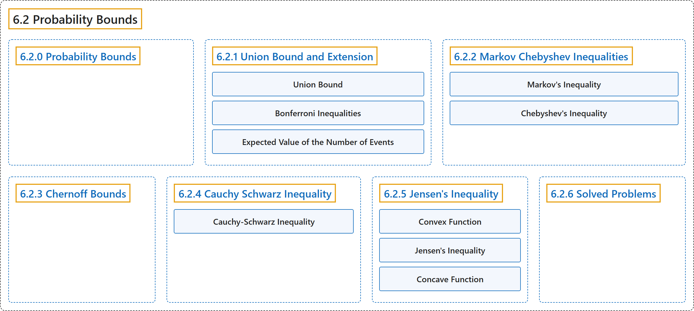

# 6.2 Probability Bounds

## Classification

## Glossary

| Term | Definition | 中文翻译 | Source |
|---|---|---|---|
| **6.2 Probability Bounds** 概率界 | (No definition) | （无定义） | [Pishro-Nik, 2014, section 6.2](https://www.probabilitycourse.com/chapter6/6_2_0_probability_bounds.php) |
| **6.2.0 Probability Bounds** 概率界 | (No definition) | （无定义） | [Pishro-Nik, 2014, section 6.2.0](https://www.probabilitycourse.com/chapter6/6_2_0_probability_bounds.php) |
| **6.2.1 Union Bound and Extension** 并集界及其推广 | (No definition) | （无定义） | [Pishro-Nik, 2014, section 6.2.1](https://www.probabilitycourse.com/chapter6/6_2_1_union_bound_and_exten.php) |
| **Union Bound** 联合界（布尔不等式） | "The **union bound** or **Boole's inequality** [ 13 ] is applicable when you need to show that the probability of union of some events is less than some value." | 当需要证明若干事件并集的概率小于某个值时，可以使用**联合界**或**布尔不等式** [ 13 ]。 | [Pishro-Nik, 2014, section 6.2.1](https://www.probabilitycourse.com/chapter6/6_2_1_union_bound_and_exten.php#:~:text=The%20union%20bound%20or%20Boole%27s%20inequality) |
| **Bonferroni Inequalities** 邦费罗尼不等式 | "We can in fact extend the union bound to obtain lower and upper bounds on the probability of union of events. These bounds are known as **Bonferroni inequalities** [ 13 ]." | 事实上，我们可以推广联合界，得到事件并集概率的下界和上界。这些界称为**邦费罗尼不等式** [ 13 ]。 | [Pishro-Nik, 2014, section 6.2.1](https://www.probabilitycourse.com/chapter6/6_2_1_union_bound_and_exten.php#:~:text=We%20can%20in%20fact%20extend%20the) |
| **Expected Value of the Number of Events** 事件发生个数的期望 | "It is interesting to note that the union bound formula is also equal to the **expected value of the number of occurred events**." | 值得注意的是，联合界公式也等于**发生事件个数的期望**。 | [Pishro-Nik, 2014, section 6.2.1](https://www.probabilitycourse.com/chapter6/6_2_1_union_bound_and_exten.php#:~:text=It%20is%20interesting%20to%20note%20that) |
| **6.2.2 Markov Chebyshev Inequalities** 马尔可夫不等式与切比雪夫不等式 | (No definition) | （无定义） | [Pishro-Nik, 2014, section 6.2.2](https://www.probabilitycourse.com/chapter6/6_2_2_markov_chebyshev_inequalities.php) |
| **Markov's Inequality** 马尔可夫不等式 | "We can prove the above inequality for discrete or mixed random variables similarly (using the generalized PDF), so we have the following result, called **Markov's inequality**." | 对于离散或混合型随机变量，我们可以类似地（利用广义概率密度函数）证明上述不等式，于是得到如下结果，称为**马尔可夫不等式**。 | [Pishro-Nik, 2014, section 6.2.2](https://www.probabilitycourse.com/chapter6/6_2_2_markov_chebyshev_inequalities.php#:~:text=We%20can%20prove%20the%20above%20inequality) |
| **Chebyshev's Inequality** 切比雪夫不等式 | "**Chebyshev's inequality** states that the difference between $X$ and $EX$ is somehow **limited by** $Var(X)$." | **切比雪夫不等式**表明 $X$ 与 $EX$ 之差在某种程度上受 $Var(X)$ **限制**。 | [Pishro-Nik, 2014, section 6.2.2](https://www.probabilitycourse.com/chapter6/6_2_2_markov_chebyshev_inequalities.php#:~:text=Chebyshev%27s%20inequality%20states%20that%20the%20difference) |
| **6.2.3 Chernoff Bounds** 切尔诺夫界 | (No definition) | （无定义） | [Pishro-Nik, 2014, section 6.2.3](https://www.probabilitycourse.com/chapter6/6_2_3_chernoff_bounds.php) |
| **6.2.4 Cauchy Schwarz Inequality** 柯西-施瓦茨不等式 | (No definition) | （无定义） | [Pishro-Nik, 2014, section 6.2.4](https://www.probabilitycourse.com/chapter6/6_2_4_cauchy_schwarz.php) |
| **Cauchy-Schwarz Inequality** 柯西-施瓦茨不等式 | "You might have seen the **Cauchy-Schwarz inequality** in your linear algebra course. The same inequality is valid for random variables." | 你可能在线性代数课程中见过**柯西-施瓦茨不等式**。同样的不等式对随机变量也成立。 | [Pishro-Nik, 2014, section 6.2.4](https://www.probabilitycourse.com/chapter6/6_2_4_cauchy_schwarz.php#:~:text=You%20might%20have%20seen%20the%20Cauchy-Schwarz) |
| **6.2.5 Jensen's Inequality** 詹森不等式 | (No definition) | （无定义） | [Pishro-Nik, 2014, section 6.2.5](https://www.probabilitycourse.com/chapter6/6_2_5_jensen's_inequality.php) |
| **Convex Function** 凸函数 | "We say that $g$ is a **convex function** if, for any two points $x$ and $y$ in $I$ and any $\alpha \in [0,1]$, we have" | 如果对 $I$ 中任意两点 $x$ 和 $y$ 以及任意 $\alpha \in [0,1]$，都有下式成立，我们就说 $g$ 是**凸函数** | [Pishro-Nik, 2014, section 6.2.5](https://www.probabilitycourse.com/chapter6/6_2_5_jensen's_inequality.php#:~:text=We%20say%20that%20is%20a%20convex) |
| **Jensen's Inequality** 詹森不等式 | "**Jensen's inequality** states that, for any **convex function** $g$, we have $E[g(X)] \geq g(E[X])$." | **詹森不等式**指出，对任意**凸函数** $g$，有 $E[g(X)] \geq g(E[X])$。 | [Pishro-Nik, 2014, section 6.2.5](https://www.probabilitycourse.com/chapter6/6_2_5_jensen's_inequality.php#:~:text=Jensen%27s%20inequality%20states%20that%2C%20for%20any) |
| **Concave Function** 凹函数 | "On the other hand, if the line segment always lies **below the graph**, the function is said to be **concave**." | 反之，如果线段始终位于**图像下方**，则称该函数是**凹函数**。 | [Pishro-Nik, 2014, section 6.2.5](https://www.probabilitycourse.com/chapter6/6_2_5_jensen's_inequality.php#:~:text=On%20the%20other%20hand%2C%20if%20the) |
| **6.2.6 Solved Problems** 例题详解 | (No definition) | （无定义） | [Pishro-Nik, 2014, section 6.2.6](https://www.probabilitycourse.com/chapter6/6_2_6_solved6_2.php) |

## References

Pishro-Nik, H. (2014). *Introduction to probability, statistics, and random processes*. Kappa Research. Retrieved October 28, 2026, from <https://www.probabilitycourse.com/>
