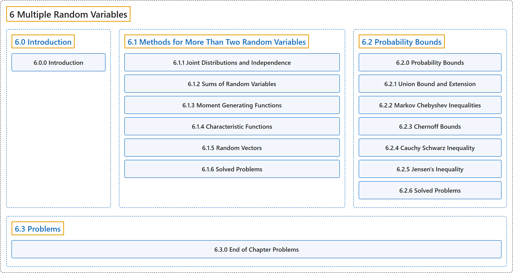

# 6 Multiple Random Variables

## Classification

## Glossary

| Term | Definition | 中文翻译 | Source |
|---|---|---|---|
| **6 Multiple Random Variables** 多个随机变量 | (No definition) | （无定义） | [Pishro-Nik, 2014, chapter 6](https://www.probabilitycourse.com/) |
| **[6.0 Introduction](6-0-introduction.md)** 介绍 | (No definition) | （无定义） | [Pishro-Nik, 2014, section 6.0](https://www.probabilitycourse.com/chapter6/6_0_0_intro.php) |
| **[6.1 Methods for More Than Two Random Variables](6-1-methods-for-more-than-two-random-variables.md)** 多于两个随机变量的方法 | (No definition) | （无定义） | [Pishro-Nik, 2014, section 6.1](https://www.probabilitycourse.com/chapter6/6_1_1_joint_distributions_independence.php) |
| **[6.2 Probability Bounds](6-2-probability-bounds.md)** 概率界 | (No definition) | （无定义） | [Pishro-Nik, 2014, section 6.2](https://www.probabilitycourse.com/chapter6/6_2_0_probability_bounds.php) |
| **[6.3 Problems](6-3-problems.md)** 习题 | (No definition) | （无定义） | [Pishro-Nik, 2014, section 6.3](https://www.probabilitycourse.com/chapter6/6_3_0_chapter_problems.php) |

## References

Pishro-Nik, H. (2014). *Introduction to probability, statistics, and random processes*. Kappa Research. Retrieved October 28, 2026, from <https://www.probabilitycourse.com/>
