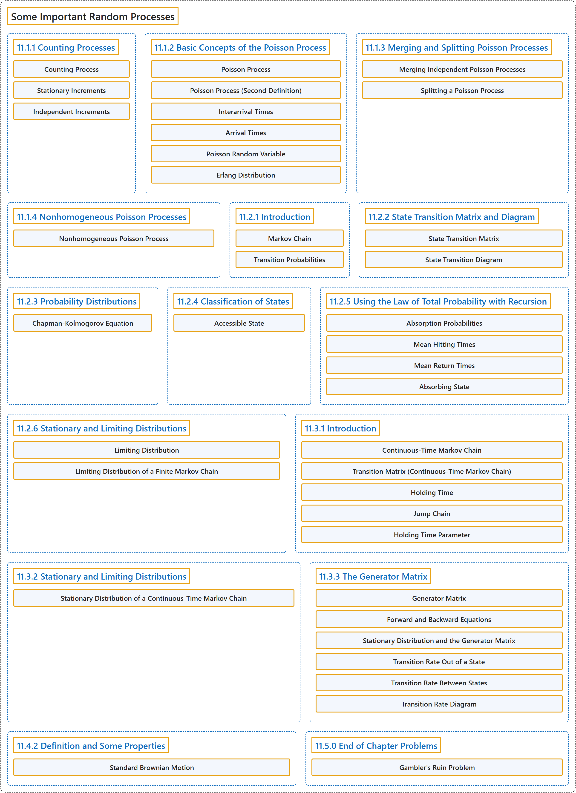

# 11 Some Important Random Processes

## Classification

## Glossary

| Term | Definition | 中文翻译 | Source |
|---|---|---|---|
| **11 Some Important Random Processes** 一些重要的随机过程 | (No definition) | （无定义） | [Pishro-Nik, 2014, chapter 11](https://www.probabilitycourse.com/) |
| **11.1.1 Counting Processes** 计数过程 | (No definition) | （无定义） | [Pishro-Nik, 2014, section 11.1.1](https://www.probabilitycourse.com/chapter11/11_1_1_counting_processes.php) |
| **Counting Process** 计数过程 | "A random process $\{N(t), t \in [0,\infty) \}$ is said to be a **counting process** if $N(t)$ is the number of events occurred from time $0$ up to and including time $t$." | 若 $N(t)$ 表示从时刻 $0$ 起至（含）时刻 $t$ 为止发生的事件数，则称随机过程 $\{N(t), t \in [0,\infty) \}$ 为**计数过程**。 | [Pishro-Nik, 2014, section 11.1.1](https://www.probabilitycourse.com/chapter11/11_1_1_counting_processes.php#:~:text=A%20random%20process%20is%20said%20to) |
| **Stationary Increments** 平稳增量 | "A counting process has **stationary increments** if, for all $t_2>t_1\geq0$, $N(t_2)-N(t_1)$ has the same distribution as $N(t_2-t_1)$." | 若对所有 $t_2>t_1\geq0$，$N(t_2)-N(t_1)$ 与 $N(t_2-t_1)$ 具有相同的分布，则称计数过程具有**平稳增量**。 | [Pishro-Nik, 2014, section 11.1.1](https://www.probabilitycourse.com/chapter11/11_1_1_counting_processes.php#:~:text=A%20counting%20process%20has%20stationary%20increments) |
| **Independent Increments** 独立增量 | "We say that $X(t)$ has **independent increments** if, for all $0 \leq t_1 \lt t_2 \lt t_3 \cdots \lt t_n$, the random variables $$\begin{align*} X(t_2)-X(t_1), \; X(t_3)-X(t_2), \; \cdots, \; X(t_n)-X(t_{n-1}) \end{align*}$$ are independent." | 若对所有 $0 \leq t_1 \lt t_2 \lt t_3 \cdots \lt t_n$，随机变量 $$\begin{align*} X(t_2)-X(t_1), \; X(t_3)-X(t_2), \; \cdots, \; X(t_n)-X(t_{n-1}) \end{align*}$$ 相互独立，则称 $X(t)$ 具有**独立增量**。 | [Pishro-Nik, 2014, section 11.1.1](https://www.probabilitycourse.com/chapter11/11_1_1_counting_processes.php#:~:text=We%20say%20that%20has%20independent%20increments) |
| **11.1.2 Basic Concepts of the Poisson Process** 泊松过程的基本概念 | (No definition) | （无定义） | [Pishro-Nik, 2014, section 11.1.2](https://www.probabilitycourse.com/chapter11/11_1_2_basic_concepts_of_the_poisson_process.php) |
| **Poisson Process** 泊松过程 | "Let $\lambda>0$ be fixed. The counting process $\{N(t), t \in [0, \infty)\}$ is called a **Poisson process** with rate s $\lambda$ if all the following conditions hold: $N(0)=0$; $N(t)$ has **independent increments**; the number of arrivals in any interval of length $\tau>0$ has $Poisson(\lambda \tau)$ distribution." | 设 $\lambda>0$ 为定值。若计数过程 $\{N(t), t \in [0, \infty)\}$ 满足以下全部条件，则称其为速率为 $\lambda$ 的**泊松过程**：$N(0)=0$；$N(t)$ 具有**独立增量**；任意长度为 $\tau>0$ 的区间内的到达数服从 $Poisson(\lambda \tau)$ 分布。 | [Pishro-Nik, 2014, section 11.1.2](https://www.probabilitycourse.com/chapter11/11_1_2_basic_concepts_of_the_poisson_process.php#:~:text=Let%20be%20fixed.%20The%20counting%20process) |
| **Poisson Process (Second Definition)** 泊松过程（第二定义） | "Let $\lambda>0$ be fixed. The counting process $\{N(t), t \in [0, \infty)\}$ is called a **Poisson process** with rate $\lambda$ if all the following conditions hold: $N(0)=0$; $N(t)$ has **independent and stationary increments** we have $$\begin{align*} &P(N(\Delta)=0) =1-\lambda \Delta+ o(\Delta),\\ &P(N(\Delta)=1)=\lambda \Delta+o(\Delta),\\ &P(N(\Delta) \geq 2)=o(\Delta). \end{align*}$$" | 设 $\lambda>0$ 为定值。若计数过程 $\{N(t), t \in [0, \infty)\}$ 满足以下全部条件，则称其为速率为 $\lambda$ 的**泊松过程**：$N(0)=0$；$N(t)$ 具有**独立且平稳的增量**，我们有 $$\begin{align*} &P(N(\Delta)=0) =1-\lambda \Delta+ o(\Delta),\\ &P(N(\Delta)=1)=\lambda \Delta+o(\Delta),\\ &P(N(\Delta) \geq 2)=o(\Delta). \end{align*}$$ | [Pishro-Nik, 2014, section 11.1.2](https://www.probabilitycourse.com/chapter11/11_1_2_basic_concepts_of_the_poisson_process.php#:~:text=Let%20be%20fixed.%20The%20counting%20process) |
| **Interarrival Times** 到达间隔时间 | "If $N(t)$ is a Poisson process with rate $\lambda$, then the **interarrival times** $X_1$, $X_2$, $\cdots$ are independent and $$\begin{align*} X_i \sim Exponential(\lambda), \; \textrm{ for }i=1,2,3, \cdots. \end{align*}$$" | 若 $N(t)$ 是速率为 $\lambda$ 的泊松过程，则**到达间隔时间** $X_1$，$X_2$，$\cdots$ 相互独立，且 $$\begin{align*} X_i \sim Exponential(\lambda), \; \textrm{ for }i=1,2,3, \cdots. \end{align*}$$ | [Pishro-Nik, 2014, section 11.1.2](https://www.probabilitycourse.com/chapter11/11_1_2_basic_concepts_of_the_poisson_process.php#:~:text=If%20is%20a%20Poisson%20process%20with) |
| **Arrival Times** 到达时间 | "If $N(t)$ is a Poisson process with rate $\lambda$, then the **arrival times** $T_1$, $T_2$, $\cdots$ have $Gamma(n, \lambda)$ distribution. In particular, for $n=1,2,3,\cdots$, we have $$\begin{align*} E[T_n]=\frac{n}{\lambda}, \; \textrm{and} \; \textrm{Var}(T_n)=\frac{n}{\lambda^2}. \end{align*}$$" | 若 $N(t)$ 是速率为 $\lambda$ 的泊松过程，则**到达时间** $T_1$，$T_2$，$\cdots$ 服从 $Gamma(n, \lambda)$ 分布。特别地，对 $n=1,2,3,\cdots$，有 $$\begin{align*} E[T_n]=\frac{n}{\lambda}, \; \textrm{and} \; \textrm{Var}(T_n)=\frac{n}{\lambda^2}. \end{align*}$$ | [Pishro-Nik, 2014, section 11.1.2](https://www.probabilitycourse.com/chapter11/11_1_2_basic_concepts_of_the_poisson_process.php#:~:text=If%20is%20a%20Poisson%20process%20with) |
| **Poisson Random Variable** 泊松随机变量 | "Remember that a discrete random variable $X$ is said to be a **Poisson random variable** with parameter $\mu$, shown as $X \sim Poisson(\mu)$, if its range is $R_X=\{0,1,2,3,...\}$, and its PMF is given by $$\begin{equation} \nonumber P_X(k) = \left\{ \begin{array}{l l} \frac{e^{-\mu} \mu^k}{k!}& \quad \text{for } k \in R_X\\ 0 & \quad \text{ otherwise} \end{array} \right. \end{equation}$$" | 若离散型随机变量 $X$ 的取值范围为 $R_X=\{0,1,2,3,...\}$，且其 PMF 为 $$\begin{equation} \nonumber P_X(k) = \left\{ \begin{array}{l l} \frac{e^{-\mu} \mu^k}{k!}& \quad \text{for } k \in R_X\\ 0 & \quad \text{ otherwise} \end{array} \right. \end{equation}$$，则称 $X$ 为参数为 $\mu$ 的**泊松随机变量**，记作 $X \sim Poisson(\mu)$。 | [Pishro-Nik, 2014, section 11.1.2](https://www.probabilitycourse.com/chapter11/11_1_2_basic_concepts_of_the_poisson_process.php#:~:text=Remember%20that%20a%20discrete%20random%20variable) |
| **Erlang Distribution** 爱尔朗分布 | "The $Gamma(n, \lambda)$ is also called **Erlang distribution**, i.e, we can write $$\begin{align*} T_n \sim Erlang(n,\lambda)=Gamma(n, \lambda), \; \textrm{ for }n=1,2,3, \cdots. \end{align*}$$" | $Gamma(n, \lambda)$ 也称为**爱尔朗分布**，即我们可以写成 $$\begin{align*} T_n \sim Erlang(n,\lambda)=Gamma(n, \lambda), \; \textrm{ for }n=1,2,3, \cdots. \end{align*}$$ | [Pishro-Nik, 2014, section 11.1.2](https://www.probabilitycourse.com/chapter11/11_1_2_basic_concepts_of_the_poisson_process.php#:~:text=The%20is%20also%20called%20Erlang%20distribution%2C) |
| **11.1.3 Merging and Splitting Poisson Processes** 泊松过程的合并与分解 | (No definition) | （无定义） | [Pishro-Nik, 2014, section 11.1.3](https://www.probabilitycourse.com/chapter11/11_1_3_merging_and_splitting_poisson_processes.php) |
| **Merging Independent Poisson Processes** 独立泊松过程的合并 | "Let also $$\begin{align*} N(t)=N_1(t)+N_2(t)+\cdots+N_m(t), \quad \textrm{for all } t \in [0, \infty). \end{align*}$$ Then, $N(t)$ is a **Poisson process** with rate $\lambda_1+\lambda_2+\cdots+\lambda_m$." | 再令 $$\begin{align*} N(t)=N_1(t)+N_2(t)+\cdots+N_m(t), \quad \textrm{for all } t \in [0, \infty). \end{align*}$$ 则 $N(t)$ 是速率为 $\lambda_1+\lambda_2+\cdots+\lambda_m$ 的**泊松过程**。 | [Pishro-Nik, 2014, section 11.1.3](https://www.probabilitycourse.com/chapter11/11_1_3_merging_and_splitting_poisson_processes.php#:~:text=Let%20also%20%5Cbegin%7Balign%2A%7D%20N%28t%29%3DN_1%28t%29%2BN_2%28t%29%2B%5Ccdots%2BN_m%28t%29%2C%20%5Cquad%20%5Ctextrm%7Bfor) |
| **Splitting a Poisson Process** 泊松过程的分流 | "For each arrival, a **coin** with $P(H)=p$ is tossed. If the coin lands heads up, the arrival is **sent to the first process** ($N_1(t)$), otherwise it is sent to the second process." | 对每一次到达，抛一枚满足 $P(H)=p$ 的**硬币**。若硬币正面朝上，则该到达**被送入第一个过程**（$N_1(t)$），否则被送入第二个过程。 | [Pishro-Nik, 2014, section 11.1.3](https://www.probabilitycourse.com/chapter11/11_1_3_merging_and_splitting_poisson_processes.php#:~:text=For%20each%20arrival%2C%20a%20coin%20with) |
| **11.1.4 Nonhomogeneous Poisson Processes** 非齐次泊松过程 | (No definition) | （无定义） | [Pishro-Nik, 2014, section 11.1.4](https://www.probabilitycourse.com/chapter11/11_1_4_nonhomogeneous_poisson_processes.php) |
| **Nonhomogeneous Poisson Process** 非齐次泊松过程 | "Let $\lambda(t):[0,\infty) \mapsto [0,\infty)$ be an integrable function. The counting process $\{N(t), t \in [0, \infty)\}$ is called a **nonhomogeneous Poisson process** with rate $\lambda(t)$ if all the following conditions hold." | 设 $\lambda(t):[0,\infty) \mapsto [0,\infty)$ 为可积函数。若计数过程 $\{N(t), t \in [0, \infty)\}$ 满足下列全部条件，则称其为速率为 $\lambda(t)$ 的**非齐次泊松过程**。 | [Pishro-Nik, 2014, section 11.1.4](https://www.probabilitycourse.com/chapter11/11_1_4_nonhomogeneous_poisson_processes.php#:~:text=Let%20be%20an%20integrable%20function.%20The) |
| **11.2.1 Introduction** 引言 | (No definition) | （无定义） | [Pishro-Nik, 2014, section 11.2.1](https://www.probabilitycourse.com/chapter11/11_2_1_introduction.php) |
| **Markov Chain** 马尔可夫链 | "We say that this process is a **Markov chain** if $$\begin{align*} &P(X_{m+1}=j \vert X_{m}=i, X_{m-1}=i_{m-1}, \cdots, X_{0}=i_{0})\\ &\hspace{80pt}= P(X_{m+1}=j \vert X_{m}=i), \end{align*}$$ for all $m, j, i, i_0, i_1, \cdots i_{m-1}$." | 若 $$\begin{align*} &P(X_{m+1}=j \vert X_{m}=i, X_{m-1}=i_{m-1}, \cdots, X_{0}=i_{0})\\ &\hspace{80pt}= P(X_{m+1}=j \vert X_{m}=i), \end{align*}$$ 对所有 $m, j, i, i_0, i_1, \cdots i_{m-1}$ 成立，则称该过程为**马尔可夫链**。 | [Pishro-Nik, 2014, section 11.2.1](https://www.probabilitycourse.com/chapter11/11_2_1_introduction.php#:~:text=We%20say%20that%20this%20process%20is) |
| **Transition Probabilities** 转移概率 | "The numbers $P(X_{m+1}=j \vert X_{m}=i)$ are called the **transition probabilities**." | 数 $P(X_{m+1}=j \vert X_{m}=i)$ 称为**转移概率**。 | [Pishro-Nik, 2014, section 11.2.1](https://www.probabilitycourse.com/chapter11/11_2_1_introduction.php#:~:text=The%20numbers%20are%20called%20the%20transition) |
| **11.2.2 State Transition Matrix and Diagram** 状态转移矩阵与状态转移图 | (No definition) | （无定义） | [Pishro-Nik, 2014, section 11.2.2](https://www.probabilitycourse.com/chapter11/11_2_2_state_transition_matrix_and_diagram.php) |
| **State Transition Matrix** 状态转移矩阵 | "We often list the transition probabilities in a matrix. The matrix is called the **state transition matrix** or **transition probability matrix** and is usually shown by $P$." | 我们常把转移概率列成一个矩阵。该矩阵称为**状态转移矩阵**或**转移概率矩阵**，通常记为 $P$。 | [Pishro-Nik, 2014, section 11.2.2](https://www.probabilitycourse.com/chapter11/11_2_2_state_transition_matrix_and_diagram.php#:~:text=We%20often%20list%20the%20transition%20probabilities) |
| **State Transition Diagram** 状态转移图 | "A Markov chain is usually shown by a **state transition diagram**." | 马尔可夫链通常用**状态转移图**表示。 | [Pishro-Nik, 2014, section 11.2.2](https://www.probabilitycourse.com/chapter11/11_2_2_state_transition_matrix_and_diagram.php#:~:text=A%20Markov%20chain%20is%20usually%20shown) |
| **11.2.3 Probability Distributions** 概率分布 | (No definition) | （无定义） | [Pishro-Nik, 2014, section 11.2.3](https://www.probabilitycourse.com/chapter11/11_2_3_probability_distributions.php) |
| **Chapman-Kolmogorov Equation** 查普曼-柯尔莫哥洛夫方程 | "To obtain $p^{(m+n)}_{ij}$, we sum over all possible intermediate states: $$\begin{align*} p^{(m+n)}_{ij}&=P(X_{m+n}=j \vert X_0=i)\\ &=\sum_{k \in S} p^{(m)}_{ik}p^{(n)}_{kj}. \end{align*}$$ The above equation is called the **Chapman-Kolmogorov equation**." | 为得到 $p^{(m+n)}_{ij}$，我们对所有可能的中间状态求和：$$\begin{align*} p^{(m+n)}_{ij}&=P(X_{m+n}=j \vert X_0=i)\\ &=\sum_{k \in S} p^{(m)}_{ik}p^{(n)}_{kj}. \end{align*}$$ 上述方程称为**查普曼-柯尔莫哥洛夫方程**。 | [Pishro-Nik, 2014, section 11.2.3](https://www.probabilitycourse.com/chapter11/11_2_3_probability_distributions.php#:~:text=To%20obtain%20%2C%20we%20sum%20over) |
| **11.2.4 Classification of States** 状态的分类 | (No definition) | （无定义） | [Pishro-Nik, 2014, section 11.2.4](https://www.probabilitycourse.com/chapter11/11_2_4_classification_of_states.php) |
| **Accessible State** 可达状态 | "We say that state $j$ is **accessible** from state $i$, written as $i \rightarrow j$, if $p^{(n)}_{ij}>0$ for some $n$." | 若对某个 $n$ 有 $p^{(n)}_{ij}>0$，则称状态 $j$ 从状态 $i$ **可达**，记作 $i \rightarrow j$。 | [Pishro-Nik, 2014, section 11.2.4](https://www.probabilitycourse.com/chapter11/11_2_4_classification_of_states.php#:~:text=We%20say%20that%20state%20is%20accessible) |
| **11.2.5 Using the Law of Total Probability with Recursion** 结合递推使用全概率公式 | (No definition) | （无定义） | [Pishro-Nik, 2014, section 11.2.5](https://www.probabilitycourse.com/chapter11/11_2_5_using_the_law_of_total_probability_with_recursion.php) |
| **Absorption Probabilities** 吸收概率 | "Let $l\in S$ be an **absorbing state**. Define $$\begin{align*} a_i&=P(\textrm{absorption in }l \vert  X_0=i), \quad \textrm{ for all }i \in S. \end{align*}$$" | 设 $l\in S$ 为一个**吸收态**。定义 $$\begin{align*} a_i&=P(\textrm{absorption in }l \vert  X_0=i), \quad \textrm{ for all }i \in S. \end{align*}$$ | [Pishro-Nik, 2014, section 11.2.5](https://www.probabilitycourse.com/chapter11/11_2_5_using_the_law_of_total_probability_with_recursion.php#:~:text=Let%20be%20an%20absorbing%20state.%20Define) |
| **Mean Hitting Times** 平均击中时间 | "Let $T$ be the **first time** the chain visits a state in $A$. For all $i \in S$, define $$\begin{align*} t_i&=E[T \vert X_0=i]. \end{align*}$$" | 设 $T$ 为链访问 $A$ 中某一状态的**首次时间**。对所有 $i \in S$，定义 $$\begin{align*} t_i&=E[T \vert X_0=i]. \end{align*}$$ | [Pishro-Nik, 2014, section 11.2.5](https://www.probabilitycourse.com/chapter11/11_2_5_using_the_law_of_total_probability_with_recursion.php#:~:text=Let%20be%20the%20first%20time%20the) |
| **Mean Return Times** 平均返回时间 | "Let $r_l$ be the **mean return time** to state $l$." | 设 $r_l$ 为状态 $l$ 的**平均返回时间**。 | [Pishro-Nik, 2014, section 11.2.5](https://www.probabilitycourse.com/chapter11/11_2_5_using_the_law_of_total_probability_with_recursion.php#:~:text=Let%20be%20the%20mean%20return%20time) |
| **Absorbing State** 吸收态 | "Note that states $0$ and $3$ have the following property: once you enter those states, you never leave them. For this reason, we call them **absorbing states**." | 注意状态 $0$ 和 $3$ 具有如下性质：一旦进入这些状态，就永远不会离开。因此我们称它们为**吸收态**。 | [Pishro-Nik, 2014, section 11.2.5](https://www.probabilitycourse.com/chapter11/11_2_5_using_the_law_of_total_probability_with_recursion.php#:~:text=Note%20that%20states%20and%20have%20the) |
| **11.2.6 Stationary and Limiting Distributions** 平稳分布与极限分布 | (No definition) | （无定义） | [Pishro-Nik, 2014, section 11.2.6](https://www.probabilitycourse.com/chapter11/11_2_6_stationary_and_limiting_distributions.php) |
| **Limiting Distribution** 极限分布 | "The probability distribution $\pi=[\pi_0, \pi_1, \pi_2, \cdots ]$ is called the **limiting distribution** of the Markov chain $X_n$ if $$\begin{align*} \pi_j=\lim_{n \rightarrow \infty} P(X_n=j \vert X_0=i) \end{align*}$$ for all $i, j \in S$, and we have $$\begin{align*} \sum_{j \in S} \pi_j=1. \end{align*}$$" | 若 $$\begin{align*} \pi_j=\lim_{n \rightarrow \infty} P(X_n=j \vert X_0=i) \end{align*}$$ 对所有 $i, j \in S$ 成立，且有 $$\begin{align*} \sum_{j \in S} \pi_j=1. \end{align*}$$，则称概率分布 $\pi=[\pi_0, \pi_1, \pi_2, \cdots ]$ 为马尔可夫链 $X_n$ 的**极限分布**。 | [Pishro-Nik, 2014, section 11.2.6](https://www.probabilitycourse.com/chapter11/11_2_6_stationary_and_limiting_distributions.php#:~:text=The%20probability%20distribution%20is%20called%20the) |
| **Limiting Distribution of a Finite Markov Chain** 有限马尔可夫链的极限分布 | "The unique solution to the above equations is the **limiting distribution** of the Markov chain, i.e.," | 上述方程的唯一解即为该马尔可夫链的**极限分布**，即 | [Pishro-Nik, 2014, section 11.2.6](https://www.probabilitycourse.com/chapter11/11_2_6_stationary_and_limiting_distributions.php#:~:text=The%20unique%20solution%20to%20the%20above) |
| **11.3.1 Introduction** 引言 | (No definition) | （无定义） | [Pishro-Nik, 2014, section 11.3.1](https://www.probabilitycourse.com/chapter11/11_3_1_introduction.php) |
| **Continuous-Time Markov Chain** 连续时间马尔可夫链 | "A **continuous-time Markov chain** $X(t)$ is defined by two components: a **jump chain**, and a set of holding time parameters $\lambda_i$." | **连续时间马尔可夫链** $X(t)$ 由两个部分定义：一个**跳跃链**，以及一组保持时间参数 $\lambda_i$。 | [Pishro-Nik, 2014, section 11.3.1](https://www.probabilitycourse.com/chapter11/11_3_1_introduction.php#:~:text=A%20continuous-time%20Markov%20chain%20is%20defined) |
| **Transition Matrix (Continuous-Time Markov Chain)** 转移矩阵（连续时间马尔可夫链） | "For a continuous-time Markov chain, we define the **transition matrix** $P(t)$. The $(i,j)\text{th}$ entry of the transition matrix is given by $$\begin{align*} P_{ij}(t)&=P(X(t)=j\vert X(0)=i). \end{align*}$$" | 对于连续时间马尔可夫链，我们定义**转移矩阵** $P(t)$。转移矩阵的第 $(i,j)$ 个元素为 $$\begin{align*} P_{ij}(t)&=P(X(t)=j\vert X(0)=i). \end{align*}$$ | [Pishro-Nik, 2014, section 11.3.1](https://www.probabilitycourse.com/chapter11/11_3_1_introduction.php#:~:text=For%20a%20continuous-time%20Markov%20chain%2C%20we) |
| **Holding Time** 保持时间 | "Thus, the time that a continuous-time Markov chain spends in state $i$ (called the **holding time**) will have $Exponential(\lambda_i)$ distribution, where $\lambda_i$ is a nonnegative real number." | 因此，连续时间马尔可夫链停留在状态 $i$ 的时间（称为**保持时间**）服从 $Exponential(\lambda_i)$ 分布，其中 $\lambda_i$ 是一个非负实数。 | [Pishro-Nik, 2014, section 11.3.1](https://www.probabilitycourse.com/chapter11/11_3_1_introduction.php#:~:text=Thus%2C%20the%20time%20that%20a%20continuous-time) |
| **Jump Chain** 跳跃链（嵌入马尔可夫链） | "First, we have a discrete-time Markov chain, called the **jump chain** or the the **embedded Markov chain**, that gives us the transition probabilities $p_{ij}$." | 首先，我们有一个离散时间马尔可夫链，称为**跳跃链**或**嵌入马尔可夫链**，它给出转移概率 $p_{ij}$。 | [Pishro-Nik, 2014, section 11.3.1](https://www.probabilitycourse.com/chapter11/11_3_1_introduction.php#:~:text=First%2C%20we%20have%20a%20discrete-time%20Markov) |
| **Holding Time Parameter** 保持时间参数 | "Second, for each state we have a **holding time parameter** $\lambda_i$ that controls the amount of time spent in each state." | 其次，对每个状态都有一个**保持时间参数** $\lambda_i$，它控制在每个状态所花费的时间。 | [Pishro-Nik, 2014, section 11.3.1](https://www.probabilitycourse.com/chapter11/11_3_1_introduction.php#:~:text=Second%2C%20for%20each%20state%20we%20have) |
| **11.3.2 Stationary and Limiting Distributions** 平稳分布与极限分布 | (No definition) | （无定义） | [Pishro-Nik, 2014, section 11.3.2](https://www.probabilitycourse.com/chapter11/11_3_2_stationary_and_limiting_distributions.php) |
| **Stationary Distribution of a Continuous-Time Markov Chain** 连续时间马尔可夫链的平稳分布 | "is said to be a **stationary distribution** for $X(t)$ if" | 称为 $X(t)$ 的**平稳分布**，若 | [Pishro-Nik, 2014, section 11.3.2](https://www.probabilitycourse.com/chapter11/11_3_2_stationary_and_limiting_distributions.php#:~:text=is%20said%20to%20be%20a%20stationary) |
| **11.3.3 The Generator Matrix** 生成元矩阵 | (No definition) | （无定义） | [Pishro-Nik, 2014, section 11.3.3](https://www.probabilitycourse.com/chapter11/11_3_3_the_generator_matrix.php) |
| **Generator Matrix** 生成元矩阵 | "For a continuous-time Markov chain, we define the **generator matrix** $G$. The $(i,j)\text{th}$ entry of the transition matrix is given by $$\begin{align} \nonumber g_{ij} = \left\{ \begin{array}{l l} \lambda_i p_{ij} & \quad \textrm{ if }i \neq j \\ & \quad \\ -\lambda_i & \quad \textrm{ if }i = j \end{array} \right. \end{align}$$" | 对于连续时间马尔可夫链，我们定义**生成元矩阵** $G$。转移矩阵的第 $(i,j)$ 个元素为 $$\begin{align} \nonumber g_{ij} = \left\{ \begin{array}{l l} \lambda_i p_{ij} & \quad \textrm{ if }i \neq j \\ & \quad \\ -\lambda_i & \quad \textrm{ if }i = j \end{array} \right. \end{align}$$ | [Pishro-Nik, 2014, section 11.3.3](https://www.probabilitycourse.com/chapter11/11_3_3_the_generator_matrix.php#:~:text=For%20a%20continuous-time%20Markov%20chain%2C%20we) |
| **Forward and Backward Equations** 前向方程与后向方程 | "The **forward equations** state that $$P'(t)=P(t)G,$$ which is equivalent to $$p'_{ij}(t)=\sum_{k \in S} p_{ik}(t) g_{kj}, \textrm{ for all }i,j \in S.$$ The **backward equations** state that $$P'(t)=GP(t),$$ which is equivalent to $$p'_{ij}(t)=\sum_{k \in S} g_{ik} p_{kj}(t), \textrm{ for all }i,j \in S.$$" | **前向方程**表明 $$P'(t)=P(t)G,$$，它等价于 $$p'_{ij}(t)=\sum_{k \in S} p_{ik}(t) g_{kj}, \textrm{ for all }i,j \in S.$$ **后向方程**表明 $$P'(t)=GP(t),$$，它等价于 $$p'_{ij}(t)=\sum_{k \in S} g_{ik} p_{kj}(t), \textrm{ for all }i,j \in S.$$ | [Pishro-Nik, 2014, section 11.3.3](https://www.probabilitycourse.com/chapter11/11_3_3_the_generator_matrix.php#:~:text=The%20forward%20equations%20state%20that%20P%27%28t%29%3DP%28t%29G%2C) |
| **Stationary Distribution and the Generator Matrix** 平稳分布与生成矩阵 | "Consider a continuous Markov chain $X(t)$ with the state space $S$ and the **generator Matrix** $G$. The probability distribution $\pi$ on $S$ is a **stationary distribution** for $X(t)$ if and only if it satisfies" | 考虑状态空间为 $S$、**生成矩阵**为 $G$ 的连续马尔可夫链 $X(t)$。$S$ 上的概率分布 $\pi$ 是 $X(t)$ 的**平稳分布**，当且仅当它满足 | [Pishro-Nik, 2014, section 11.3.3](https://www.probabilitycourse.com/chapter11/11_3_3_the_generator_matrix.php#:~:text=Consider%20a%20continuous%20Markov%20chain%20with) |
| **Transition Rate Out of a State** 离开状态的转移速率 | "Thus, in a short interval of length $\delta$, the probability of leaving state $i$ is approximately $\lambda_i \delta$. For this reason, $\lambda_i$ is often called the **transition rate** out of state $i$." | 因此，在长度为 $\delta$ 的短区间内，离开状态 $i$ 的概率约为 $\lambda_i \delta$。为此，$\lambda_i$ 常被称为离开状态 $i$ 的**转移速率**。 | [Pishro-Nik, 2014, section 11.3.3](https://www.probabilitycourse.com/chapter11/11_3_3_the_generator_matrix.php#:~:text=Thus%2C%20in%20a%20short%20interval%20of) |
| **Transition Rate Between States** 状态间转移速率 | "Since we go from state $i$ to state $j$ with probability $p_{ij}$, we call the quantity $g_{ij}=\lambda_i p_{ij}$, the **transition rate** from state $i$ to state $j$." | 由于我们以概率 $p_{ij}$ 从状态 $i$ 转移到状态 $j$，我们把量 $g_{ij}=\lambda_i p_{ij}$ 称为从状态 $i$ 到状态 $j$ 的**转移速率**。 | [Pishro-Nik, 2014, section 11.3.3](https://www.probabilitycourse.com/chapter11/11_3_3_the_generator_matrix.php#:~:text=Since%20we%20go%20from%20state%20to) |
| **Transition Rate Diagram** 转移速率图 | "A continuous-time Markov chain can be shown by its **transition rate diagram**. In this diagram, the values $g_{ij}$ are shown on the edges." | 连续时间马尔可夫链可以用其**转移速率图**表示。在该图中，数值 $g_{ij}$ 标在边上。 | [Pishro-Nik, 2014, section 11.3.3](https://www.probabilitycourse.com/chapter11/11_3_3_the_generator_matrix.php#:~:text=A%20continuous-time%20Markov%20chain%20can%20be) |
| **11.4.2 Definition and Some Properties** 定义与一些性质 | (No definition) | （无定义） | [Pishro-Nik, 2014, section 11.4.2](https://www.probabilitycourse.com/chapter11/11_4_2_definition_and_some_properties.php) |
| **Standard Brownian Motion** 标准布朗运动 | "A Gaussian random process $\{W(t), t \in [0, \infty) \}$ is called a (standard) **Brownian motion** or a (standard) **Wiener process** if W(0)=0; for all $0 \leq t_1 \lt t_2$, $W(t_2)-W(t_1) \sim N(0, t_2-t_1)$; W(t) has independent increments. That is, for all $0 \leq t_1 \lt t_2 \lt t_3 \cdots \lt t_n$, the random variables $$\begin{align*} W(t_2)-W(t_1), \; W(t_3)-W(t_2), \; \cdots, \; W(t_n)-W(t_{n-1}) \end{align*}$$ are independent; W(t) has continuous sample paths." | 若高斯随机过程 $\{W(t), t \in [0, \infty) \}$ 满足 W(0)=0；对所有 $0 \leq t_1 \lt t_2$ 有 $W(t_2)-W(t_1) \sim N(0, t_2-t_1)$；W(t) 具有独立增量，即对所有 $0 \leq t_1 \lt t_2 \lt t_3 \cdots \lt t_n$，随机变量 $$\begin{align*} W(t_2)-W(t_1), \; W(t_3)-W(t_2), \; \cdots, \; W(t_n)-W(t_{n-1}) \end{align*}$$ 相互独立；W(t) 具有连续样本路径，则称其为（标准）**布朗运动或（标准）维纳过程**。 | [Pishro-Nik, 2014, section 11.4.2](https://www.probabilitycourse.com/chapter11/11_4_2_definition_and_some_properties.php#:~:text=A%20Gaussian%20random%20process%20is%20called) |
| **11.5.0 End of Chapter Problems** 章末习题 | (No definition) | （无定义） | [Pishro-Nik, 2014, section 11.5.0](https://www.probabilitycourse.com/chapter11/11_5_0_end_of_chapter_problems.php) |
| **Gambler's Ruin Problem** 赌徒破产问题 | "The game ends when one of the gamblers **runs out of money** (in which case the other gambler will have $N$ dollars). Our goal is to find $p_i$, the **probability that A wins the game** given that he has initially $i$ dollars." | 当其中一名赌徒**输光钱**时游戏结束（此时另一名赌徒将拥有 $N$ 美元）。我们的目标是求 $p_i$，即 A 在初始拥有 $i$ 美元的条件下**赢得游戏的概率**。 | [Pishro-Nik, 2014, section 11.5.0](https://www.probabilitycourse.com/chapter11/11_5_0_end_of_chapter_problems.php#:~:text=The%20game%20ends%20when%20one%20of) |

## References

Pishro-Nik, H. (2014). *Introduction to probability, statistics, and random processes*. Kappa Research. Retrieved October 28, 2026, from <https://www.probabilitycourse.com/>
