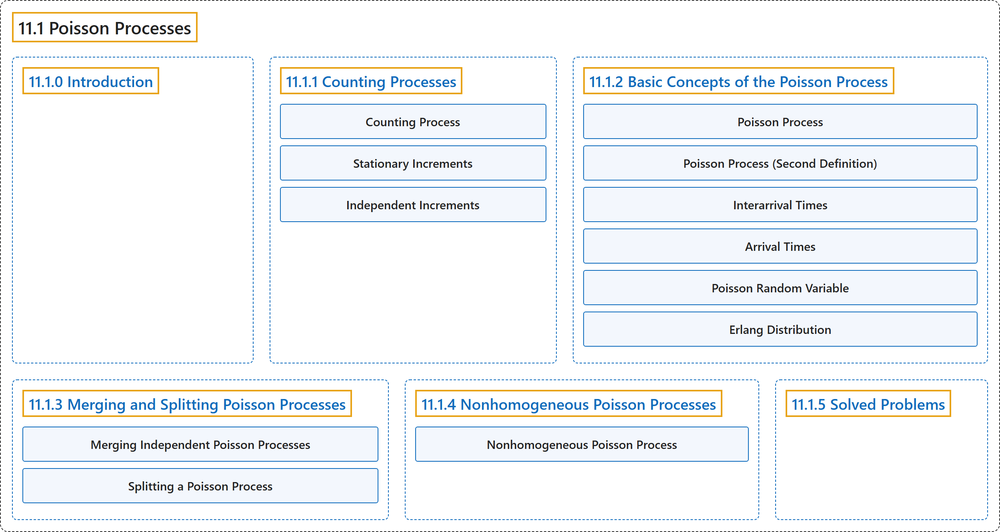

# 11.1 Poisson Processes

## Classification

## Glossary

| Term | Definition | 中文翻译 | Source |
|---|---|---|---|
| **11.1 Poisson Processes** 泊松过程 | (No definition) | （无定义） | [Pishro-Nik, 2014, section 11.1](https://www.probabilitycourse.com/chapter11/11_1_1_counting_processes.php) |
| **11.1.0 Introduction** 介绍 | (No definition) | （无定义） | [Pishro-Nik, 2014, section 11.1.0](https://www.probabilitycourse.com/chapter11/11_1_1_counting_processes.php) |
| **11.1.1 Counting Processes** 计数过程 | (No definition) | （无定义） | [Pishro-Nik, 2014, section 11.1.1](https://www.probabilitycourse.com/chapter11/11_1_1_counting_processes.php) |
| **Counting Process** 计数过程 | "A random process $\{N(t), t \in [0,\infty) \}$ is said to be a **counting process** if $N(t)$ is the number of events occurred from time $0$ up to and including time $t$." | 若 $N(t)$ 表示从时刻 $0$ 起至（含）时刻 $t$ 为止发生的事件数，则称随机过程 $\{N(t), t \in [0,\infty) \}$ 为**计数过程**。 | [Pishro-Nik, 2014, section 11.1.1](https://www.probabilitycourse.com/chapter11/11_1_1_counting_processes.php#:~:text=A%20random%20process%20is%20said%20to) |
| **Stationary Increments** 平稳增量 | "A counting process has **stationary increments** if, for all $t_2>t_1\geq0$, $N(t_2)-N(t_1)$ has the same distribution as $N(t_2-t_1)$." | 若对所有 $t_2>t_1\geq0$，$N(t_2)-N(t_1)$ 与 $N(t_2-t_1)$ 具有相同的分布，则称计数过程具有**平稳增量**。 | [Pishro-Nik, 2014, section 11.1.1](https://www.probabilitycourse.com/chapter11/11_1_1_counting_processes.php#:~:text=A%20counting%20process%20has%20stationary%20increments) |
| **Independent Increments** 独立增量 | "We say that $X(t)$ has **independent increments** if, for all $0 \leq t_1 \lt t_2 \lt t_3 \cdots \lt t_n$, the random variables $$\begin{align*} X(t_2)-X(t_1), \; X(t_3)-X(t_2), \; \cdots, \; X(t_n)-X(t_{n-1}) \end{align*}$$ are independent." | 若对所有 $0 \leq t_1 \lt t_2 \lt t_3 \cdots \lt t_n$，随机变量 $$\begin{align*} X(t_2)-X(t_1), \; X(t_3)-X(t_2), \; \cdots, \; X(t_n)-X(t_{n-1}) \end{align*}$$ 相互独立，则称 $X(t)$ 具有**独立增量**。 | [Pishro-Nik, 2014, section 11.1.1](https://www.probabilitycourse.com/chapter11/11_1_1_counting_processes.php#:~:text=We%20say%20that%20has%20independent%20increments) |
| **11.1.2 Basic Concepts of the Poisson Process** 泊松过程的基本概念 | (No definition) | （无定义） | [Pishro-Nik, 2014, section 11.1.2](https://www.probabilitycourse.com/chapter11/11_1_2_basic_concepts_of_the_poisson_process.php) |
| **Poisson Process** 泊松过程 | "Let $\lambda>0$ be fixed. The counting process $\{N(t), t \in [0, \infty)\}$ is called a **Poisson process** with rate s $\lambda$ if all the following conditions hold: $N(0)=0$; $N(t)$ has **independent increments**; the number of arrivals in any interval of length $\tau>0$ has $Poisson(\lambda \tau)$ distribution." | 设 $\lambda>0$ 为定值。若计数过程 $\{N(t), t \in [0, \infty)\}$ 满足以下全部条件，则称其为速率为 $\lambda$ 的**泊松过程**：$N(0)=0$；$N(t)$ 具有**独立增量**；任意长度为 $\tau>0$ 的区间内的到达数服从 $Poisson(\lambda \tau)$ 分布。 | [Pishro-Nik, 2014, section 11.1.2](https://www.probabilitycourse.com/chapter11/11_1_2_basic_concepts_of_the_poisson_process.php#:~:text=Let%20be%20fixed.%20The%20counting%20process) |
| **Poisson Process (Second Definition)** 泊松过程（第二定义） | "Let $\lambda>0$ be fixed. The counting process $\{N(t), t \in [0, \infty)\}$ is called a **Poisson process** with rate $\lambda$ if all the following conditions hold: $N(0)=0$; $N(t)$ has **independent and stationary increments** we have $$\begin{align*} &P(N(\Delta)=0) =1-\lambda \Delta+ o(\Delta),\\ &P(N(\Delta)=1)=\lambda \Delta+o(\Delta),\\ &P(N(\Delta) \geq 2)=o(\Delta). \end{align*}$$" | 设 $\lambda>0$ 为定值。若计数过程 $\{N(t), t \in [0, \infty)\}$ 满足以下全部条件，则称其为速率为 $\lambda$ 的**泊松过程**：$N(0)=0$；$N(t)$ 具有**独立且平稳的增量**，我们有 $$\begin{align*} &P(N(\Delta)=0) =1-\lambda \Delta+ o(\Delta),\\ &P(N(\Delta)=1)=\lambda \Delta+o(\Delta),\\ &P(N(\Delta) \geq 2)=o(\Delta). \end{align*}$$ | [Pishro-Nik, 2014, section 11.1.2](https://www.probabilitycourse.com/chapter11/11_1_2_basic_concepts_of_the_poisson_process.php#:~:text=Let%20be%20fixed.%20The%20counting%20process) |
| **Interarrival Times** 到达间隔时间 | "If $N(t)$ is a Poisson process with rate $\lambda$, then the **interarrival times** $X_1$, $X_2$, $\cdots$ are independent and $$\begin{align*} X_i \sim Exponential(\lambda), \; \textrm{ for }i=1,2,3, \cdots. \end{align*}$$" | 若 $N(t)$ 是速率为 $\lambda$ 的泊松过程，则**到达间隔时间** $X_1$，$X_2$，$\cdots$ 相互独立，且 $$\begin{align*} X_i \sim Exponential(\lambda), \; \textrm{ for }i=1,2,3, \cdots. \end{align*}$$ | [Pishro-Nik, 2014, section 11.1.2](https://www.probabilitycourse.com/chapter11/11_1_2_basic_concepts_of_the_poisson_process.php#:~:text=If%20is%20a%20Poisson%20process%20with) |
| **Arrival Times** 到达时间 | "If $N(t)$ is a Poisson process with rate $\lambda$, then the **arrival times** $T_1$, $T_2$, $\cdots$ have $Gamma(n, \lambda)$ distribution. In particular, for $n=1,2,3,\cdots$, we have $$\begin{align*} E[T_n]=\frac{n}{\lambda}, \; \textrm{and} \; \textrm{Var}(T_n)=\frac{n}{\lambda^2}. \end{align*}$$" | 若 $N(t)$ 是速率为 $\lambda$ 的泊松过程，则**到达时间** $T_1$，$T_2$，$\cdots$ 服从 $Gamma(n, \lambda)$ 分布。特别地，对 $n=1,2,3,\cdots$，有 $$\begin{align*} E[T_n]=\frac{n}{\lambda}, \; \textrm{and} \; \textrm{Var}(T_n)=\frac{n}{\lambda^2}. \end{align*}$$ | [Pishro-Nik, 2014, section 11.1.2](https://www.probabilitycourse.com/chapter11/11_1_2_basic_concepts_of_the_poisson_process.php#:~:text=If%20is%20a%20Poisson%20process%20with) |
| **Poisson Random Variable** 泊松随机变量 | "Remember that a discrete random variable $X$ is said to be a **Poisson random variable** with parameter $\mu$, shown as $X \sim Poisson(\mu)$, if its range is $R_X=\{0,1,2,3,...\}$, and its PMF is given by $$\begin{equation} \nonumber P_X(k) = \left\{ \begin{array}{l l} \frac{e^{-\mu} \mu^k}{k!}& \quad \text{for } k \in R_X\\ 0 & \quad \text{ otherwise} \end{array} \right. \end{equation}$$" | 若离散型随机变量 $X$ 的取值范围为 $R_X=\{0,1,2,3,...\}$，且其 PMF 为 $$\begin{equation} \nonumber P_X(k) = \left\{ \begin{array}{l l} \frac{e^{-\mu} \mu^k}{k!}& \quad \text{for } k \in R_X\\ 0 & \quad \text{ otherwise} \end{array} \right. \end{equation}$$，则称 $X$ 为参数为 $\mu$ 的**泊松随机变量**，记作 $X \sim Poisson(\mu)$。 | [Pishro-Nik, 2014, section 11.1.2](https://www.probabilitycourse.com/chapter11/11_1_2_basic_concepts_of_the_poisson_process.php#:~:text=Remember%20that%20a%20discrete%20random%20variable) |
| **Erlang Distribution** 爱尔朗分布 | "The $Gamma(n, \lambda)$ is also called **Erlang distribution**, i.e, we can write $$\begin{align*} T_n \sim Erlang(n,\lambda)=Gamma(n, \lambda), \; \textrm{ for }n=1,2,3, \cdots. \end{align*}$$" | $Gamma(n, \lambda)$ 也称为**爱尔朗分布**，即我们可以写成 $$\begin{align*} T_n \sim Erlang(n,\lambda)=Gamma(n, \lambda), \; \textrm{ for }n=1,2,3, \cdots. \end{align*}$$ | [Pishro-Nik, 2014, section 11.1.2](https://www.probabilitycourse.com/chapter11/11_1_2_basic_concepts_of_the_poisson_process.php#:~:text=The%20is%20also%20called%20Erlang%20distribution%2C) |
| **11.1.3 Merging and Splitting Poisson Processes** 泊松过程的合并与分解 | (No definition) | （无定义） | [Pishro-Nik, 2014, section 11.1.3](https://www.probabilitycourse.com/chapter11/11_1_3_merging_and_splitting_poisson_processes.php) |
| **Merging Independent Poisson Processes** 独立泊松过程的合并 | "Let also $$\begin{align*} N(t)=N_1(t)+N_2(t)+\cdots+N_m(t), \quad \textrm{for all } t \in [0, \infty). \end{align*}$$ Then, $N(t)$ is a **Poisson process** with rate $\lambda_1+\lambda_2+\cdots+\lambda_m$." | 再令 $$\begin{align*} N(t)=N_1(t)+N_2(t)+\cdots+N_m(t), \quad \textrm{for all } t \in [0, \infty). \end{align*}$$ 则 $N(t)$ 是速率为 $\lambda_1+\lambda_2+\cdots+\lambda_m$ 的**泊松过程**。 | [Pishro-Nik, 2014, section 11.1.3](https://www.probabilitycourse.com/chapter11/11_1_3_merging_and_splitting_poisson_processes.php#:~:text=Let%20also%20%5Cbegin%7Balign%2A%7D%20N%28t%29%3DN_1%28t%29%2BN_2%28t%29%2B%5Ccdots%2BN_m%28t%29%2C%20%5Cquad%20%5Ctextrm%7Bfor) |
| **Splitting a Poisson Process** 泊松过程的分流 | "For each arrival, a **coin** with $P(H)=p$ is tossed. If the coin lands heads up, the arrival is **sent to the first process** ($N_1(t)$), otherwise it is sent to the second process." | 对每一次到达，抛一枚满足 $P(H)=p$ 的**硬币**。若硬币正面朝上，则该到达**被送入第一个过程**（$N_1(t)$），否则被送入第二个过程。 | [Pishro-Nik, 2014, section 11.1.3](https://www.probabilitycourse.com/chapter11/11_1_3_merging_and_splitting_poisson_processes.php#:~:text=For%20each%20arrival%2C%20a%20coin%20with) |
| **11.1.4 Nonhomogeneous Poisson Processes** 非齐次泊松过程 | (No definition) | （无定义） | [Pishro-Nik, 2014, section 11.1.4](https://www.probabilitycourse.com/chapter11/11_1_4_nonhomogeneous_poisson_processes.php) |
| **Nonhomogeneous Poisson Process** 非齐次泊松过程 | "Let $\lambda(t):[0,\infty) \mapsto [0,\infty)$ be an integrable function. The counting process $\{N(t), t \in [0, \infty)\}$ is called a **nonhomogeneous Poisson process** with rate $\lambda(t)$ if all the following conditions hold." | 设 $\lambda(t):[0,\infty) \mapsto [0,\infty)$ 为可积函数。若计数过程 $\{N(t), t \in [0, \infty)\}$ 满足下列全部条件，则称其为速率为 $\lambda(t)$ 的**非齐次泊松过程**。 | [Pishro-Nik, 2014, section 11.1.4](https://www.probabilitycourse.com/chapter11/11_1_4_nonhomogeneous_poisson_processes.php#:~:text=Let%20be%20an%20integrable%20function.%20The) |
| **11.1.5 Solved Problems** 例题详解 | (No definition) | （无定义） | [Pishro-Nik, 2014, section 11.1.5](https://www.probabilitycourse.com/chapter11/11_1_5_solved_probs.php) |

## References

Pishro-Nik, H. (2014). *Introduction to probability, statistics, and random processes*. Kappa Research. Retrieved October 28, 2026, from <https://www.probabilitycourse.com/>
