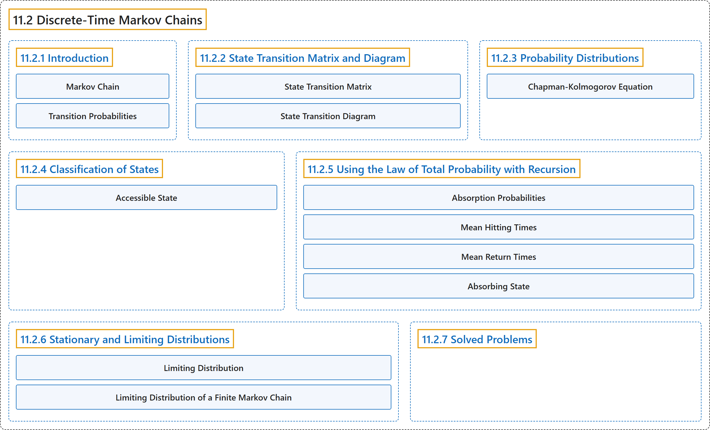

# 11.2 Discrete-Time Markov Chains

## Classification

## Glossary

| Term | Definition | 中文翻译 | Source |
|---|---|---|---|
| **11.2 Discrete-Time Markov Chains** 离散时间马尔可夫链 | (No definition) | （无定义） | [Pishro-Nik, 2014, section 11.2](https://www.probabilitycourse.com/chapter11/11_2_1_introduction.php) |
| **11.2.1 Introduction** 介绍 | (No definition) | （无定义） | [Pishro-Nik, 2014, section 11.2.1](https://www.probabilitycourse.com/chapter11/11_2_1_introduction.php) |
| **Markov Chain** 马尔可夫链 | "We say that this process is a **Markov chain** if $$\begin{align*} &P(X_{m+1}=j \vert X_{m}=i, X_{m-1}=i_{m-1}, \cdots, X_{0}=i_{0})\\ &\hspace{80pt}= P(X_{m+1}=j \vert X_{m}=i), \end{align*}$$ for all $m, j, i, i_0, i_1, \cdots i_{m-1}$." | 若 $$\begin{align*} &P(X_{m+1}=j \vert X_{m}=i, X_{m-1}=i_{m-1}, \cdots, X_{0}=i_{0})\\ &\hspace{80pt}= P(X_{m+1}=j \vert X_{m}=i), \end{align*}$$ 对所有 $m, j, i, i_0, i_1, \cdots i_{m-1}$ 成立，则称该过程为**马尔可夫链**。 | [Pishro-Nik, 2014, section 11.2.1](https://www.probabilitycourse.com/chapter11/11_2_1_introduction.php#:~:text=We%20say%20that%20this%20process%20is) |
| **Transition Probabilities** 转移概率 | "The numbers $P(X_{m+1}=j \vert X_{m}=i)$ are called the **transition probabilities**." | 数 $P(X_{m+1}=j \vert X_{m}=i)$ 称为**转移概率**。 | [Pishro-Nik, 2014, section 11.2.1](https://www.probabilitycourse.com/chapter11/11_2_1_introduction.php#:~:text=The%20numbers%20are%20called%20the%20transition) |
| **11.2.2 State Transition Matrix and Diagram** 状态转移矩阵与状态转移图 | (No definition) | （无定义） | [Pishro-Nik, 2014, section 11.2.2](https://www.probabilitycourse.com/chapter11/11_2_2_state_transition_matrix_and_diagram.php) |
| **State Transition Matrix** 状态转移矩阵 | "We often list the transition probabilities in a matrix. The matrix is called the **state transition matrix** or **transition probability matrix** and is usually shown by $P$." | 我们常把转移概率列成一个矩阵。该矩阵称为**状态转移矩阵**或**转移概率矩阵**，通常记为 $P$。 | [Pishro-Nik, 2014, section 11.2.2](https://www.probabilitycourse.com/chapter11/11_2_2_state_transition_matrix_and_diagram.php#:~:text=We%20often%20list%20the%20transition%20probabilities) |
| **State Transition Diagram** 状态转移图 | "A Markov chain is usually shown by a **state transition diagram**." | 马尔可夫链通常用**状态转移图**表示。 | [Pishro-Nik, 2014, section 11.2.2](https://www.probabilitycourse.com/chapter11/11_2_2_state_transition_matrix_and_diagram.php#:~:text=A%20Markov%20chain%20is%20usually%20shown) |
| **11.2.3 Probability Distributions** 概率分布 | (No definition) | （无定义） | [Pishro-Nik, 2014, section 11.2.3](https://www.probabilitycourse.com/chapter11/11_2_3_probability_distributions.php) |
| **Chapman-Kolmogorov Equation** 查普曼-柯尔莫哥洛夫方程 | "To obtain $p^{(m+n)}_{ij}$, we sum over all possible intermediate states: $$\begin{align*} p^{(m+n)}_{ij}&=P(X_{m+n}=j \vert X_0=i)\\ &=\sum_{k \in S} p^{(m)}_{ik}p^{(n)}_{kj}. \end{align*}$$ The above equation is called the **Chapman-Kolmogorov equation**." | 为得到 $p^{(m+n)}_{ij}$，我们对所有可能的中间状态求和：$$\begin{align*} p^{(m+n)}_{ij}&=P(X_{m+n}=j \vert X_0=i)\\ &=\sum_{k \in S} p^{(m)}_{ik}p^{(n)}_{kj}. \end{align*}$$ 上述方程称为**查普曼-柯尔莫哥洛夫方程**。 | [Pishro-Nik, 2014, section 11.2.3](https://www.probabilitycourse.com/chapter11/11_2_3_probability_distributions.php#:~:text=To%20obtain%20%2C%20we%20sum%20over) |
| **11.2.4 Classification of States** 状态的分类 | (No definition) | （无定义） | [Pishro-Nik, 2014, section 11.2.4](https://www.probabilitycourse.com/chapter11/11_2_4_classification_of_states.php) |
| **Accessible State** 可达状态 | "We say that state $j$ is **accessible** from state $i$, written as $i \rightarrow j$, if $p^{(n)}_{ij}>0$ for some $n$." | 若对某个 $n$ 有 $p^{(n)}_{ij}>0$，则称状态 $j$ 从状态 $i$ **可达**，记作 $i \rightarrow j$。 | [Pishro-Nik, 2014, section 11.2.4](https://www.probabilitycourse.com/chapter11/11_2_4_classification_of_states.php#:~:text=We%20say%20that%20state%20is%20accessible) |
| **11.2.5 Using the Law of Total Probability with Recursion** 结合递推使用全概率公式 | (No definition) | （无定义） | [Pishro-Nik, 2014, section 11.2.5](https://www.probabilitycourse.com/chapter11/11_2_5_using_the_law_of_total_probability_with_recursion.php) |
| **Absorption Probabilities** 吸收概率 | "Let $l\in S$ be an **absorbing state**. Define $$\begin{align*} a_i&=P(\textrm{absorption in }l \vert  X_0=i), \quad \textrm{ for all }i \in S. \end{align*}$$" | 设 $l\in S$ 为一个**吸收态**。定义 $$\begin{align*} a_i&=P(\textrm{absorption in }l \vert  X_0=i), \quad \textrm{ for all }i \in S. \end{align*}$$ | [Pishro-Nik, 2014, section 11.2.5](https://www.probabilitycourse.com/chapter11/11_2_5_using_the_law_of_total_probability_with_recursion.php#:~:text=Let%20be%20an%20absorbing%20state.%20Define) |
| **Mean Hitting Times** 平均击中时间 | "Let $T$ be the **first time** the chain visits a state in $A$. For all $i \in S$, define $$\begin{align*} t_i&=E[T \vert X_0=i]. \end{align*}$$" | 设 $T$ 为链访问 $A$ 中某一状态的**首次时间**。对所有 $i \in S$，定义 $$\begin{align*} t_i&=E[T \vert X_0=i]. \end{align*}$$ | [Pishro-Nik, 2014, section 11.2.5](https://www.probabilitycourse.com/chapter11/11_2_5_using_the_law_of_total_probability_with_recursion.php#:~:text=Let%20be%20the%20first%20time%20the) |
| **Mean Return Times** 平均返回时间 | "Let $r_l$ be the **mean return time** to state $l$." | 设 $r_l$ 为状态 $l$ 的**平均返回时间**。 | [Pishro-Nik, 2014, section 11.2.5](https://www.probabilitycourse.com/chapter11/11_2_5_using_the_law_of_total_probability_with_recursion.php#:~:text=Let%20be%20the%20mean%20return%20time) |
| **Absorbing State** 吸收态 | "Note that states $0$ and $3$ have the following property: once you enter those states, you never leave them. For this reason, we call them **absorbing states**." | 注意状态 $0$ 和 $3$ 具有如下性质：一旦进入这些状态，就永远不会离开。因此我们称它们为**吸收态**。 | [Pishro-Nik, 2014, section 11.2.5](https://www.probabilitycourse.com/chapter11/11_2_5_using_the_law_of_total_probability_with_recursion.php#:~:text=Note%20that%20states%20and%20have%20the) |
| **11.2.6 Stationary and Limiting Distributions** 平稳分布与极限分布 | (No definition) | （无定义） | [Pishro-Nik, 2014, section 11.2.6](https://www.probabilitycourse.com/chapter11/11_2_6_stationary_and_limiting_distributions.php) |
| **Limiting Distribution** 极限分布 | "The probability distribution $\pi=[\pi_0, \pi_1, \pi_2, \cdots ]$ is called the **limiting distribution** of the Markov chain $X_n$ if $$\begin{align*} \pi_j=\lim_{n \rightarrow \infty} P(X_n=j \vert X_0=i) \end{align*}$$ for all $i, j \in S$, and we have $$\begin{align*} \sum_{j \in S} \pi_j=1. \end{align*}$$" | 若 $$\begin{align*} \pi_j=\lim_{n \rightarrow \infty} P(X_n=j \vert X_0=i) \end{align*}$$ 对所有 $i, j \in S$ 成立，且有 $$\begin{align*} \sum_{j \in S} \pi_j=1. \end{align*}$$，则称概率分布 $\pi=[\pi_0, \pi_1, \pi_2, \cdots ]$ 为马尔可夫链 $X_n$ 的**极限分布**。 | [Pishro-Nik, 2014, section 11.2.6](https://www.probabilitycourse.com/chapter11/11_2_6_stationary_and_limiting_distributions.php#:~:text=The%20probability%20distribution%20is%20called%20the) |
| **Limiting Distribution of a Finite Markov Chain** 有限马尔可夫链的极限分布 | "The unique solution to the above equations is the **limiting distribution** of the Markov chain, i.e.," | 上述方程的唯一解即为该马尔可夫链的**极限分布**，即 | [Pishro-Nik, 2014, section 11.2.6](https://www.probabilitycourse.com/chapter11/11_2_6_stationary_and_limiting_distributions.php#:~:text=The%20unique%20solution%20to%20the%20above) |
| **11.2.7 Solved Problems** 例题详解 | (No definition) | （无定义） | [Pishro-Nik, 2014, section 11.2.7](https://www.probabilitycourse.com/chapter11/11_2_7_solved_probs.php) |

## References

Pishro-Nik, H. (2014). *Introduction to probability, statistics, and random processes*. Kappa Research. Retrieved October 28, 2026, from <https://www.probabilitycourse.com/>
