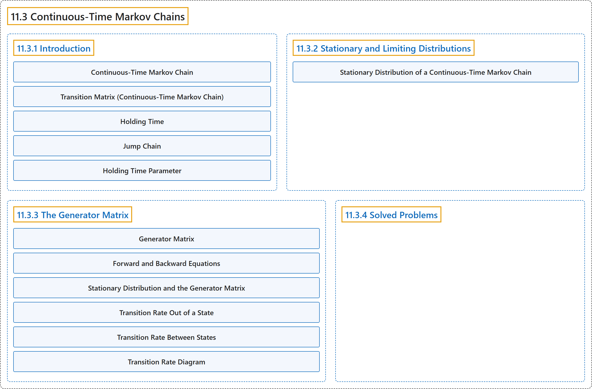

# 11.3 Continuous-Time Markov Chains

## Classification

## Glossary

| Term | Definition | 中文翻译 | Source |
|---|---|---|---|
| **11.3 Continuous-Time Markov Chains** 连续时间马尔可夫链 | (No definition) | （无定义） | [Pishro-Nik, 2014, section 11.3](https://www.probabilitycourse.com/chapter11/11_3_1_introduction.php) |
| **11.3.1 Introduction** 介绍 | (No definition) | （无定义） | [Pishro-Nik, 2014, section 11.3.1](https://www.probabilitycourse.com/chapter11/11_3_1_introduction.php) |
| **Continuous-Time Markov Chain** 连续时间马尔可夫链 | "A **continuous-time Markov chain** $X(t)$ is defined by two components: a **jump chain**, and a set of holding time parameters $\lambda_i$." | **连续时间马尔可夫链** $X(t)$ 由两个部分定义：一个**跳跃链**，以及一组保持时间参数 $\lambda_i$。 | [Pishro-Nik, 2014, section 11.3.1](https://www.probabilitycourse.com/chapter11/11_3_1_introduction.php#:~:text=A%20continuous-time%20Markov%20chain%20is%20defined) |
| **Transition Matrix (Continuous-Time Markov Chain)** 转移矩阵（连续时间马尔可夫链） | "For a continuous-time Markov chain, we define the **transition matrix** $P(t)$. The $(i,j)\text{th}$ entry of the transition matrix is given by $$\begin{align*} P_{ij}(t)&=P(X(t)=j\vert X(0)=i). \end{align*}$$" | 对于连续时间马尔可夫链，我们定义**转移矩阵** $P(t)$。转移矩阵的第 $(i,j)$ 个元素为 $$\begin{align*} P_{ij}(t)&=P(X(t)=j\vert X(0)=i). \end{align*}$$ | [Pishro-Nik, 2014, section 11.3.1](https://www.probabilitycourse.com/chapter11/11_3_1_introduction.php#:~:text=For%20a%20continuous-time%20Markov%20chain%2C%20we) |
| **Holding Time** 保持时间 | "Thus, the time that a continuous-time Markov chain spends in state $i$ (called the **holding time**) will have $Exponential(\lambda_i)$ distribution, where $\lambda_i$ is a nonnegative real number." | 因此，连续时间马尔可夫链停留在状态 $i$ 的时间（称为**保持时间**）服从 $Exponential(\lambda_i)$ 分布，其中 $\lambda_i$ 是一个非负实数。 | [Pishro-Nik, 2014, section 11.3.1](https://www.probabilitycourse.com/chapter11/11_3_1_introduction.php#:~:text=Thus%2C%20the%20time%20that%20a%20continuous-time) |
| **Jump Chain** 跳跃链（嵌入马尔可夫链） | "First, we have a discrete-time Markov chain, called the **jump chain** or the the **embedded Markov chain**, that gives us the transition probabilities $p_{ij}$." | 首先，我们有一个离散时间马尔可夫链，称为**跳跃链**或**嵌入马尔可夫链**，它给出转移概率 $p_{ij}$。 | [Pishro-Nik, 2014, section 11.3.1](https://www.probabilitycourse.com/chapter11/11_3_1_introduction.php#:~:text=First%2C%20we%20have%20a%20discrete-time%20Markov) |
| **Holding Time Parameter** 保持时间参数 | "Second, for each state we have a **holding time parameter** $\lambda_i$ that controls the amount of time spent in each state." | 其次，对每个状态都有一个**保持时间参数** $\lambda_i$，它控制在每个状态所花费的时间。 | [Pishro-Nik, 2014, section 11.3.1](https://www.probabilitycourse.com/chapter11/11_3_1_introduction.php#:~:text=Second%2C%20for%20each%20state%20we%20have) |
| **11.3.2 Stationary and Limiting Distributions** 平稳分布与极限分布 | (No definition) | （无定义） | [Pishro-Nik, 2014, section 11.3.2](https://www.probabilitycourse.com/chapter11/11_3_2_stationary_and_limiting_distributions.php) |
| **Stationary Distribution of a Continuous-Time Markov Chain** 连续时间马尔可夫链的平稳分布 | "is said to be a **stationary distribution** for $X(t)$ if" | 称为 $X(t)$ 的**平稳分布**，若 | [Pishro-Nik, 2014, section 11.3.2](https://www.probabilitycourse.com/chapter11/11_3_2_stationary_and_limiting_distributions.php#:~:text=is%20said%20to%20be%20a%20stationary) |
| **11.3.3 The Generator Matrix** 生成元矩阵 | (No definition) | （无定义） | [Pishro-Nik, 2014, section 11.3.3](https://www.probabilitycourse.com/chapter11/11_3_3_the_generator_matrix.php) |
| **Generator Matrix** 生成元矩阵 | "For a continuous-time Markov chain, we define the **generator matrix** $G$. The $(i,j)\text{th}$ entry of the transition matrix is given by $$\begin{align} \nonumber g_{ij} = \left\{ \begin{array}{l l} \lambda_i p_{ij} & \quad \textrm{ if }i \neq j \\ & \quad \\ -\lambda_i & \quad \textrm{ if }i = j \end{array} \right. \end{align}$$" | 对于连续时间马尔可夫链，我们定义**生成元矩阵** $G$。转移矩阵的第 $(i,j)$ 个元素为 $$\begin{align} \nonumber g_{ij} = \left\{ \begin{array}{l l} \lambda_i p_{ij} & \quad \textrm{ if }i \neq j \\ & \quad \\ -\lambda_i & \quad \textrm{ if }i = j \end{array} \right. \end{align}$$ | [Pishro-Nik, 2014, section 11.3.3](https://www.probabilitycourse.com/chapter11/11_3_3_the_generator_matrix.php#:~:text=For%20a%20continuous-time%20Markov%20chain%2C%20we) |
| **Forward and Backward Equations** 前向方程与后向方程 | "The **forward equations** state that $$P'(t)=P(t)G,$$ which is equivalent to $$p'_{ij}(t)=\sum_{k \in S} p_{ik}(t) g_{kj}, \textrm{ for all }i,j \in S.$$ The **backward equations** state that $$P'(t)=GP(t),$$ which is equivalent to $$p'_{ij}(t)=\sum_{k \in S} g_{ik} p_{kj}(t), \textrm{ for all }i,j \in S.$$" | **前向方程**表明 $$P'(t)=P(t)G,$$，它等价于 $$p'_{ij}(t)=\sum_{k \in S} p_{ik}(t) g_{kj}, \textrm{ for all }i,j \in S.$$ **后向方程**表明 $$P'(t)=GP(t),$$，它等价于 $$p'_{ij}(t)=\sum_{k \in S} g_{ik} p_{kj}(t), \textrm{ for all }i,j \in S.$$ | [Pishro-Nik, 2014, section 11.3.3](https://www.probabilitycourse.com/chapter11/11_3_3_the_generator_matrix.php#:~:text=The%20forward%20equations%20state%20that%20P%27%28t%29%3DP%28t%29G%2C) |
| **Stationary Distribution and the Generator Matrix** 平稳分布与生成矩阵 | "Consider a continuous Markov chain $X(t)$ with the state space $S$ and the **generator Matrix** $G$. The probability distribution $\pi$ on $S$ is a **stationary distribution** for $X(t)$ if and only if it satisfies" | 考虑状态空间为 $S$、**生成矩阵**为 $G$ 的连续马尔可夫链 $X(t)$。$S$ 上的概率分布 $\pi$ 是 $X(t)$ 的**平稳分布**，当且仅当它满足 | [Pishro-Nik, 2014, section 11.3.3](https://www.probabilitycourse.com/chapter11/11_3_3_the_generator_matrix.php#:~:text=Consider%20a%20continuous%20Markov%20chain%20with) |
| **Transition Rate Out of a State** 离开状态的转移速率 | "Thus, in a short interval of length $\delta$, the probability of leaving state $i$ is approximately $\lambda_i \delta$. For this reason, $\lambda_i$ is often called the **transition rate** out of state $i$." | 因此，在长度为 $\delta$ 的短区间内，离开状态 $i$ 的概率约为 $\lambda_i \delta$。为此，$\lambda_i$ 常被称为离开状态 $i$ 的**转移速率**。 | [Pishro-Nik, 2014, section 11.3.3](https://www.probabilitycourse.com/chapter11/11_3_3_the_generator_matrix.php#:~:text=Thus%2C%20in%20a%20short%20interval%20of) |
| **Transition Rate Between States** 状态间转移速率 | "Since we go from state $i$ to state $j$ with probability $p_{ij}$, we call the quantity $g_{ij}=\lambda_i p_{ij}$, the **transition rate** from state $i$ to state $j$." | 由于我们以概率 $p_{ij}$ 从状态 $i$ 转移到状态 $j$，我们把量 $g_{ij}=\lambda_i p_{ij}$ 称为从状态 $i$ 到状态 $j$ 的**转移速率**。 | [Pishro-Nik, 2014, section 11.3.3](https://www.probabilitycourse.com/chapter11/11_3_3_the_generator_matrix.php#:~:text=Since%20we%20go%20from%20state%20to) |
| **Transition Rate Diagram** 转移速率图 | "A continuous-time Markov chain can be shown by its **transition rate diagram**. In this diagram, the values $g_{ij}$ are shown on the edges." | 连续时间马尔可夫链可以用其**转移速率图**表示。在该图中，数值 $g_{ij}$ 标在边上。 | [Pishro-Nik, 2014, section 11.3.3](https://www.probabilitycourse.com/chapter11/11_3_3_the_generator_matrix.php#:~:text=A%20continuous-time%20Markov%20chain%20can%20be) |
| **11.3.4 Solved Problems** 例题详解 | (No definition) | （无定义） | [Pishro-Nik, 2014, section 11.3.4](https://www.probabilitycourse.com/chapter11/11_3_4_solved_probs.php) |

## References

Pishro-Nik, H. (2014). *Introduction to probability, statistics, and random processes*. Kappa Research. Retrieved October 28, 2026, from <https://www.probabilitycourse.com/>
