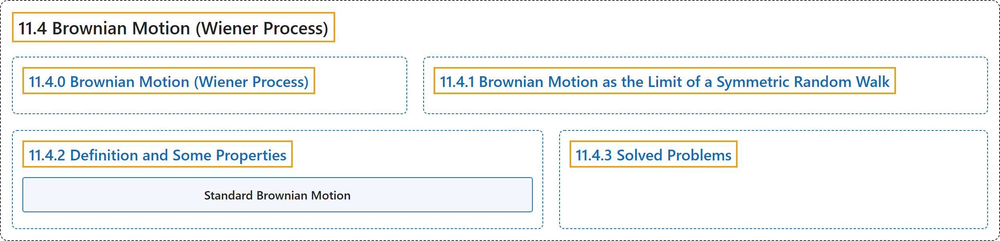

# 11.4 Brownian Motion (Wiener Process)

## Classification

## Glossary

| Term | Definition | 中文翻译 | Source |
|---|---|---|---|
| **11.4 Brownian Motion (Wiener Process)** 布朗运动（维纳过程） | (No definition) | （无定义） | [Pishro-Nik, 2014, section 11.4](https://www.probabilitycourse.com/chapter11/11_4_0_brownian_motion_wiener_process.php) |
| **11.4.0 Brownian Motion (Wiener Process)** 布朗运动（维纳过程） | (No definition) | （无定义） | [Pishro-Nik, 2014, section 11.4.0](https://www.probabilitycourse.com/chapter11/11_4_0_brownian_motion_wiener_process.php) |
| **11.4.1 Brownian Motion as the Limit of a Symmetric Random Walk** 布朗运动作为对称随机游走的极限 | (No definition) | （无定义） | [Pishro-Nik, 2014, section 11.4.1](https://www.probabilitycourse.com/chapter11/11_4_1_brownian_motion_as_the_limit_of_a_symmetric_random_walk.php) |
| **11.4.2 Definition and Some Properties** 定义与一些性质 | (No definition) | （无定义） | [Pishro-Nik, 2014, section 11.4.2](https://www.probabilitycourse.com/chapter11/11_4_2_definition_and_some_properties.php) |
| **Standard Brownian Motion** 标准布朗运动 | "A Gaussian random process $\{W(t), t \in [0, \infty) \}$ is called a (standard) **Brownian motion** or a (standard) **Wiener process** if W(0)=0; for all $0 \leq t_1 \lt t_2$, $W(t_2)-W(t_1) \sim N(0, t_2-t_1)$; W(t) has independent increments. That is, for all $0 \leq t_1 \lt t_2 \lt t_3 \cdots \lt t_n$, the random variables $$\begin{align*} W(t_2)-W(t_1), \; W(t_3)-W(t_2), \; \cdots, \; W(t_n)-W(t_{n-1}) \end{align*}$$ are independent; W(t) has continuous sample paths." | 若高斯随机过程 $\{W(t), t \in [0, \infty) \}$ 满足 W(0)=0；对所有 $0 \leq t_1 \lt t_2$ 有 $W(t_2)-W(t_1) \sim N(0, t_2-t_1)$；W(t) 具有独立增量，即对所有 $0 \leq t_1 \lt t_2 \lt t_3 \cdots \lt t_n$，随机变量 $$\begin{align*} W(t_2)-W(t_1), \; W(t_3)-W(t_2), \; \cdots, \; W(t_n)-W(t_{n-1}) \end{align*}$$ 相互独立；W(t) 具有连续样本路径，则称其为（标准）**布朗运动或（标准）维纳过程**。 | [Pishro-Nik, 2014, section 11.4.2](https://www.probabilitycourse.com/chapter11/11_4_2_definition_and_some_properties.php#:~:text=A%20Gaussian%20random%20process%20is%20called) |
| **11.4.3 Solved Problems** 例题详解 | (No definition) | （无定义） | [Pishro-Nik, 2014, section 11.4.3](https://www.probabilitycourse.com/chapter11/11_4_3_solved_probs.php) |

## References

Pishro-Nik, H. (2014). *Introduction to probability, statistics, and random processes*. Kappa Research. Retrieved October 28, 2026, from <https://www.probabilitycourse.com/>
