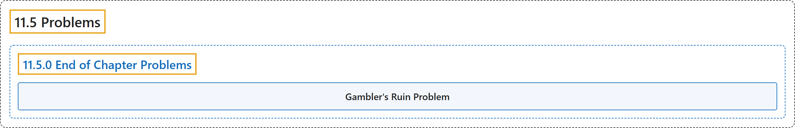

# 11.5 Problems

## Classification

## Glossary

| Term | Definition | 中文翻译 | Source |
|---|---|---|---|
| **11.5 Problems** 习题 | (No definition) | （无定义） | [Pishro-Nik, 2014, section 11.5](https://www.probabilitycourse.com/chapter11/11_5_0_end_of_chapter_problems.php) |
| **11.5.0 End of Chapter Problems** 章末习题 | (No definition) | （无定义） | [Pishro-Nik, 2014, section 11.5.0](https://www.probabilitycourse.com/chapter11/11_5_0_end_of_chapter_problems.php) |
| **Gambler's Ruin Problem** 赌徒破产问题 | "The game ends when one of the gamblers **runs out of money** (in which case the other gambler will have $N$ dollars). Our goal is to find $p_i$, the **probability that A wins the game** given that he has initially $i$ dollars." | 当其中一名赌徒**输光钱**时游戏结束（此时另一名赌徒将拥有 $N$ 美元）。我们的目标是求 $p_i$，即 A 在初始拥有 $i$ 美元的条件下**赢得游戏的概率**。 | [Pishro-Nik, 2014, section 11.5.0](https://www.probabilitycourse.com/chapter11/11_5_0_end_of_chapter_problems.php#:~:text=The%20game%20ends%20when%20one%20of) |

## References

Pishro-Nik, H. (2014). *Introduction to probability, statistics, and random processes*. Kappa Research. Retrieved October 28, 2026, from <https://www.probabilitycourse.com/>
