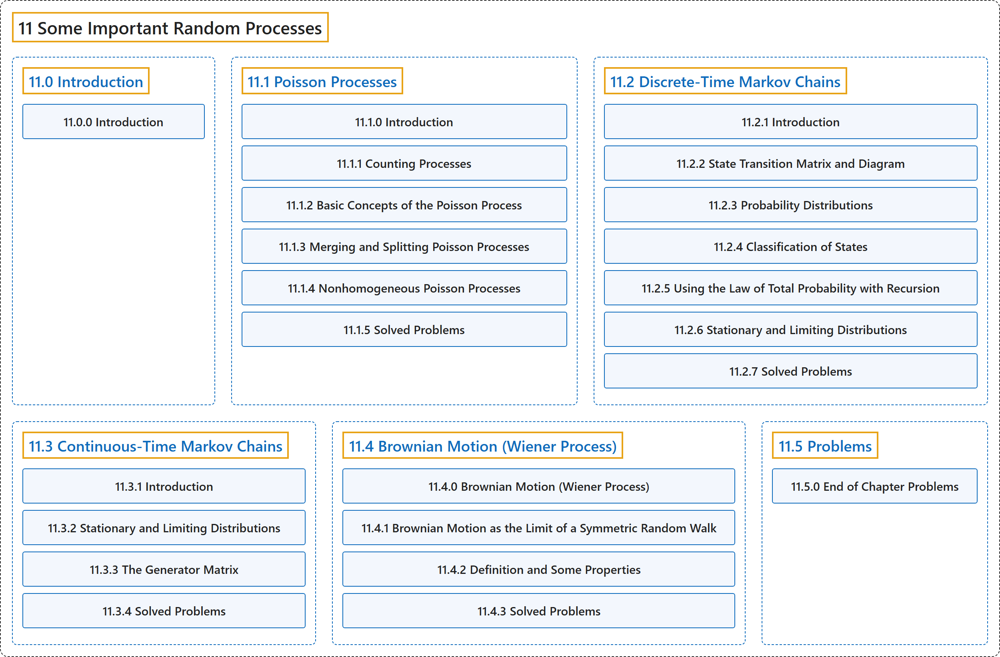

# 11 Some Important Random Processes

## Classification

## Glossary

| Term | Definition | 中文翻译 | Source |
|---|---|---|---|
| **11 Some Important Random Processes** 一些重要的随机过程 | (No definition) | （无定义） | [Pishro-Nik, 2014, chapter 11](https://www.probabilitycourse.com/) |
| **[11.0 Introduction](11-0-introduction.md)** 介绍 | (No definition) | （无定义） | [Pishro-Nik, 2014, section 11.0](https://www.probabilitycourse.com/chapter11/11_0_0_intro.php) |
| **[11.1 Poisson Processes](11-1-poisson-processes.md)** 泊松过程 | (No definition) | （无定义） | [Pishro-Nik, 2014, section 11.1](https://www.probabilitycourse.com/chapter11/11_1_1_counting_processes.php) |
| **[11.2 Discrete-Time Markov Chains](11-2-discrete-time-markov-chains.md)** 离散时间马尔可夫链 | (No definition) | （无定义） | [Pishro-Nik, 2014, section 11.2](https://www.probabilitycourse.com/chapter11/11_2_1_introduction.php) |
| **[11.3 Continuous-Time Markov Chains](11-3-continuous-time-markov-chains.md)** 连续时间马尔可夫链 | (No definition) | （无定义） | [Pishro-Nik, 2014, section 11.3](https://www.probabilitycourse.com/chapter11/11_3_1_introduction.php) |
| **[11.4 Brownian Motion (Wiener Process)](11-4-brownian-motion-wiener-process.md)** 布朗运动（维纳过程） | (No definition) | （无定义） | [Pishro-Nik, 2014, section 11.4](https://www.probabilitycourse.com/chapter11/11_4_0_brownian_motion_wiener_process.php) |
| **[11.5 Problems](11-5-problems.md)** 习题 | (No definition) | （无定义） | [Pishro-Nik, 2014, section 11.5](https://www.probabilitycourse.com/chapter11/11_5_0_end_of_chapter_problems.php) |

## References

Pishro-Nik, H. (2014). *Introduction to probability, statistics, and random processes*. Kappa Research. Retrieved October 28, 2026, from <https://www.probabilitycourse.com/>
