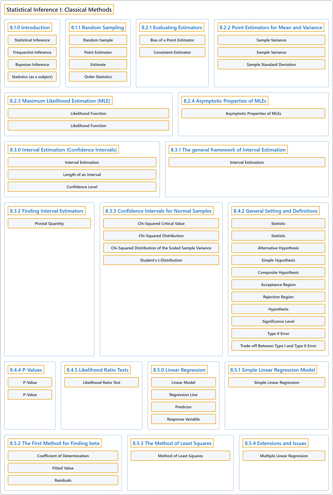

# 8 Statistical Inference I: Classical Methods

## Classification

## Glossary

| Term | Definition | 中文翻译 | Source |
|---|---|---|---|
| **8 Statistical Inference I: Classical Methods** 统计推断一：经典方法 | (No definition) | （无定义） | [Pishro-Nik, 2014, chapter 8](https://www.probabilitycourse.com/) |
| **8.1.0 Introduction** 引言 | (No definition) | （无定义） | [Pishro-Nik, 2014, section 8.1.0](https://www.probabilitycourse.com/chapter8/8_1_0_intro.php) |
| **Statistical Inference** 统计推断 | "**Statistical inference** is a collection of methods that deal with drawing conclusions from data that are prone to random variation." | **统计推断**是一组方法，用于从易受随机变异影响的数据中得出结论。 | [Pishro-Nik, 2014, section 8.1.0](https://www.probabilitycourse.com/chapter8/8_1_0_intro.php#:~:text=Statistical%20inference%20is%20a%20collection%20of) |
| **Frequentist Inference** 频率学派推断 | "In this approach, the unknown quantity $\theta$ is assumed to be a **fixed quantity**. That is, $\theta$ is a **deterministic** (non-random) quantity that is to be estimated by the observed data." | 在这种方法中，未知量 $\theta$ 被假定为**固定量**。也就是说，$\theta$ 是一个**确定性的**（非随机的）量，需要由观测数据来估计。 | [Pishro-Nik, 2014, section 8.1.0](https://www.probabilitycourse.com/chapter8/8_1_0_intro.php#:~:text=In%20this%20approach%2C%20the%20unknown%20quantity) |
| **Bayesian Inference** 贝叶斯推断 | "In the Bayesian approach the unknown quantity $\Theta$ is assumed to be a **random variable**, and we assume that we have some initial guess about the distribution of $\Theta$. After observing the data, we update the distribution of $\Theta$ using **Bayes' Rule**." | 在贝叶斯方法中，未知量 $\Theta$ 被假定为**随机变量**，并假定我们对 $\Theta$ 的分布有某种初始猜测。观测到数据后，我们利用**贝叶斯法则**更新 $\Theta$ 的分布。 | [Pishro-Nik, 2014, section 8.1.0](https://www.probabilitycourse.com/chapter8/8_1_0_intro.php#:~:text=In%20the%20Bayesian%20approach%20the%20unknown) |
| **Statistics (as a subject)** 统计（作为学科） | "The mathematical study of the **likelihood and probability of events** occurring based on known information and inferred by **taking a limited number of samples**." | 对事件发生的**可能性和概率**所作的数学研究，依据已知信息，并通过**抽取有限数量的样本**来推断。 | [Weisstein, n.d., "Statistics" entry, para. 1](https://mathworld.wolfram.com/Statistics.html#:~:text=The%20mathematical%20study%20of%20the%20likelihood%20and%20probability%20of%20events) |
| **8.1.1 Random Sampling** 随机抽样 | (No definition) | （无定义） | [Pishro-Nik, 2014, section 8.1.1](https://www.probabilitycourse.com/chapter8/8_1_1_random_sampling.php) |
| **Random Sample** 随机样本 | "The collection of random variables $X_1$, $X_2$, $X_3$, $...$, $X_n$ is said to be a **random sample** of size $n$ if they are independent and identically distributed (i.i.d.)," | 若随机变量集合 $X_1$, $X_2$, $X_3$, $...$, $X_n$ 独立同分布（i.i.d.），则称其为容量为 $n$ 的**随机样本**， | [Pishro-Nik, 2014, section 8.1.1](https://www.probabilitycourse.com/chapter8/8_1_1_random_sampling.php#:~:text=The%20collection%20of%20random%20variables%20%2C) |
| **Point Estimator** 点估计量 | "In general, a **point estimator** is a function of the random sample $\hat{\Theta}=h(X_1,X_2,\cdots,X_n)$ that is used to estimate an unknown quantity." | 一般地，**点估计量**是随机样本的函数 $\hat{\Theta}=h(X_1,X_2,\cdots,X_n)$，用来估计未知量。 | [Pishro-Nik, 2014, section 8.1.1](https://www.probabilitycourse.com/chapter8/8_1_1_random_sampling.php#:~:text=In%20general%2C%20a%20point%20estimator%20is) |
| **Estimate** 估计值 | "Here, $\hat{\theta}$ is called an **estimate** of the average height in the population." | 这里 $\hat{\theta}$ 称为总体平均身高的**估计值**。 | [Pishro-Nik, 2014, section 8.1.1](https://www.probabilitycourse.com/chapter8/8_1_1_random_sampling.php#:~:text=Here%2C%20is%20called%20an%20estimate%20of) |
| **Order Statistics** 顺序统计量 | "Thus, we often order the observed data from the smallest to the largest. We call the resulting ordered random variables **order statistics**." | 因此，我们常把观测数据从小到大排序。我们把得到的有序随机变量称为**顺序统计量**。 | [Pishro-Nik, 2014, section 8.1.1](https://www.probabilitycourse.com/chapter8/8_1_1_random_sampling.php#:~:text=Thus%2C%20we%20often%20order%20the%20observed) |
| **8.2.1 Evaluating Estimators** 评价估计量 | (No definition) | （无定义） | [Pishro-Nik, 2014, section 8.2.1](https://www.probabilitycourse.com/chapter8/8_2_1_evaluating_estimators.php) |
| **Bias of a Point Estimator** 点估计量的偏差 | "Let $\hat{\Theta}=h(X_1,X_2,\cdots,X_n)$ be a point estimator for $\theta$. The **bias** of point estimator $\hat{\Theta}$ is defined by" | 设 $\hat{\Theta}=h(X_1,X_2,\cdots,X_n)$ 为 $\theta$ 的点估计量。点估计量 $\hat{\Theta}$ 的**偏差**定义为 | [Pishro-Nik, 2014, section 8.2.1](https://www.probabilitycourse.com/chapter8/8_2_1_evaluating_estimators.php#:~:text=Let%20be%20a%20point%20estimator%20for) |
| **Consistent Estimator** 相合估计量 | "then $\hat{\Theta}_n$ is a **consistent estimator** of $\theta$." | 则 $\hat{\Theta}_n$ 是 $\theta$ 的**相合估计量**。 | [Pishro-Nik, 2014, section 8.2.1](https://www.probabilitycourse.com/chapter8/8_2_1_evaluating_estimators.php#:~:text=then%20is%20a%20consistent%20estimator%20of) |
| **8.2.2 Point Estimators for Mean and Variance** 均值与方差的点估计量 | (No definition) | （无定义） | [Pishro-Nik, 2014, section 8.2.2](https://www.probabilitycourse.com/chapter8/8_2_2_point_estimators_for_mean_and_var.php) |
| **Sample Variance** 样本方差 | "The **sample variance** of this random sample is defined as" | 该随机样本的**样本方差**定义为 | [Pishro-Nik, 2014, section 8.2.2](https://www.probabilitycourse.com/chapter8/8_2_2_point_estimators_for_mean_and_var.php#:~:text=The%20sample%20variance%20of%20this%20random) |
| **Sample Variance** 样本方差 | "By the above discussion, $S^2$ is an unbiased estimator of the variance. We call it the **sample variance**." | 由上述讨论，$S^2$ 是方差的无偏估计量。我们称之为**样本方差**。 | [Pishro-Nik, 2014, section 8.2.2](https://www.probabilitycourse.com/chapter8/8_2_2_point_estimators_for_mean_and_var.php#:~:text=By%20the%20above%20discussion%2C%20is%20an) |
| **Sample Standard Deviation** 样本标准差 | "We also define the **sample standard deviation** as" | 我们还把**样本标准差**定义为 | [Pishro-Nik, 2014, section 8.2.2](https://www.probabilitycourse.com/chapter8/8_2_2_point_estimators_for_mean_and_var.php#:~:text=We%20also%20define%20the%20sample%20standard) |
| **8.2.3 Maximum Likelihood Estimation (MLE)** 最大似然估计（MLE） | (No definition) | （无定义） | [Pishro-Nik, 2014, section 8.2.3](https://www.probabilitycourse.com/chapter8/8_2_3_max_likelihood_estimation.php) |
| **Likelihood Function** 似然函数 | "If $X_i$'s are discrete, then the **likelihood function** is defined as" | 若 $X_i$ 为离散型，则**似然函数**定义为 | [Pishro-Nik, 2014, section 8.2.3](https://www.probabilitycourse.com/chapter8/8_2_3_max_likelihood_estimation.php#:~:text=If%20%27s%20are%20discrete%2C%20then%20the) |
| **Likelihood Function** 似然函数 | "If $X_i$'s are discrete random variables, we define the **likelihood function** as the **probability of the observed sample** as a function of $\theta$:" | 如果 $X_i$ 是离散随机变量，我们把**似然函数**定义为**观测样本的概率**，视为 $\theta$ 的函数： | [Pishro-Nik, 2014, section 8.2.3](https://www.probabilitycourse.com/chapter8/8_2_3_max_likelihood_estimation.php#:~:text=If%20%27s%20are%20discrete%20random%20variables%2C) |
| **8.2.4 Asymptotic Properties of MLEs** 最大似然估计量的渐近性质 | (No definition) | （无定义） | [Pishro-Nik, 2014, section 8.2.4](https://www.probabilitycourse.com/chapter8/8_2_4_asymptotic_probs_of_MLE.php) |
| **Asymptotic Properties of MLEs** 最大似然估计的渐近性质 | "Let $\hat{\Theta}_{ML}$ denote the **maximum likelihood estimator (MLE)** of $\theta$. Then, under some mild regularity conditions, $\hat{\Theta}_{ML}$ is **asymptotically consistent**, i.e.," | 设 $\hat{\Theta}_{ML}$ 表示 $\theta$ 的**最大似然估计量**（MLE）。则在一些温和的正则条件下，$\hat{\Theta}_{ML}$ 是**渐近一致的**，即 | [Pishro-Nik, 2014, section 8.2.4](https://www.probabilitycourse.com/chapter8/8_2_4_asymptotic_probs_of_MLE.php#:~:text=Let%20denote%20the%20maximum%20likelihood%20estimator) |
| **8.3.0 Interval Estimation (Confidence Intervals)** 区间估计（置信区间） | (No definition) | （无定义） | [Pishro-Nik, 2014, section 8.3.0](https://www.probabilitycourse.com/chapter8/8_3_0_interval_estimation.php) |
| **Interval Estimation** 区间估计 | "Here, we will introduce the concept of **interval estimation**. In this approach, instead of giving just one value $\hat{\theta}$ as the estimate for $\theta$, we will produce an **interval** that is likely to include the true value of $\theta$." | 这里我们引入**区间估计**的概念。在这种方法中，我们不只给出一个值 $\hat{\theta}$ 作为 $\theta$ 的估计，而是给出一个很可能包含 $\theta$ 真值的**区间**。 | [Pishro-Nik, 2014, section 8.3.0](https://www.probabilitycourse.com/chapter8/8_3_0_interval_estimation.php#:~:text=Here%2C%20we%20will%20introduce%20the%20concept) |
| **Length of an Interval** 区间长度 | "One is the **length** of the reported interval, $\hat{\theta}_h-\hat{\theta}_l$. The length of the interval shows the **precision** with which we can estimate $\theta$." | 其一是所报告区间的**长度** $\hat{\theta}_h-\hat{\theta}_l$。区间长度反映了我们估计 $\theta$ 的**精度**。 | [Pishro-Nik, 2014, section 8.3.0](https://www.probabilitycourse.com/chapter8/8_3_0_interval_estimation.php#:~:text=One%20is%20the%20length%20of%20the) |
| **Confidence Level** 置信水平 | "The second important factor is the **confidence level** that shows how confident we are about the interval. The confidence level is the **probability** that the interval that we construct includes the real value of $\theta$." | 第二个重要因素是**置信水平**，它表明我们对该区间有多大把握。置信水平是我们构造的区间包含 $\theta$ 真值的**概率**。 | [Pishro-Nik, 2014, section 8.3.0](https://www.probabilitycourse.com/chapter8/8_3_0_interval_estimation.php#:~:text=The%20second%20important%20factor%20is%20the) |
| **8.3.1 The general framework of Interval Estimation** 区间估计的一般框架 | (No definition) | （无定义） | [Pishro-Nik, 2014, section 8.3.1](https://www.probabilitycourse.com/chapter8/8_3_1_gen_framework_of_int_estimation.php) |
| **Interval Estimation** 区间估计 | "An **interval estimator** with confidence level $1-\alpha$ consists of two estimators $\hat{\Theta}_l(X_1, X_2, \cdots, X_n)$ and $\hat{\Theta}_h(X_1, X_2, \cdots, X_n)$ such that" | 置信水平为 $1-\alpha$ 的**区间估计量**由两个估计量 $\hat{\Theta}_l(X_1, X_2, \cdots, X_n)$ 和 $\hat{\Theta}_h(X_1, X_2, \cdots, X_n)$ 构成，使得 | [Pishro-Nik, 2014, section 8.3.1](https://www.probabilitycourse.com/chapter8/8_3_1_gen_framework_of_int_estimation.php#:~:text=An%20interval%20estimator%20with%20confidence%20level) |
| **8.3.2 Finding Interval Estimators** 求区间估计量 | (No definition) | （无定义） | [Pishro-Nik, 2014, section 8.3.2](https://www.probabilitycourse.com/chapter8/8_3_2_finding_interval_estimators.php) |
| **Pivotal Quantity** 枢轴量 | "The random variable $Q$ is said to be a **pivot** or a **pivotal quantity**, if it has the following properties:" | 如果随机变量 $Q$ 具有下列性质，则称它是**枢轴**（pivot）或**枢轴量**： | [Pishro-Nik, 2014, section 8.3.2](https://www.probabilitycourse.com/chapter8/8_3_2_finding_interval_estimators.php#:~:text=The%20random%20variable%20is%20said%20to) |
| **8.3.3 Confidence Intervals for Normal Samples** 正态样本的置信区间 | (No definition) | （无定义） | [Pishro-Nik, 2014, section 8.3.3](https://www.probabilitycourse.com/chapter8/8_3_3_confidence_intervals_for_norm_samples.php) |
| **Chi-Squared Critical Value** 卡方临界值 | "For any $p \in [0,1]$ and $n \in \mathbb{N}$, we define $\chi^2_{p,n}$ as the **real value** for which" | 对任意 $p \in [0,1]$ 和 $n \in \mathbb{N}$，我们把 $\chi^2_{p,n}$ 定义为满足下式的**实数值** | [Pishro-Nik, 2014, section 8.3.3](https://www.probabilitycourse.com/chapter8/8_3_3_confidence_intervals_for_norm_samples.php#:~:text=For%20any%20and%20%2C%20we%20define) |
| **Chi-Squared Distribution** 卡方分布 | "is said to have a **chi-squared distribution** with $n$ **degrees of freedom** shown by" | 称为服从自由度为 $n$ 的**卡方分布**，其**自由度**记作 | [Pishro-Nik, 2014, section 8.3.3](https://www.probabilitycourse.com/chapter8/8_3_3_confidence_intervals_for_norm_samples.php#:~:text=is%20said%20to%20have%20a%20chi-squared) |
| **Chi-Squared Distribution of the Scaled Sample Variance** 正态样本方差的卡方分布 | "has a **chi-squared distribution** with $n-1$ degrees of freedom, i.e., $Y \sim \chi^2(n-1)$. Moreover, $\overline{X}$ and $S^2$ are **independent** random variables." | 服从自由度为 $n-1$ 的**卡方分布**，即 $Y \sim \chi^2(n-1)$。此外，$\overline{X}$ 与 $S^2$ 是相互**独立**的随机变量。 | [Pishro-Nik, 2014, section 8.3.3](https://www.probabilitycourse.com/chapter8/8_3_3_confidence_intervals_for_norm_samples.php#:~:text=has%20a%20chi-squared%20distribution%20with%20degrees) |
| **Student's t-Distribution** 学生t分布 | "is said to have a $t$-distribution with $n$ **degrees of freedom** shown by" | 称为服从自由度为 $n$ 的 $t$ 分布，其**自由度**记作 | [Pishro-Nik, 2014, section 8.3.3](https://www.probabilitycourse.com/chapter8/8_3_3_confidence_intervals_for_norm_samples.php#:~:text=is%20said%20to%20have%20a%20-distribution) |
| **8.4.2 General Setting and Definitions** 一般设定与定义 | (No definition) | （无定义） | [Pishro-Nik, 2014, section 8.4.2](https://www.probabilitycourse.com/chapter8/8_4_2_general_setting_definitions.php) |
| **Statistic** 统计量 | "A **statistic** is a real-valued function of the data." | **统计量**是数据的实值函数。 | [Pishro-Nik, 2014, section 8.4.2](https://www.probabilitycourse.com/chapter8/8_4_2_general_setting_definitions.php#:~:text=A%20statistic%20is%20a%20real-valued%20function) |
| **Statistic** 统计量 | "A **statistic** is a **real-valued function** of the data." | **统计量**是数据的**实值函数**。 | [Pishro-Nik, 2014, section 8.4.2](https://www.probabilitycourse.com/chapter8/8_4_2_general_setting_definitions.php#:~:text=A%20statistic%20is%20a%20real-valued%20function) |
| **Alternative Hypothesis** 备择假设 | "$H_0$ (the **null hypothesis**): $\theta \in S_0$. $\quad$ $H_1$ (the **alternative hypothesis**): $\theta \in S_1$." | $H_0$（**原假设**）：$\theta \in S_0$。$\quad$ $H_1$（**备择假设**）：$\theta \in S_1$。 | [Pishro-Nik, 2014, section 8.4.2](https://www.probabilitycourse.com/chapter8/8_4_2_general_setting_definitions.php#:~:text=%28the%20null%20hypothesis%29%3A%20.%20%28the%20alternative) |
| **Simple Hypothesis** 简单假设 | "Here, $H_0$ is an example of a **simple hypothesis** because $S_0$ contains only one value of $\theta$." | 这里，$H_0$ 是**简单假设**的一个例子，因为 $S_0$ 只包含 $\theta$ 的一个值。 | [Pishro-Nik, 2014, section 8.4.2](https://www.probabilitycourse.com/chapter8/8_4_2_general_setting_definitions.php#:~:text=Here%2C%20is%20an%20example%20of%20a) |
| **Composite Hypothesis** 复合假设 | "On the other hand, $H_1$ is an example of **composite hypothesis** since $S_1$ contains more than one element." | 另一方面，$H_1$ 是**复合假设**的一个例子，因为 $S_1$ 包含不止一个元素。 | [Pishro-Nik, 2014, section 8.4.2](https://www.probabilitycourse.com/chapter8/8_4_2_general_setting_definitions.php#:~:text=On%20the%20other%20hand%2C%20is%20an) |
| **Acceptance Region** 接受域 | "The set $A$ is called the **acceptance region**, while the set $R=\mathbb{R}-A$ is said to be the rejection region." | 集合 $A$ 称为**接受域**，而集合 $R=\mathbb{R}-A$ 称为拒绝域。 | [Pishro-Nik, 2014, section 8.4.2](https://www.probabilitycourse.com/chapter8/8_4_2_general_setting_definitions.php#:~:text=The%20set%20is%20called%20the%20acceptance) |
| **Rejection Region** 拒绝域 | "The set $A$ is called the acceptance region, while the set $R=\mathbb{R}-A$ is said to be the **rejection region**." | 集合 $A$ 称为接受域，而集合 $R=\mathbb{R}-A$ 称为**拒绝域**。 | [Pishro-Nik, 2014, section 8.4.2](https://www.probabilitycourse.com/chapter8/8_4_2_general_setting_definitions.php#:~:text=The%20set%20is%20called%20the%20acceptance) |
| **Hypothesis** 假设 | "A hypothesis is a statement such as $\theta=1$, $\theta>1.3$, $\theta \neq 0.5$, etc. In hypothesis testing problems, we need to decide between two **contradictory hypotheses**." | 假设是形如 $\theta=1$、$\theta>1.3$、$\theta \neq 0.5$ 等的陈述。在假设检验问题中，我们需要在两个**相互矛盾的假设**之间做出决定。 | [Pishro-Nik, 2014, section 8.4.2](https://www.probabilitycourse.com/chapter8/8_4_2_general_setting_definitions.php#:~:text=A%20hypothesis%20is%20a%20statement%20such) |
| **Significance Level** 显著性水平 | "then we say the test has **significance level** $\alpha$ or simply the test is a **level** $\alpha$ **test**." | 则称该检验的**显著性水平**为 $\alpha$，或简称该检验是**水平** $\alpha$ **检验**。 | [Pishro-Nik, 2014, section 8.4.2](https://www.probabilitycourse.com/chapter8/8_4_2_general_setting_definitions.php#:~:text=then%20we%20say%20the%20test%20has) |
| **Type II Error** 第二类错误 | "The second possible error that we can make is to accept $H_0$ when $H_0$ is false. This is called the **type II error**." | 我们可能犯的第二种错误是在 $H_0$ 为假时接受 $H_0$。这称为**第二类错误**。 | [Pishro-Nik, 2014, section 8.4.2](https://www.probabilitycourse.com/chapter8/8_4_2_general_setting_definitions.php#:~:text=The%20second%20possible%20error%20that%20we) |
| **Trade-off Between Type I and Type II Error** 第一类与第二类错误的权衡 | "However, there is in fact a **trade-off** between $\alpha$ and $\beta$. That is, if we want to decrease the probability of type I error ($\alpha$), then the probability of type II error ($\beta$) **increases**, and vise versa." | 然而，$\alpha$ 与 $\beta$ 之间实际上存在**权衡**。也就是说，如果我们想减小第一类错误的概率（$\alpha$），则第二类错误的概率（$\beta$）会**增大**，反之亦然。 | [Pishro-Nik, 2014, section 8.4.2](https://www.probabilitycourse.com/chapter8/8_4_2_general_setting_definitions.php#:~:text=However%2C%20there%20is%20in%20fact%20a) |
| **8.4.4 P-Values** P值 | (No definition) | （无定义） | [Pishro-Nik, 2014, section 8.4.4](https://www.probabilitycourse.com/chapter8/8_4_4_p_vals.php) |
| **P-Value** P 值 | "**P-value** is the lowest **significance level** $\alpha$ that results in rejecting the null hypothesis." | **P 值**是导致拒绝原假设的最低**显著性水平** $\alpha$。 | [Pishro-Nik, 2014, section 8.4.4](https://www.probabilitycourse.com/chapter8/8_4_4_p_vals.php#:~:text=P-value%20is%20the%20lowest%20significance%20level) |
| **P-Value** P值 | "The $P$-value is $P(\textrm{type I error})$ when the **test threshold** $c$ is chosen to be $c=w_1$." | 当**检验阈值** $c$ 取为 $c=w_1$ 时，$P$ 值就是 $P(\textrm{type I error})$。 | [Pishro-Nik, 2014, section 8.4.4](https://www.probabilitycourse.com/chapter8/8_4_4_p_vals.php#:~:text=The%20-value%20is%20when%20the%20test) |
| **8.4.5 Likelihood Ratio Tests** 似然比检验 | (No definition) | （无定义） | [Pishro-Nik, 2014, section 8.4.5](https://www.probabilitycourse.com/chapter8/8_4_5_likelihood_ratio_tests.php) |
| **Likelihood Ratio Test** 似然比检验 | "To perform a **likelihood ratio test** (LRT), we choose a constant $c$. We reject $H_0$ if $\lambda \lt c$ and accept it if $\lambda \geq c$." | 为进行**似然比检验**（LRT），我们选取一个常数 $c$。若 $\lambda \lt c$ 则拒绝 $H_0$，若 $\lambda \geq c$ 则接受 $H_0$。 | [Pishro-Nik, 2014, section 8.4.5](https://www.probabilitycourse.com/chapter8/8_4_5_likelihood_ratio_tests.php#:~:text=To%20perform%20a%20likelihood%20ratio%20test) |
| **8.5.0 Linear Regression** 线性回归 | (No definition) | （无定义） | [Pishro-Nik, 2014, section 8.5.0](https://www.probabilitycourse.com/chapter8/8_5_0_linear_regression.php) |
| **Linear Model** 线性模型 | "A **linear model** is probably the simplest model that we can define, where we write" | **线性模型**可能是我们能定义的最简单的模型，其中我们写作 | [Pishro-Nik, 2014, section 8.5.0](https://www.probabilitycourse.com/chapter8/8_5_0_linear_regression.php#:~:text=A%20linear%20model%20is%20probably%20the) |
| **Regression Line** 回归直线 | "is called the **regression line**." | 称为**回归直线**。 | [Pishro-Nik, 2014, section 8.5.0](https://www.probabilitycourse.com/chapter8/8_5_0_linear_regression.php#:~:text=is%20called%20the%20regression%20line.) |
| **Predictor** 预测变量 | "The variable $x$ is called the **predictor** or the **explanatory variable**, and the random variable $Y$ is called the response variable." | 变量 $x$ 称为**预测变量**或**解释变量**，随机变量 $Y$ 称为响应变量。 | [Pishro-Nik, 2014, section 8.5.0](https://www.probabilitycourse.com/chapter8/8_5_0_linear_regression.php#:~:text=The%20variable%20is%20called%20the%20predictor) |
| **Response Variable** 响应变量 | "the random variable $Y$ is called the **response variable**. That is, here, we use $x$ to predict/estimate $Y$." | 随机变量 $Y$ 称为**响应变量**。也就是说，这里我们用 $x$ 来预测或估计 $Y$。 | [Pishro-Nik, 2014, section 8.5.0](https://www.probabilitycourse.com/chapter8/8_5_0_linear_regression.php#:~:text=the%20random%20variable%20is%20called%20the) |
| **8.5.1 Simple Linear Regression Model** 简单线性回归模型 | (No definition) | （无定义） | [Pishro-Nik, 2014, section 8.5.1](https://www.probabilitycourse.com/chapter8/8_5_1_simple_linear_regression_model.php) |
| **Simple Linear Regression** 简单线性回归 | "Here, we provide a model that is called the **simple linear regression** model." | 这里我们给出一个称为**简单线性回归**的模型。 | [Pishro-Nik, 2014, section 8.5.1](https://www.probabilitycourse.com/chapter8/8_5_1_simple_linear_regression_model.php#:~:text=Here%2C%20we%20provide%20a%20model%20that) |
| **8.5.2 The First Method for Finding beta** 求β的第一种方法 | (No definition) | （无定义） | [Pishro-Nik, 2014, section 8.5.2](https://www.probabilitycourse.com/chapter8/8_5_2_first_method_for_finding_beta.php) |
| **Coefficient of Determination** 决定系数 | "For the observed data pairs, $(x_1,y_1)$, $(x_2,y_2)$, $\cdots$, $(x_n,y_n)$, we define **coefficient of determination**, $r^2$ as" | 对于观测数据对 $(x_1,y_1)$, $(x_2,y_2)$, $\cdots$, $(x_n,y_n)$，我们定义**决定系数** $r^2$ 为 | [Pishro-Nik, 2014, section 8.5.2](https://www.probabilitycourse.com/chapter8/8_5_2_first_method_for_finding_beta.php#:~:text=For%20the%20observed%20data%20pairs%2C%20%2C) |
| **Fitted Value** 拟合值 | "Here, $\hat{y}_i$ is the **predicted value** of $y_i$ using the regression formula." | 这里 $\hat{y}_i$ 是利用回归公式得到的 $y_i$ 的**预测值**（拟合值）。 | [Pishro-Nik, 2014, section 8.5.2](https://www.probabilitycourse.com/chapter8/8_5_2_first_method_for_finding_beta.php#:~:text=Here%2C%20is%20the%20predicted%20value%20of) |
| **Residuals** 残差 | "which are called the **residuals**." | 称为**残差**。 | [Pishro-Nik, 2014, section 8.5.2](https://www.probabilitycourse.com/chapter8/8_5_2_first_method_for_finding_beta.php#:~:text=which%20are%20called%20the%20residuals.) |
| **8.5.3 The Method of Least Squares** 最小二乘法 | (No definition) | （无定义） | [Pishro-Nik, 2014, section 8.5.3](https://www.probabilitycourse.com/chapter8/8_5_3_the_method_of_least_squares.php) |
| **Method of Least Squares** 最小二乘法 | "This method is called the **method of least squares**, and for this reason, we call the above values of $\hat{\beta_0}$ and $\hat{\beta_1}$ the **least squares estimates** of $\beta_0$ and $\beta_1$." | 这种方法称为**最小二乘法**，因此我们把上述 $\hat{\beta_0}$ 和 $\hat{\beta_1}$ 的值称为 $\beta_0$ 和 $\beta_1$ 的**最小二乘估计**。 | [Pishro-Nik, 2014, section 8.5.3](https://www.probabilitycourse.com/chapter8/8_5_3_the_method_of_least_squares.php#:~:text=This%20method%20is%20called%20the%20method) |
| **8.5.4 Extensions and Issues** 推广与问题 | (No definition) | （无定义） | [Pishro-Nik, 2014, section 8.5.4](https://www.probabilitycourse.com/chapter8/8_5_4_extensions_and_issues.php) |
| **Multiple Linear Regression** 多元线性回归 | "A natural extension to the simple linear regression is **multiple linear regression**." | 简单线性回归的一个自然推广是**多元线性回归**。 | [Pishro-Nik, 2014, section 8.5.4](https://www.probabilitycourse.com/chapter8/8_5_4_extensions_and_issues.php#:~:text=A%20natural%20extension%20to%20the%20simple) |

## References

Pishro-Nik, H. (2014). *Introduction to probability, statistics, and random processes*. Kappa Research. Retrieved October 28, 2026, from <https://www.probabilitycourse.com/>

Weisstein, E. W. (n.d.). *Statistics*. MathWorld: A Wolfram Resource. Retrieved October 27, 2026, from <https://mathworld.wolfram.com/Statistics.html>
